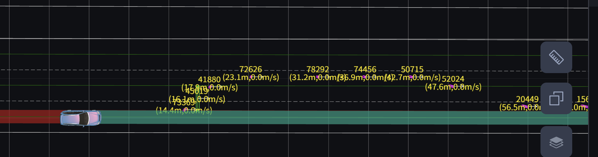
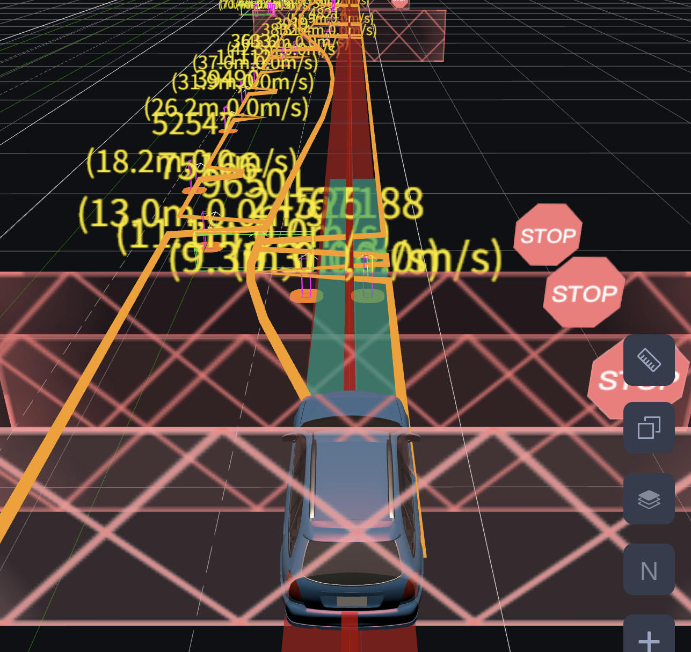

现在的情况是

可以看到两个障碍物在同一个s位置，车必须借道.

l42356-42362
I0627 13:49:55.051000 24034 path_bounds_decider_util.cc:269] last_max_nudge_l: 0.16926, obs id: 26702, obs l: 0.931148, 0.931148
I0627 13:49:55.051003 24034 path_bounds_decider_util.cc:287] 26702 right nudge
I0627 13:49:55.051007 24034 path_bounds_decider_util.cc:311] update left_bound: s 71.2009, l 1.2585 -> -0.523852
I0627 13:49:55.051010 24034 path_bounds_decider_util.cc:269] last_max_nudge_l: -0.72187, obs id: 68601, obs l: -0.539975, -0.539975
I0627 13:49:55.051013 24034 path_bounds_decider_util.cc:287] 68601 right nudge
I0627 13:49:55.051015 24034 path_bounds_decider_util.cc:305] blocked at 68601, 71.2009, l_lower: -1.99497, l_upper: -0.539975
I0627 13:49:55.051019 24034 path_bounds_decider_util.cc:176] Trimmed from 150.201 to 71.2009

l42386:
I0627 13:49:55.052858 24034 st_boundary_mapper.cc:255] check colllision for obstacle[82669], at: x: 424019.96553864918

l42394:
I0627 13:49:55.052942 24034 st_boundary_mapper.cc:255] check colllision for obstacle[26702], at: x: 424018.96554061287
s: 17.000000871053086

l42417:
E0627 13:49:55.057000 24034 piecewise_jerk_problem.cc:105] failed optimization status: primal infeasible

l42470:
I0627 13:49:55.065608 24034 on_lane_planning.cc:462] Planning end frame sequence id = [90]

l42631:
I0627 13:49:55.152786 24037 lane_follow_path.cc:268] regular/self68601

l42633:
I0627 13:49:55.152809 24037 lane_borrow_path.cc:374] Blocking obstacle ID[68601]

l42650:
I0627 13:49:55.153046 24037 st_boundary_mapper.cc:255] check colllision for obstacle[26702], at: x: 424019.07870506559
s: 16.000000819156824

l42673:
E0627 13:49:55.163918 24037 piecewise_jerk_problem.cc:105] failed optimization status: primal infeasible

l42727:
I0627 13:49:55.176528 24037 on_lane_planning.cc:462] Planning end frame sequence id = [91]

grep "self_opt_l" planning.INFO |cut -b 1-100 > ../../output/init_sl_state1.txt

也可以获取当前帧的l数值，就不需要添加AINFO了。

print_regular/rightforward_opt_l:(50.166630, -1.074877);
如果是向右变道，那么就不是self，改成rightforward！

I0628 15:50:48.546087 18033 park_and_go_scenario.cc:108] PARK_AND_GO: 1,1,1,1
第一个是is_vehicle_static，最开始是1，后面都是0，是起步的判断，如果是1，那么开始起步.

--debug

l89149:
I0628 15:51:07.373358 18023 on_lane_planning.cc:330] Planning start frame sequence id = [190]
I0628 15:51:07.379848 18023 reference_line_info.cc:422] build reference line st boundary. id:9595
I0628 15:51:07.480443 18033 park_and_go_scenario.cc:108] PARK_AND_GO: 0,1,1,1
I0628 15:51:07.381270 18023 lane_change_path.cc:493] lane change update fromto
I0628 15:51:07.381295 18023 lane_change_path.cc:498] status: CHANGE_LANE_FINISHED

l89375:
I0628 15:51:07.473367 18033 on_lane_planning.cc:330] Planning start frame sequence id = [191]
I0628 15:51:07.479394 18033 reference_line_info.cc:422] build reference line st boundary. id:9595
I0628 15:51:07.480443 18033 park_and_go_scenario.cc:108] PARK_AND_GO: 0,1,1,1
I0628 15:51:07.480473 18033 lane_follow_stage.cc:169] Planning Perf: task name [LANE_CHANGE_PATH], 0.0109673 ms.
I0628 15:51:07.480489 18033 path_generation.cc:124] Plan at the starting point: x = 424005.552617, y = 4437609.887641, and angle = -0.002188

l89547:
E0628 15:51:07.485950 18033 gridded_path_time_graph.cc:533] Fail to find the best feasible trajectory.

l89583:
I0628 15:51:07.492545 18033 on_lane_planning.cc:462] Planning end frame sequence id = [191]

从log中可以看出调用的是lane_borrow_path而不是lane_borrow_path_generic
所以修改前者。

不修改lane_change_path，是被动，根据routing好的变道进行变道的.

l62131:
I0630 13:07:37.096122 10792 on_lane_planning.cc:330] Planning start frame sequence id = [137]

观察到向右变道：
l62328:
I0630 13:07:37.107740 10792 lane_borrow_path.cc:530] CheckLaneBorrow result: left_borrowable=[0] right_borrowable=[1]
I0630 13:07:37.107743 10792 lane_borrow_path.cc:546] >> RIGHT_BORROW added to decided_side_pass_direction_
I0630 13:07:37.107746 10792 lane_borrow_path.cc:554] Switch from SELF-LANE path to LANE-BORROW path.

l62903:
I0630 13:07:37.120432 10792 print_debug_info.cc:45] print_regular/rightforward_opt_l:(50.363514, -0.000156);

l62997:
I0630 13:07:37.197125 10791 on_lane_planning.cc:330] Planning start frame sequence id = [138]

成功左变道了，但没能成功两次变道.

debug

l25711:
I0630 14:17:01.713119 17821 on_lane_planning.cc:330] Planning start frame sequence id = [67]

l25935:
I0630 14:17:01.724488 17821 lane_borrow_path.cc:700] Switch from SELF-LANE path to LANE-BORROW path.

l27376:
I0630 14:17:01.813778 17828 on_lane_planning.cc:330] Planning start frame sequence id = [68]

得到grep生成的txt

发现障碍物情况呢？
50帧，大概不到20米.
150帧，走了80多米，obstacle不为空，有点太晚了.

frame 13，开始 park_and_go = 0.

frame 57帧，开始不输出longtimeblockingobstacle
是因为：IsWithinSidePassingSpeedADC=false.
也就是因为速度超了，超过了5m/s. 之前是不超过的.

frame 182, 发现longtimeblockingobstacle.

frame 150, obstacle ID才不为空.

先分析什么时候发现obstacle的，发现obstacle的条件是：
