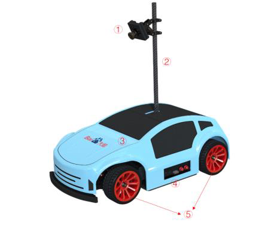
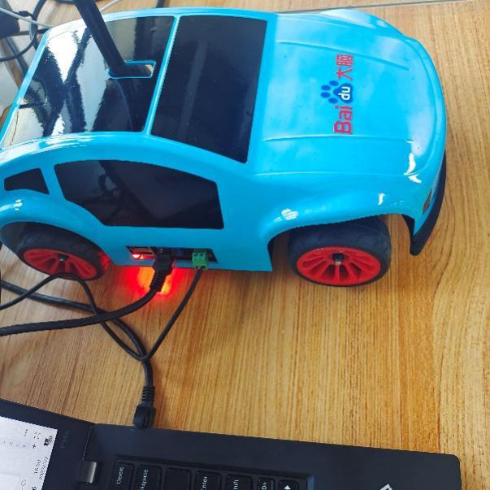
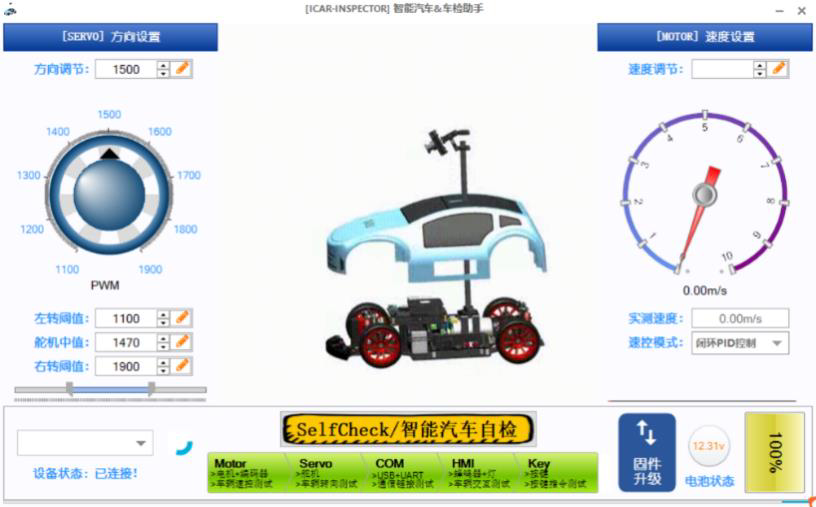
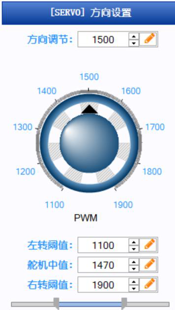
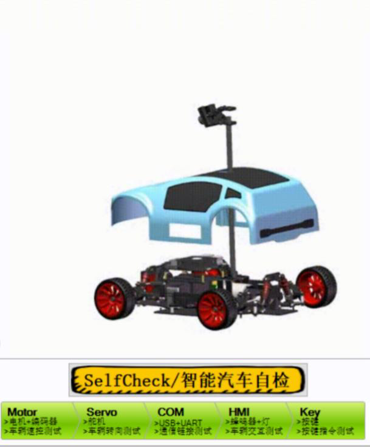
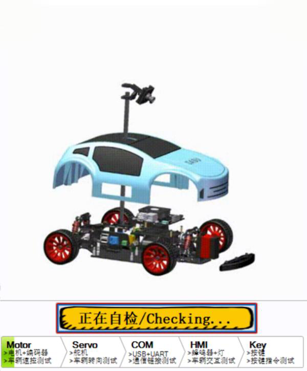
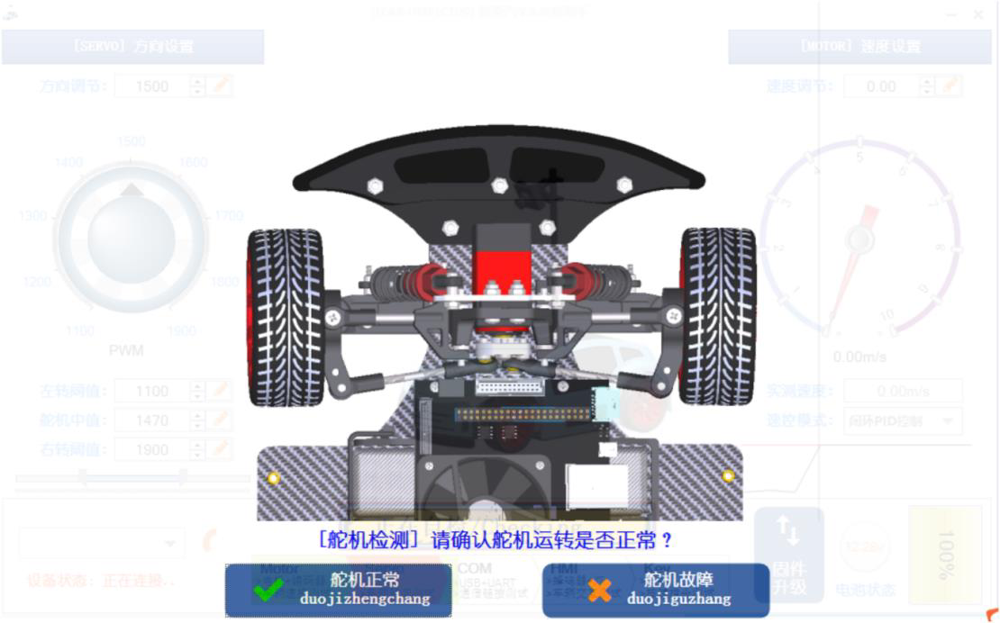
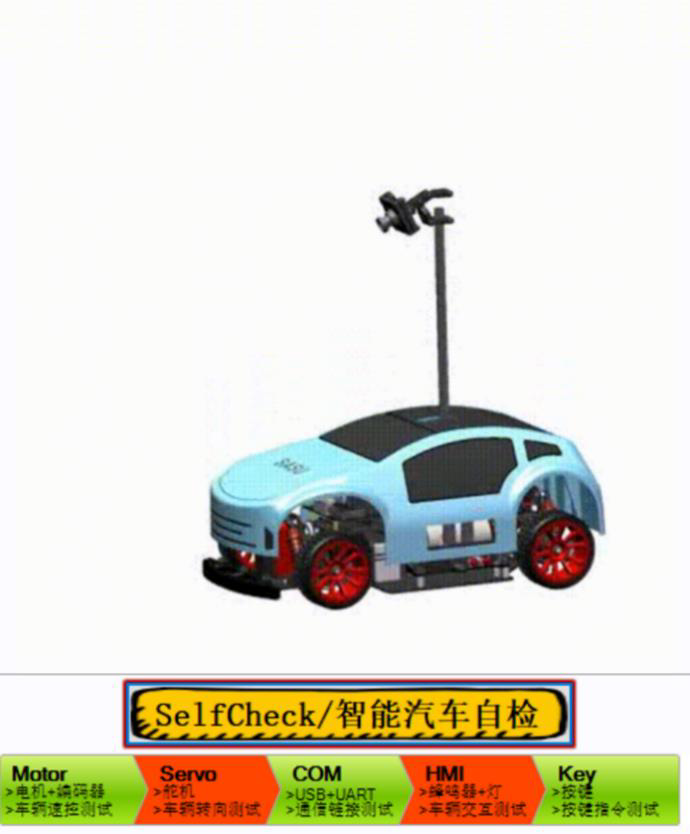
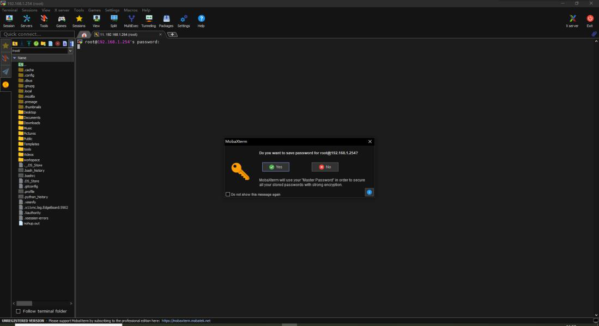
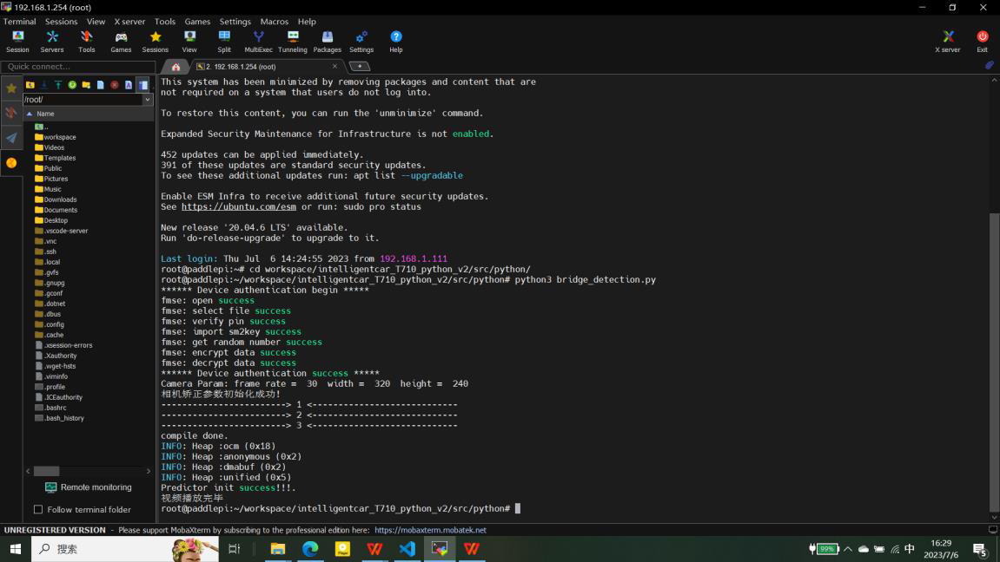

# 智能汽车配置实验指导

## 目录

- [1. 实验描述](#_1-实验描述)
- [2. 实验目标](#_2-实验目标)
- [3. 实验步骤](#_3-实验步骤)
  - [步骤 1：了解智能汽车产品清单](#步骤-1-了解智能汽车产品清单)
  - [步骤 2：认识智能汽车硬件架构](#步骤-2-认识智能汽车硬件架构)
  - [步骤 3：实训平台软件部署](#步骤-3-实训平台软件部署)
  - [步骤 4：智能汽车硬件部署](#步骤-4-智能汽车硬件部署)
  - [步骤 5：智能汽车车辆自检](#步骤-5-智能汽车车辆自检)
  - [步骤 6：为本地电脑配置静态 IP](#步骤-6-为本地电脑配置静态-ip)
  - [步骤 7：建立网络映射](#步骤-7-建立网络映射)
  - [步骤 8：MobaXterm 远程终端建立 SSH 连接](#步骤-8-mobaxterm-远程终端建立-ssh-连接)
  - [步骤 9：程序试运行](#步骤-9-程序试运行)
  - [步骤 10：代码查看与修改优化](#步骤-10-代码查看与修改优化)
  - [步骤 11：其它安全注意事项](#步骤-11-其它安全注意事项)

---

## 1. 实验描述

智能汽车课程包含人工智能、无人驾驶、图像处理与运动控制等相关内容的教学，理论 + 实践共 48 课时，所有实践均基于智能汽车实训平台及百度飞桨平台进行。课程支持 C++/Python 两种语言编程，基于实训平台及百度飞桨（PaddlePaddle）AI 框架和 OpenCV 图像处理技术，可实现在线 AI 模型训练、移动端部署、赛道识别与交通标志检测，车辆控制以及巡线导航等功能。

本实验为智能汽车实训课程的第一次实验，本次课我们将对智能汽车、赛道场地、基本参数有一个实际的接触和了解，同时完成对智能汽车实训平台的环境部署，包括软件部署与硬件部署，然后学习了解智能汽车源码程序，掌握软硬件结合的基本操作方法，为后续实验开展奠定良好的基础。

## 2. 实验目标

1. 了解智能汽车产品清单，熟悉智能汽车硬件架构；
2. 熟悉智能汽车赛道场地，包括赛道尺寸、不同赛道类型等；
3. 了解智能汽车基本参数；
4. 安装开发软件，进行实训平台的软件部署，包括安装编译工具及可视化工具、电脑静态 IP 设置、建立网络映射、建立 SSH 远程连接等；
5. 学习搭建赛道场地与智能汽车，完成硬件环境部署，掌握车检方法；
6. 熟悉智能汽车工程源码文件，并进行程序试运行。

## 3. 实验步骤

### 步骤 1：了解智能汽车产品清单

熟悉智能汽车实训箱内物品，了解智能汽车产品清单如下（仅列出部分，详细可看使用说明书的产品清单）：

**表 1-1 产品清单**

| 名称 | 数量 | 备注 |
|------|------|------|
| 智能汽车 | *1 | |
| 手柄遥控器 | *1 | |
| USB 无线网卡 | *1 | |
| 资料 U 盘 | *1 | |
| 网线 | *1 | |
| Type-C 充电线 | *1 | |
| 电源适配器 | *1 | |

---

### 步骤 2：认识智能汽车硬件架构

#### （1）认识智能汽车主体架构

认识智能汽车，智能汽车由摄像头、碳纤杆、壳体、侧面接口与轮子等组成。

**图 1-1 智能汽车**

① 摄像头 ② 碳纤杆 ③ 壳体 ④ 接口 ⑤ 轮子

#### （2）认识智能汽车侧面

侧面分右侧与左侧，有电源开关、type-c、按钮、USB、电源接口、网口以及轮子等部位。

**图 1-2 智能汽车左侧** | **图 1-3 智能汽车右侧**

| 编号 | 部位 | 功能 |
|------|------|------|
| ① | 电源开关 | 控制电源开与关 |
| ② | Type-c 接口 | 调试使用 |
| ③ | 复位按钮 | |
| ④ | 模式按钮 | 两种模式切换 |
| ⑤ | 两个 USB 2.0 接口 | |
| ⑥ | 网口 | RJ45 接口 |
| ⑦ | 电源/充电接口 | |
| ⑧ | 四个轮子 | |
| ⑨ | 摄像头 | 640×480 30 万像素 |

#### （3）认识智能汽车内部

内部亦分右侧与左侧，有舵机、MCB 板、MDB 板、EdgeBoard 计算卡（T710 开发板）、电机等部件。

**图 1-4 智能汽车内部**

#### （4）速度设置

可调节智能汽车的速度，并显示实测速度。

**图 1-5 速度设置**

速控模式有"闭环 PID 控制"与"开环控制"两个选项。车检时，不同模式下的车速需要注意，开环情况下可以从 10 开始，闭环情况下可以从 0.1 开始。

**图 1-6 速控模式**

#### （5）固件升级

点击"固件升级"按钮升级智能汽车固件。

**图 1-7 固件升级**

#### （6）电池状态

显示当前智能汽车电池电量与电压。

**图 1-8 电池状态**

#### （2）了解赛道场地

本智能汽车适用完全模型组赛道。赛道场地为室内循环赛道，并在此基础上增加任务元素，即赛道由基础赛道、赛道标志、任务锥桶三个部分组成。其中基础赛道是由 PVC 切割而成的赛道元素、斜坡和黑白胶带共同组成。

如下图示，该赛道包含了室内循环赛道的大部分基础元素，如直线赛道、曲线弯道、交叉路口、坡道、环岛、三岔路口、车库等元素。根据不同赛事主题，其各元素均有差别，故赛道视具体主题及赛事要求而定。

**图 1-9 赛道场地示例**

#### （3）基本参数

基础参数包含智能汽车基本参数与赛道场地基本参数。

**表 1-2 智能汽车基础参数**

| 类别 | 名称 | 参数 |
|------|------|:-----|
| 尺寸 | | 316×190×310 mm |
| 系统环境 | | Linux 系统 |
| 控制主板 | | EdgeBoard 计算卡（T710 开发板） |
| 控制单元 | | GD32 系列单片机 |
| 转向方式 | | 舵机控制阿克曼转向 |
| 最小转弯半径 | | 25 cm |
| 动力布局 | | 单电机后驱 |
| 电机 | | 直流高速电机，额定电压 12 V，空载转速 12000 rpm |
| 舵机 | | 高精度数字舵机 0.14 Sec/60° |
| 最大速度 | | 10 m/s |
| 电池 | | 3S 25C 锂电池，标称 11.1 V，容量 2200 mAh |
| 摄像头 | 640×480 分辨率 | 30 万像素摄像头 |
| 轮胎 | | 橡胶轮胎 |
| 车壳 | | 工程塑料 |
| 通信方式 | | 支持 Ethernet、USB、UART、CAN、RS485 |

**表 1-2 赛道场地基本参数**

| 类别 | 名称 | 参数 |
|------|------|:-----|
| 尺寸 | | 7.5 m×5.5 m 与 7.5 m×8 m 两种规格 |
| 坡道 | | 木质 150 cm×60 cm×14 cm |
| 路肩 | 厚度 2 cm；宽度 2.5 cm；长度 25 cm | |
| 锥桶 | | 直径 74 mm；高度 74 mm； |
| 标定板 | | 21 cm×29.7 cm |
| 实体标志 | | 若干（见下表） |
| 材质 | | PVC |

> 为了引导比赛任务的完成，在比赛赛道的任务元素和特殊元素区域的前方路旁的指定区域放有三维模型实体标志。以车辆行驶的方向看去，实体标志的角度与正面图中角度相当，摆放偏差不超过 ±45 度。

**表 1-3 实体标志功能指标**

| 序号 | 名称 | 说明 |
|------|------|:-----|
| 1 | 维护区 | 功能描述：表示前方车辆维护站，需要车辆在指定范围内停车片刻。 模型尺寸：154.5×92×109 mm 标志颜色：大红色、黑色 |
| 2 | 农田 | 功能描述：表示前方农田，非常规道路，需要依据锥桶围出的场地行驶。 模型尺寸：120×120×170 mm 标志颜色：中黄色、葱绿色 |
| 3 | 动物出没（减速标志） | 功能描述：表示前方动物出没，减速慢行。 模型尺寸：144×55×72 mm 标志颜色：桃红色 |
| 4 | 坡道标志 | 功能描述：表示道路前方有坡道。 模型尺寸：138.5×44×69 mm 标志颜色：大红色 |
| 5 | 粮仓卸货 | 功能描述：表示前方为粮仓，车辆需要驶入粮仓并按照指定的出口驶出，模拟定点卸货。 模型尺寸：109×109×80 mm 标志颜色：中黄色 |
| 6 | 任务锥桶 | 脱离基础赛道的任务区域由可以移动的锥桶在基础赛道的边缘临时搭建而成。 模型尺寸：直径 75 mm，高度 75 mm 颜色：黄色纯色 |

---

### 步骤 3：实训平台软件部署

#### （1）Visual Studio Code 编译工具安装

首先要安装编译工具 Visual Studio Code，后续程序查看与代码修改主要基于该软件进行。

第一步，打开"智能汽车安装支持包" → "Visual Studio Code 安装包"。

**图 1-11 智能汽车安装支持包** | **图 1-12 Visual Studio Code 安装包**

第二步，双击 `VSCodeUserSetup-x64-1.67.2` 进行安装，默认安装即可，可更改路径。安装完成后重启计算机。

**图 1-13 Visual Studio Code 安装文件**

#### （2）MobaXterm 远程终端安装

智能汽车远程终端可视化操作需要基于 MobaXterm 软件进行。

第一步，打开"智能汽车安装支持包" → "MobaXterm_Installer_v23.0.zip" 安装压缩包。

**图 1-14 MobaXterm 安装压缩包**

第二步，双击 `MobaXterm_installer_23.0.msi` 安装，默认安装即可，可更改路径。

**图 1-15 MobaXterm 安装文件** | **图 1-16 可改安装路径**

**图 1-17 安装完成**

#### （3）智能汽车车检助手安装

第一步，打开"智能汽车安装支持包" → "智能汽车车检助手安装包"。

**图 1-18 智能汽车车检助手安装包**

第二步，双击 `智能汽车车检助手.exe` 进行安装，默认安装即可，可更改路径。安装完成后重启计算机。

**图 1-19 智能汽车车检助手安装文件**

---

### 步骤 4：智能汽车硬件部署

硬件部署内容包含场地部署搭建与智能汽车部署。其中，课程教学所用的场地搭建可参照智能汽车使用说明书的步骤进行操作完成，班级共用 1~2 个智能汽车赛道场地即可。此处重点介绍智能汽车的硬件部署方法。

1. 从智能汽车实训箱中取出智能汽车，同时熟悉实训箱内配件；
2. 用适配器对智能汽车充电，同时打开智能汽车开关，红灯亮起。这样后续可以边充电边进行学习操作，以免后续操作出现电量不足的情况；
3. 将智能汽车通过实训箱内配置的网线连接笔记本相应接口，即可基于 MobaXterm 软件对汽车进行可视化操作及结果查看。

**图 1-20 网路连接** | **图 1-21 连接智能汽车**

需要实际在场地运行时，可参考以下步骤：

1. 将智能汽车放在赛道斑马线上。
2. 可通过实训箱内提供的遥控器采集赛道图像。遥控手柄上各按键对应的功能如下图示，可分别对行驶方向、行驶速度进行调整，对图像采集方式进行相关控制：

**图 1-22 遥控器**

---

### 步骤 5：智能汽车车辆自检

智能汽车车检助手主要用于检测智能汽车相关硬件，打开软件后默认会出现首页，方向设置、串口连接、速度设置、固件升级与智能汽车自检模块。

> **⚠ 注意：** 自检过程中，请将智能汽车悬空放置，避免自检过程损伤车辆！

**图 1-23 首页**

#### （1）串口连接

首先连接串口，通过 USB-to-C 线缆连接电脑与智能汽车后，打开车检助手以及智能汽车的电源，车检助手会自动连接汽车，连接按钮一直转圈，表示连接成功。

**图 1-24 串口连接**

#### （2）方向设置

可调节轮子方向，并可以设置左转阈值、舵机中值与右转阈值。

**图 1-25 方向设置**

#### （3）智能汽车自检

点击"SelfCheck/智能汽车自检"按钮，自检电机+编码器、舵机、USB+UART、蜂鸣器+灯、按钮等硬件。

**图 1-26 自检** | **图 1-27 正在自检**

> 在自检过程中会信息交互，请确认"正常"与"故障"。

**图 1-28 信息交互**

自检结束后，障碍会红色显示，绿色显示正常。

**图 1-29 自检结果**

---

### 步骤 6：为本地电脑配置静态 IP

需要为电脑配置静态 IP 才能进行后续操作。

#### （1）硬件连接

使用网线将智能汽车 RJ45 接口的网口与电脑本身网口连接。智能汽车同时充电，以免电量不足影响后续操作。

#### （2）PC 端修改静态 IP

以 WIN10 系统为例，其它系统具体操作略有不同。

首先，Windows 电脑通过网线与智能汽车连接，并打开车辆电源开关，确保车辆正常待机。

Windows 电脑打开"控制面板"，选择"网络和 Internet"选项：

**图 1-30 控制面板**

选择点击"网络和共享中心"：

**图 1-31 网络和共享中心**

接下来，点击"更改适配器设置"选项：

**图 1-32 更改适配器设置**

右键修改目标以太网口（与智能车连接）的网络属性：

**图 1-33 更改以太网属性**

鼠标左键选中"Internet 协议版本 4（TCP/IPv4）"，并点击"属性"选项：

**图 1-34 IPv4 属性**

按照下图参数配置静态 IP：

**图 1-35 修改以太网静态 IP**

#### （3）注意事项

> ⚫ 牢记此时设置的静态 IP 地址，后续需要以此 IP 作为 PC 默认 IP 通过 MobaXterm 对智能车操作编辑。子网掩码与默认网关可以默认，不修改。
>
> ⚫ 如若需要使用修改过的网络端口连接其他网络，例如需要接入互联网，则需要再按以上步骤，将模式修改为之前的自动获得 IP 地址即可。但重新连接智能车时需重复上述步骤。
>
> ⚫ 由于修改完静态 IP 属性，以太网无法正常启动网络访问服务，故用户需根据实际需求修改静态/动态 IP。

---

### 步骤 7：建立网络映射

打开"我的电脑"，右键空白地方选择添加一个网络配置。

**图 1-36 网络配置**

点击下一页后，双击选择"自定义网络位置"，在地址栏中输入 `\\192.168.1.254\root` 后选择进入下一页。这是实训箱内智能汽车的默认 IP 地址。

**图 1-37 自定义网络位置**

在弹出页面可自行设置网络名称（默认亦可），设置完成后进入下一页。

**图 1-38 设置网络名称**

选中"单击完成时打开这个网络位置"后，点击完成即可进入智能汽车工程代码文件列表。

**图 1-39 打开网络位置** | **图 1-40 代码文件列表**

> 至此即可在连接网线的情况下，通过网络映射访问打开智能汽车 EdgeBoard 中的源代码。（在后续步骤中，可使用 VS Code 完成对代码的查看、编辑和修改等工作）
>
> **需要注意的是：**
>
> ⚫ 填入 Internet 地址时的 IP `192.168.1.254` 为智能车默认 IP 地址，不可修改添加；
>
> ⚫ 在第一次点击完成后会弹出登陆界面，只需输入用户名和密码，均为 `root`。

---

### 步骤 8：MobaXterm 远程终端建立 SSH 连接

MobaXterm 是一款强大好用的远程终端登录利器，提供所有重要的远程网络工具（SSH、X11、RDP、VNC、FTP、MOSH…）和 Unix 命令（bash、ls、cat、sed、grep、awk、rsync…），简单安装即可方便的使用。

**图 1-41 MobaXterm 首页**

#### （1）新建远程会话

打开 MobaXterm 软件，单击左上 `session` 建立新会话。

**图 1-42 新会话**

#### （2）SSH 远程连接

在 `session setting` 页面中选择 `SSH` 进入 SSH 创建界面。

通过 SSH 远程连接的方式，可将本地 PC 与智能汽车 Edgeboard 板卡建立远程连接，从而可以通过命令行的方式对智能汽车的源码进行启动和编译等操作。其中，工程的源码文件需要通过 `make` 等方式进行编译后再运行。

其中，SSH 为 Secure Shell 的缩写，是建立在应用层基础上的安全协议，由 IETF 的网络小组（Network Working Group）所制定，是较为可靠的专为远程登录会话和其他网络服务提供安全性的协议。利用 SSH 协议可以有效防止远程管理过程中的信息泄露问题。

第一次实验连接成功后，后续实验中无需重新配置，直接连接即可。

**图 1-43 SSH 创建界面**

在 `remote host` 后的文本框中输入智能车的 IP 地址 `192.168.1.254`，后面访问智能汽车用户名：`root`，点击 OK 即完成 SSH 远程连接。

**图 1-44 SSH 远程连接**

在弹出的界面中输入密码为 `root`（Linux 系统下密码输入并不显示），输入完成按回车键进入系统。

**图 1-45 密码输入界面**

**图 1-46 输入成功，进入工程**

弹出的窗口为密码保存，如若需要保存按其指引步骤进行操作即可保存，不影响后续的使用。

#### （3）同步 IP

完成上述操作后，在左侧工程栏中找到 `.bashrc` 文件，双击进入：

**图 1-47 Bashrc 文件所在位置**

在整体窗口最底部找到 `export DISPLAY`，在"="后面加入之前设置的 PC 静态 IP（如果没有，则在尾部手动输入即可，注意写入格式）。

**图 1-48 静态 IP**

按 `Ctrl+S` 或上方工具栏 `save files` 保存，并在弹出窗口点击 `yes to all`，返回初始界面。

**图 1-49 初始界面**

在右侧输入栏中输入 `source ~/.bashrc` 后按回车键运行并保存上述操作：

**图 1-50 输入**

> **需要注意以下几点：**
>
> 1. 在 SSH 远程连接时输入的 `remote host ip` 地址为智能车地址不可变。
> 2. 双击选择 `.bashrc` 文件时，若其背景为白色则是文件命名，只需点击空白处后再进行其他操作即可。
> 3. 进入 `.bashrc` 文件窗口输入的 IP 地址需和步骤 6 中所设置的静态 IP 严格一致。

---

### 步骤 9：程序试运行

在右侧命令行中输入 `cd workspace/intelligentcar_T710_python_v2/src/python` 后按回车进入子目录（可使用键盘 `Tab` 键补齐）。确认进入目录后，输入 `python3 <脚本文件名称>` 按回车即可运行示例程序。（下面以道桥检测的文件 `bridge_detection` 为例）：

**图 1-51 切换目录**

弹出的窗口均点击"是"，即可运行程序并弹出可视化视频窗口查看智能汽车运行状况。如果未弹出窗口则需要关闭防火墙。

**图 1-52 弹出窗口** | **图 1-53 运行成功**

**图 1-54 可视化窗口**

> 如需退出工程，只需在命令行按键盘 `Ctrl+C` 即可。程序运行过程中出现的可视化窗口无需放大，放大后可能卡顿，如果出现问题可以点击窗口右上方的退出按钮，窗口会重新开启。
>
> 需要结束整体工程退出 MobaXterm，则只需点击主页面右上角的红色退出按钮。

**图 1-55 代码工程页面**

---

### 步骤 10：代码查看与修改优化

在"此电脑"中打开步骤 6 创建命名的网络映射，找到并进入 `root` 文件夹。

**图 1-56 root 文件夹**

进入 `root` 中 `workspace` 文件夹后，拖动 `intelligentcar_T710_python_v2` 文件至 VS Code 编译软件中即可查看和修改源码。

> **需要注意的是**：直接拖动工程文件可能会无权限访问，此时可以先打开 VS Code，然后通过 `Open Folder` 方式打开：
>
> 1. 先打开 VS Code；
> 2. 选择此电脑 → 网络位置 → root → root → workspace → `intelligentcar_T710_python_v2`。

**图 1-57 代码工程文件结构**

**图 1-58 打开代码界面**

---

### 步骤 11：其它安全注意事项

1. 使用设备时，应注意仪器适用的电压范围，使用原装适配器进行供电；
2. 无人看管时，禁止对电池充电；
3. 配置过程中，建议将智能汽车悬空放置，避免误操作运行损伤车辆；
4. 运行程序时注意将电脑的防火墙关闭，否则可视化运行界面可能无法呈现。

---
