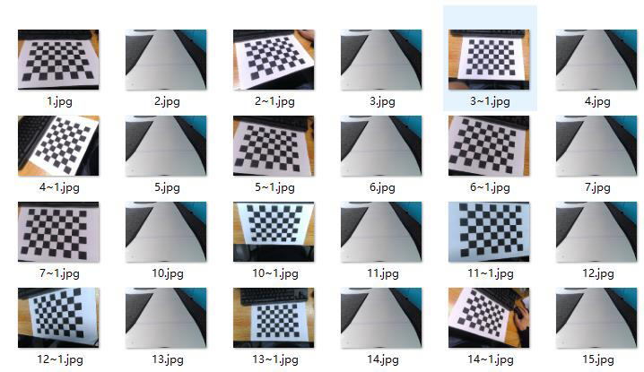

# 图像采集实验指导

## 目录

- [1.实验描述](#1.实验描述)
- [2.实验目标](#2.实验目标)
- [3.实验步骤](#3.实验步骤)
  - [步骤 1：将智能汽车与 PC 电脑相连接](#步骤1：将智能汽车与PC电脑相连接)
  - [步骤 2：打开 Visual Studio Code 学习部分源码逻辑](#步骤2：打开VisualStudioCode学习部分源码逻辑)
  - [步骤 3：熟悉手柄遥控器的按键规则](#步骤3：熟悉手柄遥控器的按键规则)
  - [步骤 4：遥控智能汽车进行运动与图像采集](#步骤4：遥控智能汽车进行运动与图像采集)
  - [步骤 5：运行代码文件，查看结果](#步骤5：运行代码文件，查看结果)
  - [步骤 6：补全代码，尝试实车运行，观察可视化运行结果](#步骤6：补全代码，尝试实车运行，观察可视化运行结果)

## 1.实验描述

智能汽车主要通过高清摄像头进行赛道环境感知，由高清摄像头采集赛道图
像再进行后续的图像处理与识别。采集图片是计算机视觉算法展开的第一步。由
于初始状态的智能汽车是不会自动去采集图片信息的，所以本次实验将通过手柄
遥控器控制智能汽车在赛道上采集图像，同时也通过手柄遥控器控制智能汽车的
行驶方向和速度，也进一步理解智能汽车的环境感知系统、运动控制系统及其通
信机制。
## 2.实验目标

（1）掌握遥控智能汽车进行图像采集的方法；
（2）掌握利用手柄遥控器控制智能汽车在前、后、左、右方向进行行驶的
基本方法，学会调速，进一步理解智能汽车的通信机制与运动控制系统；
（3）参考教材内容及源码文件，完成本实验的部分代码补全任务。
## 3.实验步骤

### 步骤 1：将智能汽车与 PC 电脑相连接

第一步，插入网线，将智能汽车通过网线与 PC 相连。PC 电脑需要参照实训
一步骤设置好静态 IP 地址，并完成网络映射相关设置。
第二步，打开 MobaXterm，建立 SSH 远程连接，将本地 PC 与智能汽车
Edgeboard 板卡建立远程连接，进而可通过命令行的方式对智能汽车的源码进行
启动等操作。
通过 MobaXterm，我们可以在电脑上看到智能汽车 Edgeboard 板卡上所展示
的界面内容。
38

---

图像采集
### 步骤 2：打开 Visual Studio Code 学习部分源码逻辑

在前面的环境准备阶段，我们已经安装了 Visual Studio Code，本次相机标定
任务需要结合 EdgeBoard 嵌入式 AI 计算卡与本地计算机完成。
在上述步骤 1 基础上进行如下操作：
第 一 步 ， 把 部 署 在 EdgeBoard 嵌 入 式 AI 计 算 卡 中 的
Intelligentcar_T710_python_v2 工程通过 Visual Studio Code 可视化界面打开。
在该工程下，进入 res/samples/文件夹内，新建名字为 train 的文件夹，用于
存放通过摄像头收集的图片。收集的图像可以用于本节课，也可供后续实验使用。
第二步，准备图像采集源码文件。
在本实验中，通过路径 src/python/image_collection.py 找到本实验提供的部
分源码，这个文件中的代码可以实现图像采集。工程文件结构如下图所示。
图 3-1 工程文件结构
39

---

图像采集
### 步骤 3：熟悉手柄遥控器的按键规则

手柄遥控器上按键众多，按键都有特定的规则去对智能汽车进行速度控制、
采图控制、方向控制等操作，按键功能如下图所示，采集的图像会存储到
res\samples\train 目录文件中。
图 3-2 手柄
（1）摇杆负责车辆方向的控制，包括上、下、左、右；
（2）按 Y 按钮，可控制摄像头进行连续采图；
（3）按 X 按钮，可控制摄像头进行单帧采图；
（4）按 A 按钮，可控制摄像头停止采图；
（5）手摇右前方“两档车速调节”按钮，可控制智能汽车的速度；
（6）其它任意键可控制智能汽车停止当前行动。
需要注意的是：
手柄左上方有信号灯闪烁，分为三种模式：红灯常亮为无线手柄 B，绿灯常
亮为无线手柄 A，双灯均亮为故障。使用时，需先连接手柄并开机，观察信号灯
具体闪烁情况，根据红/绿灯改变手柄模式。具体修改方式详见后续代码部分。
40

---

图像采集
### 步骤 4：遥控智能汽车进行运动与图像采集

image_collection.py 主要逻辑如下：
首先定义手柄类（手柄和摄像头的初始化），采集类（定义手柄功能），然
后定义遥控手柄线程（接收手柄信号），最后手柄及摄像头多线程并发实现使用
手柄操作并调用摄像头进行图像采集。
初始定义处可根据连接手柄的亮灯显示来修改手柄类型。
PWMSERVOMAX = 1900 # 舵机 PWM 最大值（左）
PWMSERVOMID = 1500 # 舵机 PWM 中值
PWMSERVOMIN = 1100 # 舵机 PWM 最小值（右）
JOYSTICK_MODE = 3 # 2/无线手柄 A（单绿灯常亮） 3/无线手柄 B（单红灯常亮））
（1） 定义手柄类
手柄和摄像头进行初始化设置：
class JoyStick:
def __init__(self):
print("avaliable devices")
for fn in os.listdir("/dev/input"):
if fn.startswith("js"):
print("/dev/input/%s" % fn)
self.fn = "/dev/input/js0"
self.x_axis = 0
def open(self):
self.jsdev = open(self.fn, "rb")
def read(self):
self.evbuf = self.jsdev.read(8)
return struct.unpack("IhBB", self.evbuf)
def type(self, type_):
if type_ & 0x01:
return "button"
if type_ & 0x02:
return "axis"
def button_state(self):
return 1
41

---

图像采集
def get_x_axis(self):
time, value, type_, number = struct.unpack("IhBB", self.evbuf)
if number == 1:
fvalue = value / 32767
return fvalue
（2） 定义采集类
初始化操作，定义智能车参数、采图使能以及保存路径等。
class Collecte:
def __init__(self):
self.camera = cv2.VideoCapture(0)
self.speed = 0.0 # 车速：m/s
self.forward = True # 车辆行驶方向
self.steer = PWMSERVOMID
self.appExit = False # 程序退出标志
self.cotMore = False # 连续图像采样使能
self.cotOnce = False # 单次图像采样使能
self.index = 0
self.counterHeart = 0 # 串口发送心跳计数器
self.saveDir = "../../res/samples/train"
if not os.path.exists(self.saveDir):
os.makedirs(self.saveDir)
if not self.camera.isOpened():
print("camera open faild!")
self.exit()
codec = cv2.VideoWriter_fourcc("M", "J", "P", "G")
self.camera.set(cv2.CAP_PROP_FOURCC, codec)
self.camera.set(cv2.CAP_PROP_FPS, 30)
self.camera.set(cv2.CAP_PROP_FRAME_WIDTH, 320)
self.camera.set(cv2.CAP_PROP_FRAME_HEIGHT, 240)
定义运动模式、方式，采图形式函数：运行分为高速与低速运行两档速度，
及前后左右四个方向。
# 高速运行
def speedHigh(self):
if self.forward:
self.speed = 0.7
else:
self.speed = -0.7
uart.carControl(self.speed, self.steer)
# 低速运行
42

---

图像采集
def speedLow(self):
if self.forward:
self.speed = 0.3
else:
self.speed = -0.3
uart.carControl(self.speed, self.steer)
# 连续采图
def collecteMore(self):
self.cotMore = True
self.cotOnce = False
# 单帧采图
def collecteOnce(self):
self.cotMore = False
self.cotOnce = True
# 停止采图
def collecteStop(self):
self.cotMore = False
self.cotOnce = False
# 向前运动
def frontRun(self):
self.forward = True
if self.speed < 0:
self.speed = -self.speed
# 向后运动
def backRun(self):
self.forward = False
if self.speed > 0:
self.speed = -self.speed
# 左右转
def turn(self, turn):
self.steer = PWMSERVOMID + turn * (PWMSERVOMID - PWMSERVOMIN) /
32767
uart.carControl(self.speed, self.steer)
图像采集函数：
首先使用心跳信号传递小部分数据，保证设备间通信链路连接正常；然后使
用 cv2 对已采样的图片进行读取，再使用 cv2 库中 putText 函数设置显示各类格
43

---

图像采集
式最终输出 UI 显示。
def sample(self):
if self.counterHeart > 5:
uart.carControl(self.speed, self.steer)
self.counterHeart = 0
else:
self.counterHeart += 1
return_value, image = self.camera.read()
if self.cotMore or self.cotOnce:
path = "{}/{}.jpg".format(self.saveDir, self.index)
cv2.imwrite(path, image)
print("saveimage: {}.jpg".format(self.index))
self.index += 1
if self.cotOnce:
self.cotOnce = False
cv2.putText(
image,
str(self.index),
(10, 30),
cv2.FONT_HERSHEY_SIMPLEX,
1,
(0, 0, 254),
1,
cv2.LINE_AA,
)
cv2.imshow("frame", image) # UI 显示
cv2.waitKey(10)
（3）定义手柄线程，接收信号：
def joystick_thread():
js.open()
while not collecte.state():
time, value, type_, number = js.read()
if inital and JOYSTICK_MODE == 3:
if js.type(type_) == "button":
# print("button:{} state: {}".format(number, value))
if number == 3 and value > 0: # 连续采图
collecte.collecteMore()
elif number == 2 and value > 0: # 单帧采图
44

---

图像采集
collecte.collecteOnce()
elif number == 0 and value > 0: # 停止采图
collecte.collecteStop()
elif number == 5: # 高速档
if value == 1:
collecte.speedHigh()
elif value == 0:
collecte.carStop()
else:
collecte.carStop()
if js.type(type_) == "axis":
# print("axis:{} state: {}".format(number, value))
if number == 1: # 车辆行驶方向
if value < 0:
collecte.frontRun()
elif value > 0:
collecte.backRun()
elif number == 0: # 左右转向移动
collecte.turn(value)
elif number == 5: # 低速档
if value >= 1:
collecte.speedLow()
elif value <= 0:
collecte.carStop()
print("JoyStick's thread out!")
（4）手柄多线程并发。
if __name__ == "__main__":
# 开启遥控手柄多线程
threadJok = threading.Thread(target=joystick_thread, args=())
threadJok.start()
time.sleep(1)
inital = True
while not collecte.state():
collecte.sample()
collecte.exit()
threadJok.join()
uart.carControl(0, PWMSERVOMID)
45

---

图像采集
### 步骤 5：运行代码文件，查看结果

（1）确认 train 文件夹已建立。
前面步骤中已经建立 train 文件夹，确认在 res/samples/目录下有空的 train 文
件夹。
运行代码文件，将棋盘格、赛道线放置于摄像头可视区域内，调整到合适角
度进行图像采集。
（2）运行图像采集的程序代码
运行代码之前，关掉电脑防火墙，打开 MobaXterm 界面，在 SSH 连接完成
的 前 提 下 ， 在 命 令 行 中 输 入 “ cd
workspace/intelligentcar_T710_python_v2/src/python”进入代码目录下；
之后输入“python3 image_collection ”回车即可运行程序。
图 3-3 运行程序
出现下面的窗口，选择“是”即可：
图 3-4 弹窗
随后将会出现可视化窗口，等待代码运行完成。
（3）查看图像采集的图片
进入智能汽车项目工程的根目录下，进入 res\samples\train 目录文件夹查看
智能汽车通过摄像头采集的图片。
46

---

图像采集
图 3-5 Demo 样例采集的部分图片
### 步骤 6：补全代码，尝试实车运行，观察可视化运行结果

打开本实验项目的实践代码，对缺失代码的文件进行代码填充操作，进一步
掌握本工程代码实现方法。
图 3-6 代码文件
将填充完毕的代码文件尝试替换智能汽车源文件中的对应文件，运行程序，
观察可视化运行结果，验证代码填充是否正确。为防止代码错误或丢失，务必将
源文件提前备份。
47

---