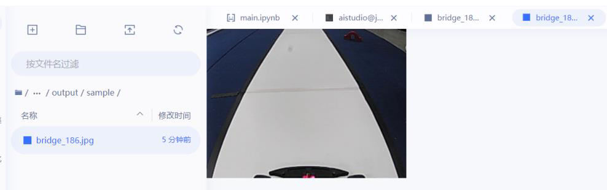
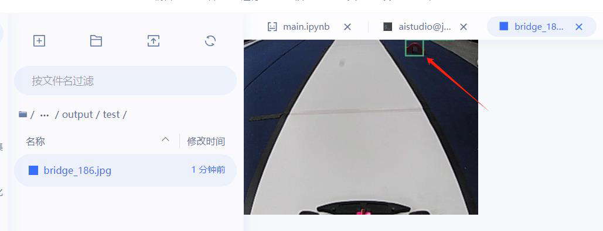

# 赛道元素识别模型训练实验指导

## 目录

- [1.实验描述](#1.实验描述)
- [2.实验目标](#2.实验目标)
- [3.实验步骤](#3.实验步骤)
  - [步骤 1：准备数据集](#步骤1：准备数据集)
  - [步骤 2：模型训练项目创建](#步骤2：模型训练项目创建)
  - [步骤 3：模型训练准备](#步骤3：模型训练准备)
  - [步骤 4：脚本编辑及环境配置](#步骤4：脚本编辑及环境配置)
  - [步骤 5：模型训练及导出](#步骤5：模型训练及导出)
  - [步骤 6：模型预测](#步骤6：模型预测)

## 1.实验描述

通过前面模块内容的学习与实践，我们知道本课程中智能汽车主要通过高清
摄像头这种视觉传感器采集道路图像。在全国大学生智能汽车竞赛中，赛道上会
放置拱桥(Bridge)、谷仓(Corn)、斑马线（CrossWalk）、拖拉机(Tractor)等赛道元
素。通过摄像头采集这些赛道元素图像并通过去噪、二值化等预处理后，智能汽
车还需要识别这些赛道元素，才能采取相应的控制策略前行、转弯或降速等。对
赛道元素的识别是通过深度学习方法实现的，在采集各种赛道标志元素图像数据
集后，通过构建人工神经网络进行模型训练，才能真正识别谷仓、坡道等赛道元
素。
## 2.实验目标

（1）学习数据集的标注、划分等操作，完成数据集准备；
（2）掌握百度飞桨 AI Studio 平台进行模型训练的基本方法；
（3）理解模型训练结果的评估指标，知道如何优化模型。
## 3.实验步骤

### 步骤 1：准备数据集

（1）数据集下载及说明
本次 AI 目标检测（Detection）模型训练建议使用赛曙科技开源数据集资源
“智能汽车竞赛交通标志 v230112”版本，文件名为“DataListVoc_320x240_v23
0112.zip”。数据集地址：https://aistudio.baidu.com/aistudio/datasetdetail/186919 。
此数据集作为标准内容，在后续其他操作中也会使用到。
75

---

赛道元素识别模型训练
图 7-1 数据集下载
文件内包含赛道基础元素及特殊的三维实体任务元素的图像信息。
图 7-2 DataListVoc_320x240_v230112 数据集组成
将“DataListVoc_320x240_v230112.zip”文件解压后，可以观察到：文件夹
中包含两个文件夹和三个文本文件。其中“Annotations”文件夹内为数据标注文
件（.xml 文件）、“JPEGImages”文件夹内为图像源文件（.jpg 文件）；标签文
本文件（.txt）为数据集的文本说明，“label_list.txt”表示标签内容，“train.txt”
表示训练集所需的图片和标注，“valid.txt”表示验证集所需的图片和标注。AI 模
型训练时需要这些素材。
76

---

赛道元素识别模型训练
图 7-3 数据集文件夹内容
图 7-4 标注文件和图像文件
图 7-5 文本文件
77

---

赛道元素识别模型训练
（2）自行准备数据集
如果想要使用自己的数据集，则需要从头开始进行图片收集、图片标注，之
后进行数据集划分的操作。
1）图像采集：在之前的实验中，我们已经学习了使用智能汽车去收集赛道
图像的操作，比如环岛图像、十字路口图像或车库等图像。本次实验是有关赛道
元素的识别，所以需要采集的是赛道上各类标志元素的图像，包括锥桶（cone）、
谷仓(granary)、拱桥(bridge)、拖拉机(tractor)、玉米(corn)、猪(pig)、斑马线
（crosswalk）、减速带(bump)一共 8 种赛道元素可以采用深度学习方法进行识别。
通过智能汽车采集到的图片如下图所示：
图 7-6 采集到的赛道元素图片
把收集到的图片，存放到本地文件夹“JPEGImages”中，并确保图片的尺
寸为 320×240。
2）图像标注：对于通过智能汽车摄像头采集的原始图像数据，需要进行标
注。标注的目的是为了将图片中需要识别的内容标识出来，方便模型训练时使用。
Labelme 与 EasyData 都是常用于图像标注的工具，它们有各自的特点和优势。
Labelme 是一个开源工具，相对来说更加简便易用，并且无需支付任何费用，是
一个受欢迎的数据标注工具。而 EasyData 则是一个商业产品，提供了更多的高
级功能和技术支持，在用户界面和交互设计上更加注重用户体验。具体操作方法
可以参阅课程提供的参考资料“[07]Labelme 与 EasyData 数据标注方法概述”。
78

---

赛道元素识别模型训练
下面仅概要介绍 EasyData 数据标注方法。
登录 EasyData 数据服务平台网站，地址为：https://console.bce.baidu.com/eas
ydata/app/proj-b3a37d35a8194236/datav/dataset/list。进入网站界面后需要创建数据
集。
图 7-7 EasyData 数据服务平台
点击创建数据集按钮，随后继续填写数据集名称，选择数据类型（图片）、
标注类型（物体检测）、标注模板（矩形框标注）以及保存位置（平台存储），
完成后点击“创建并导入”。
图 7-8 创建数据集
79

---

赛道元素识别模型训练
上传数据前先将前面准备的图片文件夹“JPEGImages”打包成压缩文件（.zip
格式）。然后选择“本地导入”--“上传压缩包”，接着单击“上传压缩包”按
钮将图片压缩包上传，上传完成后单击确认并返回。
图 7-9 上传图片压缩包
返回数据集管理界面后，等待导入完成。导入完成后选择数据集操作中的标
注。
图 7-10 数据集管理
80

---

赛道元素识别模型训练
标注页面中，先在右侧标签栏中添加识别物体的标签内容，内容可参照标签
文本文件“label_list.txt”。添加标签完成后，使用左键在图片上框选需要识别的
目标，然后单击右键添加标签，添加完成后，记得保存本次标注的图片。最后，
在最下方选择新图片继续标注操作，或者按照平台中提示快捷操作方式进行切换。
图 7-11 图像标注
全部标注完成后，返回到数据集管理界面，选择导出按键，导出标注完成的
图像。
图 7-12 数据集管理
按照下图设置后，选择“开始导出”，在导出记录中选择“查看 ”可以查
看数据集导出进度及记录。导出完成后单击“下载”按钮。
81

---

赛道元素识别模型训练
图 7-13 数据集导出
图 7-14 查看数据集导出记录
下载的文件为压缩包，解压后可得到对应的图片文件和和标注文件。首先在
文件夹中添加 label_list.txt 文件，可直接使用云端下载的数据集中的同名文件，
也可以自行创建 txt 文本并编辑内容，文件内容与云端数据集同名文件相同；然
后将“Images”文件夹重命名为“JPEGImages”。完成后将整个数据集的文件名
重命名为“DataListVoc_320x240_v230112”并打包成压缩文件以备后续的数据集
划分操作使用。
图 7-15 数据集压缩包准备完成
82

---

赛道元素识别模型训练
### 步骤 2：模型训练项目创建

模型训练使用的平台是百度飞浆 AI Studio，该平台支持用户自定义创建和
拷贝开源项目两种方式。
（1）创建训练项目
用户登录 AI Studio 官网，选择“项目”选项，地址为：https://aistudio.bai
du.com/projectoverview/public。点击“创建项目”按钮开始创建目标检测项目，
并选择类型为“Notebook”。
图 7-16 创建模型训练项目
除了直接创建外，也可以根据开源数据集创建项目，同样也选择类型为“N
otebook”。
图 7-17 基于开源数据集创建项目
类型选择完成后需要添加项目名称（自行编写），并在高级配置中选择
Notebook 版本（BML Codelab）以及选择项目框架（PaddlePaddle2.2.2），其他
内容选填。
83

---

赛道元素识别模型训练
图 7-18 创建 Notebook
完成后选择“创建”，创建完成后即可直接进入项目。
图 7-19 项目主页
已创建的项目也可以在“我的项目”中找到。
84

---

赛道元素识别模型训练
图 7-20 我的项目
（2）拷贝开源项目
登录 AI Studio 后，访问开源项目链接，地址为 https://aistudio.baidu.com/
aistudio/projectdetail/5143716。进入后选择“运行一下”会直接将开源的项目内
容复制到本账户，包含数据集与训练脚本等，复制完成后会直接进入项目。也可
以直接点击“Fork”按钮。
图 7-21 拷贝开源项目
拷贝的项目同样也能在“我的项目”中查看。关于拷贝项目的相关操作可以
在学习完全部的操作流程后自行研究，本次实训不做详细描述。
图 7-22 通过拷贝创建的项目
85

---

赛道元素识别模型训练
### 步骤 3：模型训练准备

（1）进入项目
关于项目的基础操作均需要在项目主页进行。进入项目主页后，点击“进入”
即可进入云端训练环境，点击“停止”即可终止当前训练的项目，另外还可以修
改、删除、设置为公开等。
图 7-23 项目主页
在项目主页选择“进入”后，会弹窗提示运行环境选择。用户可以根据账户
剩余的算力情况选择合适的版本（算力每日均有），推荐新手日常学习选择基础
版本，此版本不消耗算力值，但是无法启动 GPU 加速，可能导致训练耗时加倍
或者无法训练。当基础版本的环境配置完毕，训练流程熟悉，训练任务成功跑通
之后，用户再切换至 GPU 版本开展正式训练。算力值从进入环境后开始计算，
一直到停止项目后中止计时，因此如果无需训练，切记要在项目主页中停止项目，
否则算力点会随着使用时间的增加而耗尽。
训练过程中也可以进行环境切换，同样也会弹出此界面，后面会详细说明，
在配置环节首先选择基础版。
图 7-24 运行环境选择
86

---

赛道元素识别模型训练
点击“确定”按钮启动环境，等待环境启动成功后，在弹窗中点击“进入”
按钮进入飞桨云端训练环境。
图 7-25 进入训练环境
（2）训练准备
AI Studio 云端训练环境可以看作是一台“无图形化桌面的 Linux 电脑”，
主要功能包括可任意上传/下载/删除/编辑的文件系统和命令终端，熟悉 Linux
操作系统的用户应该不会陌生。
左侧为功能选择，中间为文件系统，右侧为终端窗口界面，单击窗口上方的
“+”可以增加新的终端窗口，其中终端是进行模型训练时的关键操作窗口，单
击终端即可创建对应的终端窗口。
文件系统中“work”文件夹用于存放脚本工具源码、系统 Log 等文件，“data”
文件夹下存放数据集、预训练模型、标签等文件。 若用户根据前述步骤在开源
数据集下创建项目，或者 Fork 开源项目，“data” 文件夹下默认已有数据集等
资料。否则，需要在“data”文件夹下上传数据集：
图 7-26 云端训练环境
在训练环境中，需要准备的内容包括训练套件及数据集。
1）套件准备
87

---

赛道元素识别模型训练
在左侧选择“套件”，然后选择 PaddleDetection v2.4.0，单击下载，下载完
成后平台会自动解压，解压完成后网页右下角会出现对应提示。
图 7-27 下载模型训练套件
图 7-28 网页右下角的提示
解压完成后在文件界面右键单击下载的套件，重命名为 PaddleDetection，并
将其拖拽至“work”文件夹中。
图 7-29 重命名并移动套件文件夹
2）数据集准备
88

---

赛道元素识别模型训练
进入“data 文件夹”，单击“上传文件”按钮，将步骤 1 中从云端下载的数
据集压缩包上传，中间出现警告提示继续上传即可。如果上传后文件目录无变化，
可以单击刷新按钮
图 7-30 上传按钮（左）和刷新按钮（右）
图 7-31 上传数据集压缩包
上传完成后可以在终端输入指令“unzip -oqd /home/aistudio/work/PaddleDet
ection/dataset/ /home/aistudio/data/DataListVoc_320x240_v230112.zip”将压缩包解
压到 work/PaddleDetection/dataset 目录内，此指令为解压指令，其中“unzip -oq
d”表示解压指令。“/home/aistudio/work/PaddleDetection/dataset/”表示解压文件
夹，“/home/aistudio/data/DataListVoc_320x240_v230112.zip”表示待解压文件。
使用此指令时如果文件名称或路径不同则无法使用。除了使用指令外也可以
通过鼠标右键的“解压选中文件”、“复制”、“粘贴”操作将数据集文件夹进
行移动。
89

---

赛道元素识别模型训练
图 7-32 解压后的文件夹及其内容
如图 7-32 所示，因为是下载完整的数据集，所以训练集合和验证集合都已
经被划分完成。
注意事项 1：如果是基于开源数据集创建的项目，则自带数据集压缩包，根
据 前 面 的 操 作 将 数 据 集 文 件 夹 DataListVoc_320x240_v230112 移 动 到
work/PaddleDetection/dataset 即可。因为是创建项目时直接加载的数据集，所以
会生成一个随机文件“data186919”用于嵌套数据集，使用指令时需要注意文件
路径和名称。
图 7-33 开源数据集
注意事项 2：如果是自行准备的已完成标注的数据集，则将数据集压缩包上
传至云端“data”路径下，右键单击数据集压缩包并选择“解压选中文件”，并
在解压后的文件夹内上传数据集划分脚本“dataSplite.py”。
90

---

赛道元素识别模型训练
图 7-34 解压数据集压缩包并上传数据集划分脚本
接着在终端中依次输入并运行指令：“cd data/DataListVoc_320x240_v230112”
和“python3 dataSplite.py”，前者用于进入数据集的文件路径，后者用于执行数
据集划分脚本。脚本执行完成后在左侧的目录即可看到生成了“train.txt”和
“valid.txt”。
数据集划分完成后即可将数据集文件夹“DataListVoc_320x240_v230112”移
动到路径“work/PaddleDetection/dataset”（脚本文件 dataSplite.py 不需要移动）。
图 7-35 数据集划分操作
### 步骤 4：脚本编辑及环境配置

准备工作完成后，接下来是对训练所需的脚本以及训练环境进行配置。
91

---

赛道元素识别模型训练
（1）脚本配置
数据集配置文件路径及名称为“PaddleDetection/configs/datasets/voc.yml”，
此文件主要用于在模型训练时读取数据集内容。打开此文件并按照下图所示进行
相关设置（注释部分即为修改内容），比如本实验可识别的赛道元素数量即标签
类别为 8，数据集路径等务必保持一致。修改完成后按“Ctrl”+“S” 保存，页
面底部有保存成功提示。
图 7-36 数据集配置文件
图 7-37 保存成功提示
训练环境配置的文件为“PaddleDetection/configs/runtime.yml”，此文件主要用于配
置训练环境以及输出日志等内容，无需修改，使用默认配置即可。
训练过程配置的文件为“PaddleDetection/configs/yolov3/_base_/optimizer_270e.yml”，
文件中包含训练轮次，学习率等训练过程参数。参数 epoch 表示训练轮数，训练
轮数会影响到训练时长以及模型准确率，实际使用时可根据需要调整。如果想要
快速熟悉流程，可将参数设为 10。其它参数无需修改。
92

---

赛道元素识别模型训练
图 7-38 训练过程配置文件
模型配置文件为 PaddleDetection/configs/yolov3/_base_/yolov3_mobilenet_v1.yml，此
文件是对目标检测模型 yolov3_mobilenet_v1 进行配置，无需修改,使用默认配置
即可。
模型推理配置文件为 PaddleDetection/configs/yolov3/_base_/yolov3_reader.yml，此文
件是对推理过程中的相关参数进行配置，需要修改的内容为模型的图像输入尺寸，
数值为 320×320。修改时按照下图中的注释部分修改。
93

---

赛道元素识别模型训练
图 7-39 模型推理配置文件
（2）环境配置
配置环境需要安装对应的依赖包，打开终端，输入指令“cd work/PaddleDe
tection”并运行，进入 PaddleDetection 路径下；接着输入指令“pip install -r re
quirements.txt”并运行，等待环境依赖包安装完成。
图 7-40 环境依赖安装完成
接着继续输入指令“python setup.py install”进行依赖项的配置，等待配置完
成即可使用 PaddleDetection 2.4.0 进行模型训练过程了。
图 7-41 依赖项配置完成
94

---

赛道元素识别模型训练
此步骤完成后即可进行模型训练。需要注意的是，环境配置步骤在切换环境
后需要重新进行。切换环境时，选择左侧“环境”，然后选择下方“切换环境”，
弹出界面后选择所需环境，选择完成后点击确定，即可进入切换流程。切换时如
果长时间无反应，可刷新网页或重新进入项目。进入项目后重新进行环境配置的
步骤即可，其他步骤无需改动。
这里根据算力值切换成 GPU 版本（CPU 基础版无法进行后续训练过程），
如果页面上方提示文件过大无法切换环境，则在文件选项下保存全部文件后，在
项目页面停止并重新进入环境。进入时选择 GPU 版本。重新进入环境后记得先
核查一下数据集及脚本。防止意外差错导致模型训练失败。
图 7-42 切换环境
95

---

赛道元素识别模型训练
图 7-43 保存文件
### 步骤 5：模型训练及导出

（1）模型训练
前面的步骤全部完成后，即可在终端中进行模型训练。
首先输入指令“cd work/PaddleDetection”，进入到 PaddleDetection 文件路
径。
接着输入指令“export CUDA_VISIBLE_DEVICES=0”，此指令是用于配置
单卡 GPU 进行模型训练，需要在 GPU 环境下执行。
最后输入指令“python tools/train.py -c configs/yolov3/yolov3_mobilenet_v1
_ssld_270e_voc.yml --eval”即可启动模型训练，“--eval”指令将在训练过程中
同时评估模型，自动输出最佳模型（best_model）。
图 7-44 模型训练中
训练过程中模型将输出至路径 PaddleDetection/output/yolov3_mobilenet_v1_s
96

---

赛道元素识别模型训练
sld_270e_voc。其中“best_model.pdopt”和“best_model.pdparams”为每轮训练
后的最优模型文件。
图 7-45 模型输出文件夹
图 7-46 模型训练完成
除了模型文件外，终端中 mAP 的数值表示了平均准确率，实际应用中当准
确率高于 85%时，即可进行使用。如果准确率较低，可以通过修改训练轮数来提
高。
（2）模型导出
模型训练完成后，在 PaddleDetection 文件路径下，在终端输入指令“pytho
n tools/export_model.py -c configs/yolov3/yolov3_mobilenet_v1_ssld_270e_voc.y
ml -o weights=output/yolov3_mobilenet_v1_ssld_270e_voc/best_model.pdparams -
-output_dir=output_inference”即可导出模型文件。
模型文件最终将导出至 PaddleDetection/output_inference/yolov3_mobilenet_v
1_ssld_270e_voc 路径下。其中.yml 为配置文件，其他为模型文件。将四个文件
全部下载至本地，后续进行模型编译和部署时需要使用。
97

---

赛道元素识别模型训练
图 7-47 模型导出操作
图 7-48 最终导出的文件
### 步骤 6：模型预测

根据路径“work/PaddleDetection/output/”新建“sample”文件夹，将想要测
试的一些图片放置于该文件夹内容，或者提前准备好想要测试的图像内容，上传
至“sample”文件夹内。
图 7-49 sample 文件夹
为了便于演示，本次在文件夹内存放了一张待测试图片。
98

---

赛道元素识别模型训练
图 7-50 待测试图片
切换到终端，输入指令“cd ~/work/PaddleDetection/ && python tools/infer.
py \-c configs/yolov3/yolov3_mobilenet_v1_ssld_270e_voc.yml \-o weights=outpu
t/yolov3_mobilenet_v1_ssld_270e_voc/best_model.pdparams \--infer_dir=output/sa
mple \--output_dir=output/test”完成模型预测，即可在 output 文件夹下生成 tes
t 文件夹。
图 7-51 生成测试文件夹
点击进去，查看预测效果。如下图小方框所框选的内容为预测的目标。
图 7-52 结果预测
根据模型预测的好坏，就可以确定最终是否要使用该模型。
99

---