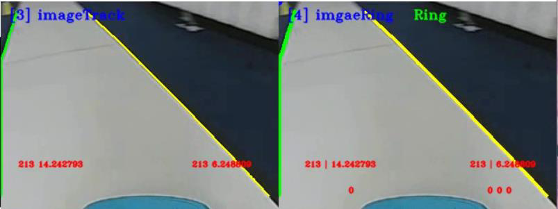

# 赛道与环岛识别实验指导

## 目录

- [1.实验描述](#1.实验描述)
- [2.实验目标](#2.实验目标)
- [3.实验步骤](#3.实验步骤)
  - [步骤 1：将智能汽车与 PC 电脑相连接](#步骤1：将智能汽车与PC电脑相连接)
  - [步骤 2：打开 Visual Studio Code 学习源码逻辑](#步骤2：打开VisualStudioCode学习源码逻辑)
  - [步骤 3：新建文件夹，用于存储采集的图像或视频源](#步骤3：新建文件夹，用于存储采集的图像或视频源)
  - [步骤 4：赛道识别与环岛识别](#步骤4：赛道识别与环岛识别)
  - [步骤 5：运行代码文件，查看环岛的识别结果](#步骤5：运行代码文件，查看环岛的识别结果)
- [1.环岛检测](#1.环岛检测)
- [2.入环岛识别](#2.入环岛识别)
- [3.环岛内识别](#3.环岛内识别)
- [4.出环岛识别](#4.出环岛识别)
- [5.结束](#5.结束)
  - [步骤 6：补全代码，尝试实车运行，观察可视化运行结果](#步骤6：补全代码，尝试实车运行，观察可视化运行结果)

## 1.实验描述

通过前面几部分的理论与实践学习，我们掌握了赛道图像采集与预处理的基
本原理与方法，熟悉了赛道元素识别模型训练的基本程序，对车辆行驶路径搜索
的理论和技术都有一定的理解，接下来我们需要结合曾经实验的学习经验，在赛
道各类图像采集与预处理的基础上，完成赛道识别的任务。
具体任务是通过摄像头对赛道进行实时识别，或者读取本地的“MP4”视频
对赛道进行识别，一方面可以识别基本的赛道线；另外还可以识别出环岛类型的
赛道。本次课程我们选择读取视频的方式完成任务。
## 2.实验目标

（1）理解赛道识别的基本原理，掌握普通赛道识别的基本方法；
（2）掌握智能汽车识别环岛类型赛道的基本方法；
（3）参考教材内容及源码文件，完成本实验的部分代码补全任务。
## 3.实验步骤

### 步骤 1：将智能汽车与 PC 电脑相连接

第一步，插入网线，将智能汽车通过网线与 PC 相连。PC 电脑需要参照实
训一步骤设置好静态 IP 地址，并完成网络映射相关设置。
第二步，打开 MobaXterm，建立 SSH 远程连接，将本地 PC 与智能汽车
Edgeboard 板卡建立远程连接，进而可通过命令行的方式对智能汽车的源码进行
启动等操作。
通过 MobaXterm，我们可以在电脑上看到智能汽车 Edgeboard 板卡上所展示
的界面内容。
100

---

赛道与环岛识别
### 步骤 2：打开 Visual Studio Code 学习源码逻辑

在前面的环境准备阶段，我们已经安装了 Visual Studio Code，本次图像感知
任务需要结合 EdgeBoard 嵌入式 AI 计算卡与本地计算机完成。
在上述步骤 1 基础上进行如下操作：
第 一 步 ， 把 部 署 在 EdgeBoard 嵌 入 式 AI 计 算 卡 中 的
Intelligentcar_T710_python_v2 工程通过 Visual Studio Code 可视化界面打开。
第二步，准备环岛识别和赛道识别的工程源码文件。
在 本 实 验 中 ， 通 过 路 径 src/python/ring_recognition.py 和
src/python/track_recognition.py 找到本实验提供的环岛识别和赛道识别部分源码
文件。工程文件结构如下图所示。
图 8-1 工程文件结构
101

---

赛道与环岛识别
### 步骤 3：新建文件夹，用于存储采集的图像或视频源

在该工程下，进入 res/samples/文件夹内，存放本次实验使用的 MP4 视频，
如果我们采用读取本地视频的方式进行赛道及环岛识别，通过修改代码中的读取
视频源的方式读取本地的 MP4 视频。
### 步骤 4：赛道识别与环岛识别

（1）引入函数库（src/python/ring_recognition.py）
引入 Python OpenCV 的函数库、智能汽车 intelligentCar_v2 函数库以及一些
其他的在程序中使用到的函数库。
import base64
import cv2
import numpy as np
import sys
sys.path.append("../lib") # 引用 C++库
import intelligentCar_v2
（2）确认输入源（src/python/ring_recognition.py）
根据自身情况调整输入源的输入方法，可切换选择本地视频或者选择摄像头
的方式，同时设置分辨率为 320×240，这里我们选择本地输入视频的方式。
capture = cv2.VideoCapture("../../res/samples/ring.mp4") # 选择本地视频
capture.set(cv2.CAP_PROP_FRAME_WIDTH, 320) # 设置视频分辨率
capture.set(cv2.CAP_PROP_FRAME_HEIGHT, 240)
（3）实例对象初始化（src/python/ring_recognition.py）
第一步，初始化智能汽车类，便于后续调用一些赛道处理的函数；
第二步，相机校正参数初始化，保证后续在进行图像识别时照片的准确性。
# 初始化智能汽车类
icar = intelligentCar_v2.IntelligentCar()
# 相机矫正参数初始化
icar.imageCorrecteInit()
102

---

赛道与环岛识别
（4）赛道识别与环岛识别（src/python/ring_recognition.py）
——代码补全
第一步，读取视频的每一帧；
第二步，对这一帧的 RGB 彩色图像进行图像校正；
第三步，把 RGB 彩色图像转换成为灰度图；
第四步，把灰度图像转换成二值化图像；
第五步，根据传入的二值化图像完成赛道识别功能，绘制赛道线，并且可视
化显示识别结果；
第六步，根据传入的赛道识别结果，完成环岛识别功能。
while True:
# 读取视频帧
isTrue, imageFrame = capture.read()
if isTrue:
cv2.waitKey(1)
else:
print("视频播放完毕")
break
# 图像矫正
base64Frame = matToBase64(False, imageFrame)
base64Corret = icar.imageCorrection(base64Frame)
imageCorret = base64ToMat(base64Corret)
# RGB 图像转换成灰度图像
imageGray = cv2.cvtColor(imageCorret, cv2.COLOR_BGR2GRAY)
# 图像二值化
rel, imageBinary = cv2.threshold(imageGray, 0, 255, cv2.THRESH_OTSU)
# 赛道识别
base64Binary = matToBase64(False, imageBinary)
icar.trackRecognition(base64Binary)
icar.trackDrawImage(base64Corret) # 绘制赛道线
# 环岛识别
icar.ringRecognition(base64Binary)
base64Ring = matToBase64(True, imageCorret)
icar.ringDrawImage(base64Ring) # 可视化显示识别结果
103

---

赛道与环岛识别
### 步骤 5：运行代码文件，查看环岛的识别结果

进入 python 文件夹下使用命令 python3 ring_recognition.py 运行环岛识别事
例代码，通过处理智能汽车摄像头提前录制好的赛道视频，实现环岛识别的实验
效果。
输 入 “cd workspace/intelligentcar_T710_python_v2/src/python/” 命 令 进 入
python 文件夹：
图 8-2 切换目录
运行环岛识别文件 python3 ring_recognition.py：
图 8-3 运行代码
如需退出，只需在终端按 Ctrl+c 即可。
## 1.环岛检测

比赛场地中，道路两侧的车道线一般分为左侧和右侧，如果智能汽车即将驶
入左环岛，那么就检测左侧是否有内侧半圆与右侧直行的车道线；如果智能汽车
即将驶入右环岛，那么就检测右侧是否有内侧半圆与左侧直行的车道线。
104

---

赛道与环岛识别
图 8-4 环岛检测
## 2.入环岛识别

识别到环的位置，智能汽车即将入环，需要依据识别内圆的位置、岔路口角
点的位置以及右侧的车道线进行车道线绘制，完整的规划出智能汽车的行驶范围。
图 8-5 入环岛识别
## 3.环岛内识别

环岛内特征较为明显，图像中只存在车道线的单边轨迹。
105

---

赛道与环岛识别
图 8-6 环岛内识别
## 4.出环岛识别

执行出环岛的拐角识别、对侧直道边进行识别、车道线路径规划，完成智能
汽车的出环。
图 8-7 出环岛识别
## 5.结束

出环岛后，虽然依旧会检测到拐角点，但此时可以同时检测到左侧车道线与
右侧车道线。
106

---

赛道与环岛识别
图 8-8 驶出环岛
### 步骤 6：补全代码，尝试实车运行，观察可视化运行结果

打开本实验项目的实践代码，对缺失代码的文件进行代码填充操作，进一步
掌握本工程代码实现方法。
图 8-9 代码文件
将填充完毕的代码文件尝试替换智能汽车源文件中的对应文件，运行程序，
观察可视化运行结果，验证代码填充是否正确。为防止代码错误或丢失，务必将
源文件提前备份。
107

---