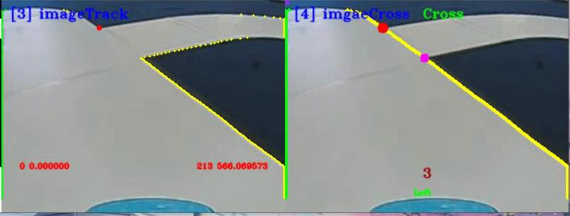
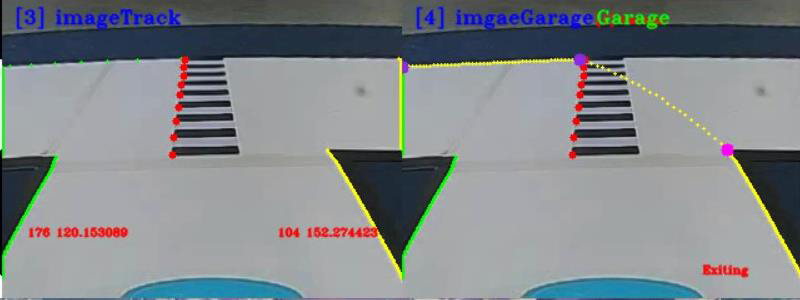
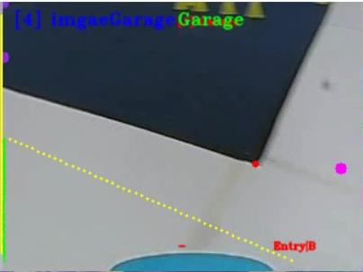
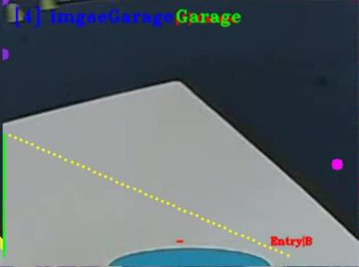

# 十字路口与车库识别实验指导

## 目录

- [1.实验描述](#1.实验描述)
- [2.实验目标](#2.实验目标)
- [3.实验步骤](#3.实验步骤)
  - [步骤 1：连接智能汽车，查看板卡代码](#步骤1：连接智能汽车，查看板卡代码)
  - [步骤 2：打开 Visual Studio Code 学习部分源码逻辑](#步骤2：打开VisualStudioCode学习部分源码逻辑)
  - [步骤 3：新建文件夹，用于存储采集的图像或视频](#步骤3：新建文件夹，用于存储采集的图像或视频)
  - [步骤 4：十字路口识别与车库识别](#步骤4：十字路口识别与车库识别)
  - [步骤 5：运行代码文件，查看可视化运行结果](#步骤5：运行代码文件，查看可视化运行结果)
- [1.十字路口识别](#1.十字路口识别)
  - [步骤 6：补全代码，尝试实车运行，观察可视化运行结果](#步骤6：补全代码，尝试实车运行，观察可视化运行结果)

## 1.实验描述

通过之前课程理论与实践的学习，我们已经初步了解赛道的基本识别方法和
遇到环岛情况下的识别策略，接下来我们要对其他几种类型的赛道情况进行讨论
和实践，并在本实验完成智能汽车对十字路口和车库的识别。
实践中可通过摄像头对赛道实时拍照进行识别，也可以读取本地的“MP4”
视频文件对视频中的赛道进行十字路口和车库的识别。本次课程我们选择读取视
频的方式完成任务。
## 2.实验目标

（1）理解十字路口识别的原理，掌握十字路口的识别方法；
（2）理解车库识别的原理，掌握车库识别的源码编程方法；
（3）参考教材内容及源码文件，完成本实验的部分代码补全任务。
## 3.实验步骤

### 步骤 1：连接智能汽车，查看板卡代码

第一步，插入网线，将智能汽车通过网线与 PC 相连。
第二步，打开 MobaXterm，通过 SSH 远程连接的方式，将本地 PC 与智能
汽车 Edgeboard 板卡建立远程连接，进而通过命令行的方式对智能汽车的源码进
行启动和编译等操作，具体操作见实训 1。
### 步骤 2：打开 Visual Studio Code 学习部分源码逻辑

在前面的环境准备阶段，我们已经安装了 Visual Studio Code，本次赛道识别
相关任务需要结合 EdgeBoard 嵌入式 AI 计算卡与本地计算机完成。
在上述步骤 1 基础上进行如下操作：
108

---

十字路口与车库识别
第 一 步 ， 把 部 署 在 EdgeBoard 嵌 入 式 AI 计 算 卡 中 的
intelligentcar_T710_python_v2 工程通过 Visual Studio Code 可视化界面打开。
第二步，准备十字路口与车库识别的源码文件。
在 本 实 验 中 ， 通 过 路 径 1“src/python/cross_recognition.py” 、 路 径 2
“src//python/garage_recognition.py”找到本实验提供的十字路口和车库识别的部
分源码。
工程文件结构如下图所示。
v
图 9-1 工程文件结构
109

---

十字路口与车库识别
### 步骤 3：新建文件夹，用于存储采集的图像或视频

在该工程下，进入 res/samples/文件夹内，存放本次实验使用的 MP4 视频，
如果我们采用读取本地视频的方式进行赛道及环岛识别，可通过修改代码中的读
取视频源的方式读取本地的 MP4 视频。
### 步骤 4：十字路口识别与车库识别

（1）引入函数库（src/python/ cross_recognition.py 或者
garage_recognition.py）
引入 Python OpenCV 的函数库、智能汽车 intelligentCar_v2 函数库以及一些
其他的在程序中使用到的函数库。
import base64
import cv2
import numpy as np
import sys
sys.path.append("../lib") # 引用 C++库
import intelligentCar_v2
（2）确认输入源（src/python/ cross_recognition.py 或者
garage_recognition.py）
根据自身情况调整输入源的输入方法，可切换选择本地视频或者选择摄像头
的方式，同时设置分辨率为 320×240，这里我们选择本地输入视频的方式。
capture = cv2.VideoCapture("../../res/samples/garage.mp4") # 选择本地视
频
capture.set(cv2.CAP_PROP_FRAME_WIDTH, 320) # 设置视频分辨率
capture.set(cv2.CAP_PROP_FRAME_HEIGHT, 240)
（3）实例对象初始化（src/python/cross_recognition.py 或
者 garage_recognition.py）
第一步，初始化智能汽车类，便于后续调用一些赛道处理的函数；
第二步，相机校正参数初始化，保证后续在进行图像识别时照片的准确性。
# 初始化智能汽车类
110

---

十字路口与车库识别
icar = intelligentCar_v2.IntelligentCar()
# 相机矫正参数初始化
icar.imageCorrecteInit()
（ 4 ） 赛 道 识 别 （ src/python/cross_recognition.py 或 者
garage_recognition.py）
第一步，读取视频的每一帧；
第二步，对这一帧的 RGB 彩色图像进行图像校正；
第三步，把 RGB 彩色图像转换成为灰度图；
第四步，把灰度图像转换成二值化图像；
第五步，根据传入的二值化图像完成赛道识别功能，并且可视化显示车道线
的识别结果；
while True:
# 读取视频帧
isTrue, imageFrame = capture.read()
if isTrue:
cv2.waitKey(1)
else:
print("视频播放完毕")
break
# 图像矫正
base64Frame = matToBase64(False, imageFrame)
base64Corret = icar.imageCorrection(base64Frame)
imageCorret = base64ToMat(base64Corret)
# RGB 图像转换成灰度图像
imageGray = cv2.cvtColor(imageCorret, cv2.COLOR_BGR2GRAY)
# 图像二值化
rel, imageBinary = cv2.threshold(imageGray, 0, 255, cv2.THRESH_OTSU)
# 赛道识别
base64Binary = matToBase64(False, imageBinary)
icar.trackRecognition(base64Binary)
icar.trackDrawImage(base64Corret) # 可视化显示识别结果
111

---

十字路口与车库识别
（5）十字路口识别（src/python/cross_recognition.py）
直接调用 icar.crossRecognition()十字路口识别函数：
# 十字道路识别
icar.crossRecognition()
base64Cross = matToBase64(True, imageCorret)
icar.crossDrawImage(base64Cross)
（6）车库识别（src/python/ garage_recognition.py）
直接调用 icar.garageRecognition()函数进行车库识别：
# 车库识别
icar.garageRecognition()
base64Garage = matToBase64(True, imageCorret)
icar.garageDrawImage(base64Garage) # 可视化显示识别结果
### 步骤 5：运行代码文件，查看可视化运行结果

与先前实验步骤相同，先进入 python 文件夹，然后分别运行十字路口识别
代码和车库识别代码。
输 入 “cd workspace/intelligentcar_T710_python_v2/src/python/” 命 令 进 入
python 文件夹：
图 9-2 切换目录
运行十字路口识别代码 python3 cross_recognition.py：
图 9-3 运行识别十字路口代码
运行车库识别代码 python3 garage_recognition.py：
112

---

十字路口与车库识别
图 9-4 运行识别车库代码
如需退出，只需在终端按 Ctrl+c 即可。
## 1.十字路口识别

如下图所示，左侧图为车道线识别，右侧图为环岛入口的十字路口识别，可
以从图中观测出，此时智能汽车正在左转入弯，视野只有两个角点，根据紫色和
粉色两点，使用最小二乘法规划路线，向上延伸，补齐缺口部分。右转弯入十字
路口同理。
图 9-5 十字路口检测
如下图所示，左侧图为车道线识别，右侧图为十字路口识别，可以从图中观
测出，此时的智能汽车即将直入十字路口，可以观测到 3-4 个角点，左侧两角点，
向上延伸规划路径；右侧两角点向上延伸规划路径。驶出十字路口同理。
113

---

十字路口与车库识别
图 9-6 十字路口检测
2．出库识别
车库前的斑马线通过 AI 与传统图像处理技术共同检测，双重确认智能汽车
是否进入出入库状态。如下图中第一张图片所示，有一个白框将斑马线圈了起来
即为 AI 检测结果。当检测到斑马线后，程序默认规划向左转的路线。如下方第
四张图所示，为结合贝塞尔曲线规划的出库路径。
图 9-7 出库，检测斑马线
图 9-8 出库
114

---

十字路口与车库识别
3．入库识别
出库只有一次，入库也只有一次。入库时同样是利用 AI 技术与传统图像处
理技术共同检测斑马线，以判断是否进入入库状态。
图 9-9 入库，检测斑马线
图 9-10 入库
入库分为两种情况，一种是智能汽车压过斑马线之前，另一种是智能汽车压
过斑马线后，入库过程如下图所示。具体识别策略可参考课程讲义内容，以进一
步理解代码逻辑。
图 9-11（a） 入库，未压过斑马线 图 9-11(b) 入库，未压过斑马线
115

---

十字路口与车库识别
图 9-12（a） 入库，压过斑马线 图 9-12（b） 入库，压过斑马线
### 步骤 6：补全代码，尝试实车运行，观察可视化运行结果

打开本实验项目的实践代码，对缺失代码的文件进行代码填充操作，进一步
掌握本工程代码实现方法。
图 9-13 代码文件
将填充完毕的代码文件尝试替换智能汽车源文件中的对应文件，运行程序，
观察可视化运行结果，验证代码填充是否正确。为防止代码错误或丢失，务必将
源文件提前备份。
116

---