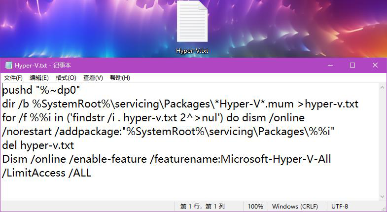
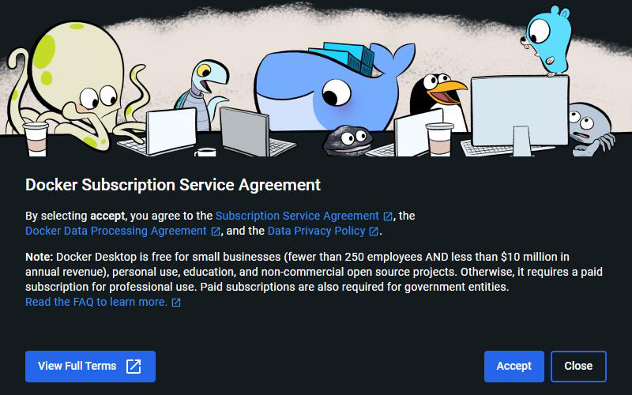
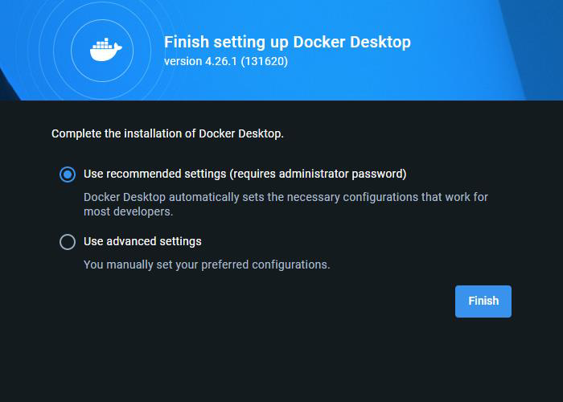
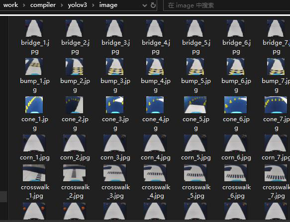

# 智能汽车 AI 模型部署实验指导

## 目录

- [1.实验描述](#1.实验描述)
- [2.实验目标](#2.实验目标)
- [3.实验步骤](#3.实验步骤)
  - [步骤 1：编译环境配置](#步骤1：编译环境配置)
  - [步骤 2：模型及编译文件配置](#步骤2：模型及编译文件配置)
  - [步骤 3：模型编译及部署](#步骤3：模型编译及部署)

## 1.实验描述

前面实训中基于百度飞桨 AI Studio 平台，通过对智能汽车采集的赛道图像
数据进行目标检测模型训练，已导出了相应的模型文件。但智能汽车实际运行过
程中，我们需要把训练后的模型部署到智能汽车的 EdgeBoard 边缘计算卡上，智
能汽车才能在行驶中实时的采集赛道图像并进行识别。将训练成功的 AI 模型部
署到智能汽车本地 EdgeBoard 板卡，才算是真正的部署成功。
本次课程将学习目标检测模型的编译和部署步骤，将前面实训中训练所得的
模型文件进行编译后，部署到智能汽车的工程文件中，从而在后续的赛道元素识
别中实现实际应用。
## 2.实验目标

（1）学习模型编译所需的环境配置步骤；
（2）对前面训练所得的模型文件进行编译；
（3）将编译完成的模型部署到智能汽车的工程文件中。
## 3.实验步骤

通过前面的实训，已经得到了对应的模型文件，但是在部署之前，还需要通
过编译步骤将得到的模型文件转换成可调用的文件类型，以此才能在工程文件中
利用并对目标进行识别。因此在部署模型之前，需要先配置编译环境并将模型文
件编译，从而得到可用的模型文件。
### 步骤 1：编译环境配置

（1）电脑设置
安装编译所需的环境之前，需要先在本地电脑开启 Hyper-V 功能。
Hyper-V 是微软开发的一款虚拟化产品，它允许用户在同一台物理计算机上
117

---

智能汽车 AI 模型部署
创建和运行多个虚拟机。其主要功能包括：虚拟机管理、高可用性、灾难恢复、
数据备份和恢复等。通过使用 Hyper-V，用户可以将不同的操作系统和应用程序
部署在虚拟机上，并对其进行集中管理和控制。在编译模型时，就需要通过
Hyper-V 功能在本地创建一个 Linux 系统，并在 Linux 系统中完成模型的编译。
开启功能之前，先确认电脑已启用虚拟化。打开任务管理器（快捷键：
Ctrl+Shift+Esc），选择“性能”--“CPU”，确认 PC 已开启虚拟化。
图 10-1 查看虚拟化功能
如果未开启虚拟化，则需要根据电脑的品牌在网上查找开启虚拟化的方法。
不同品牌的电脑操作不同，本次实训中不做详细说明。
虚拟化开启完成后，打开电脑的“控制面板”，选择“程序”，在“程序和
功能”中选择“启用或关闭 windows 功能”。
图 10-2 打开“启动或关闭 Windows 功能”
在打开的选项卡中确保 Hyper-V 功能正常启用，设置完成后等待功能生效。
118

---

智能汽车 AI 模型部署
图 10-3 启用 Hyper-V 功能
如果未找到 Hyper-v 选项，需要在桌面单击右键创建文本文档，命名为
“Hyper-V.txt”。命名完成后在文件内填写如下内容。
pushd "%~dp0"
dir /b %SystemRoot%\servicing\Packages\*Hyper-V*.mum >hyper-v.txt
for /f %%i in ('findstr /i . hyper-v.txt 2^>nul') do dism /online
/norestart /addpackage:"%SystemRoot%\servicing\Packages\%%i"
del hyper-v.txt
Dism /online /enable-feature /featurename:Microsoft-Hyper-V-All
/LimitAccess /ALL
图 10-4 创建文件并填写内容
填写完成后保存文件，右键单击文件将文件重命名为“Hyper-V.bat”。然后
鼠标右键单击“Hyper-V.bat”文件并且用管理员身份运行，运行后会自动弹出终
119

---

智能汽车 AI 模型部署
端窗口并执行功能，执行完成后会自动关闭终端窗口。
图 10-5 重命名并运行文件
（2）环境安装
电脑设置完成后，即可进行编译环境的安装。本次实训使用的编译环境是基
于 Docker。
Docker 是一个开源的应用容器引擎，它允许开发者将应用程序以及依赖包
打包到一个可移植的容器中，然后发布到任何流行的 Linux 或 Windows 操作系
统的机器上，实现虚拟化。前面开启虚拟化的步骤也是为了支持 Docker 以及后
续的镜像系统的运行。
单击此链接可在浏览器中下载 Docker 安装包：https://desktop.docker.com/wi
n/main/amd64/Docker%20Desktop%20Installer.exe。
图 10-6 Docker 安装包
鼠标左键双击 Docker Desktop installer.exe 文件进行安装操作，在弹出的窗
口中点击“OK”，接着等待程序安装。
120

---

智能汽车 AI 模型部署
图 10-7 配置界面
图 10-8 安装过程
安装完成后，点击“Close”，桌面上便出现 Docker 的快捷方式。
图 10-9 安装完成
121

---

智能汽车 AI 模型部署
图 10-10 快捷方式
双击快捷方式，等待软件打开。打开后会出现订阅服务协议，选择“Accept”。
图 10-11 接受订阅服务协议
接着进行基本设置，直接选择“Finish”即可。
图 10-12 完成设置
接着会进入到 Docker 的启动界面，直接跳过登录界面和使用方法。
122

---

智能汽车 AI 模型部署
图 10-13 跳过登录和使用方向
接下来便进入到 Docker 的操作界面。需要说明的是，由于个人电脑系统不
同，该部分可能受阻，这主要是因为电脑没有下载 Ubuntu 的子系统导致 Docker
软件无法正常启动。后续会继续进行镜像下载和容器操作，操作时需要保证 Do
cker 处于运行状态。
图 10-14 Docker 界面
Docker 安装完成后，可以在命令行中检查其安装版本。使用快捷键“win”
123

---

智能汽车 AI 模型部署
+“R”调出运行命令，输入“cmd”并确定。在打开的终端中，输入指令“doc
ker --version”即可在终端中查询 Docker 的版本信息。
图 10-15 打开中断
图 10-16 查看 Docker 版本
（3）镜像部署
在电脑上创建新文件夹“work”，确保此文件夹所在磁盘有不低于 15G 的
存储空间。进入此文件夹后，在输入框输入“cmd”并按下回车打开终端。同时
还需要保证 Docker 在后台运行中。
124

---

智能汽车 AI 模型部署
图 10-17 新建文件夹并进入终端
在打开的终端中输入指令“docker pull pphub/ppnc2.0:v1.0”，此指令用于
下载镜像文件。下载速度受到网速限制，需要等待下载完成。下载完成后会重新
出现路径提示。
图 10-18 镜像下载中
图 10-19 镜像下载完成
125

---

智能汽车 AI 模型部署
接下来建立本地文件夹和容器内相应文件夹的映射关系。输入指令时需要根
据本地文件夹”work“所在的路径进行对应的修改。
详细指令为“docker run -it --name ppnc2.0 -v C:\Users\EDY\Desktop\work:
/home/edgeboard/workspace pphub/ppnc2.0:v1.0 /bin/bash”。
其中：“ppnc2.0”为容器名称；“C:\Users\EDY\Desktop\work:”为本地电
脑上要映射给容器的文件夹路径，实际使用时根据自己创建的 work 文件夹路径
进行对应修改；“/home/edgeboard/workspace”为容器中被映射到的路径。
指令完成后会自动进入到容器中，可以观察到路径提示发生了变化，这是因
为本地文件路径和容器内的文件路径是不同的。
图 10-20 创建文件夹映射
镜像安装完成后，在 Docker 软件中也可以查看到镜像信息。
图 10-21 镜像信息
在终端中使用容器时，直接输入指令即可，进入容器后文件路径提示会发生
变化。这是因为本地文件夹和容器内的文件夹是映射关系，进入到容器相当于进
入了另一个操作系统，因此路径会发生改变。
关于容器的基本操作指令，主要有以下几个：
126

---

智能汽车 AI 模型部署
1）启动容器：docker start ppnc2.0
2）进入容器：docker exec -it ppnc2.0 /bin/bash
3）导入环境变量：export PPNC_HOME=/usr/local/ppnc
4）导入相关路径：source /usr/local/ppnc/scripts/activate_env.sh
5）退出容器：exit
需要注意操作 3）和操作 4）在每次重新进入容器时都需要重新执行一遍。
图 10-22 容器操作及其运行效果
使用容器时需要保持 Docker 软件运行中。否则会出现错误提示。
图 10-23 错误提示
### 步骤 2：模型及编译文件配置

（1）模型文件准备
打开前面创建的用于映射容器的文件夹“work”，将模型编译脚本文件夹下
127

---

智能汽车 AI 模型部署
的配置文件压缩包“compiler.zip”复制到此文件夹并解压。
图 10-24 解压配置文件压缩包
在解压后的“compiler”文件夹下创建一个新文件夹“yolov3”，在其内部
创建两个新文件夹“model”和“image”。
图 10-25 创建新文件夹
在“model”文件夹中，放置实训七中 AI Studio 平台上导出的模型文件；在
“image”文件夹下准备大于 50 张并覆盖所有标签种类的用于校正的赛道元素
图片文件，可从数据集的图片文件夹中自行选取。
图 10-26 添加模型文件
128

---

智能汽车 AI 模型部署
图 10-27 添加图片文件
（2）编译文件配置
打开“compiler”文件夹中的“config.json”文件进行配置。
其中，model_dir 的参数表示模型文件所在的路径，使用的是镜像内的路径；
shape 表示模型输入尺寸，需要与模型实际尺寸保存一致，这里直接设置为[320，
320]；split 参数使用默认设置 true 即可。
图 10-28 配置“config.json”文件
接着打开“compile”文件夹下的脚本文件“split.py”，找到如图所示的模
型输出张量数值，将其修改成与 AIstudio 平台上导出的模型文件的输出张量数值
相同。
129

---

智能汽车 AI 模型部署
图 10-29 修改“split.py”脚本中的输出张量数值
AI Studion 平台导出的模型文件的输出张量数据可通过在线深度学习模型可
视化平台 NETRON 查看，网址为 https://netron.app/。打开网址后选择“Open
Model”，将下载好的模型文件（后缀为.pdmodel）上传即可查看模型结构。
图 10-30 模型可视化平台 NETRON
130

---

智能汽车 AI 模型部署
图 10-31 上传模型文件
将打开的模型结构拉到最下方选择“concat”，其中第 3 个数据即为输出张
量的数值。“concat”指的是连接操作，即将两个或多个张量（或称为多维数组）
在某个维度上进行拼接。其目的是为了将不同层的输出合并在一起，以传递给下
一层。
前面的脚本文件“split.py”中的输出张量数值需要和模型中的输出张量数值
一致。
图 10-32 查看模型结构及输出张量数值
接着修改“compiler”文件夹下“res”文件夹内的“io_paddle.json”配置文
件，将其中的 shape 参数将其改成模型尺寸 320×320。
131

---

智能汽车 AI 模型部署
图 10-33 修改“io_paddle.json”配置文件中的模型尺寸
至此编译所需的相关文件已全部配置完成。
### 步骤 3：模型编译及部署

（1）模型编译
根据前面编译环境配置中的容器操作，进入容器并导入环境变量和相关路径
后，输入指令“cd home/edgeboard/workspace/compiler/”进入到“compiler“路径
下，接着输入模型编译指令“python3 compile.py config.json”并运行。程序运行
完成后即可在文件路径“work\compiler\build\”下生成编译好的模型文件压缩包
“inference.zip”，将此文件解压并打开即可获得编译好的模型文件。
图 10-34 操作容器进行模型编译
132

---

智能汽车 AI 模型部署
图 10-35 模型编译完成
图 10-36 解压最终的模型编译压缩文件
133

---

智能汽车 AI 模型部署
图 10-37 编译文件夹中的模型文件
（2）模型部署
通过网络映射使用 VSCode 打开智能汽车的工程文件目录，将“inference”
文件夹下的所有文件以及数据集文件夹中的“label_list.txt”文件一起复制到工程
文件夹的“res\model\yolov3_mobilenet_v1”路径下。至此，模型部署过程即全部
完成。
图 10-38 “label_list.txt”文件
图 10-39 工程文件中的文件部署
134

---