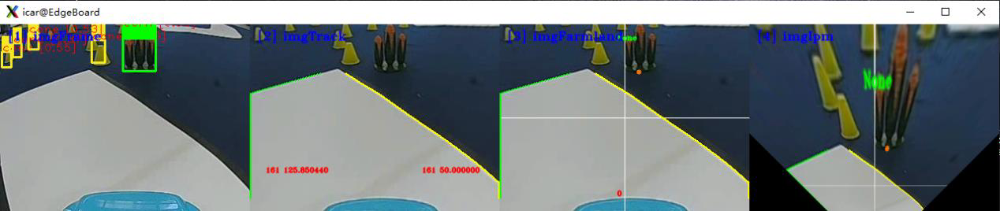

# 基于 AI 的赛道元素检测与识别实验 1——农田检测

## 目录

- [1.实验描述](#1.实验描述)
- [2.实验目标](#2.实验目标)
- [3.实验步骤](#3.实验步骤)
  - [步骤 1：了解农田区标志与特点](#步骤1：了解农田区标志与特点)
  - [步骤 2：明确 AI 检测与识别流程，准备模型](#步骤2：明确AI检测与识别流程，准备模型)
  - [步骤 3：将智能汽车与 PC 电脑相连接](#步骤3：将智能汽车与PC电脑相连接)
  - [步骤 4：打开 Visual Studio Code 学习部分源码逻辑](#步骤4：打开VisualStudioCode学习部分源码逻辑)
  - [步骤 5：学习 AI 识别代码逻辑](#步骤5：学习AI识别代码逻辑)
  - [步骤 6：运行代码文件，查看结果](#步骤6：运行代码文件，查看结果)
  - [步骤 7：补全代码，修改优化](#步骤7：补全代码，修改优化)

——农田检测
## 1.实验描述

通过之前的理论与实践的讲解，我们已经了解并掌握了基本赛道识别方法、
环岛类型赛道的识别方法、十字路口的识别方法、车库出入库情况下的识别方法
等等。但是在有些场景中，必须要结合使用 AI 方法才能完成识别任务，比如赛
道上各种标志元素的识别。在智能汽车竞赛中，合计有 8 种赛道标志可以通过
AI 方法进行检测和识别，分别是锥桶标志、斑马线、拱桥、车辆维护标志、农
田标志、减速标志、动物出没和粮仓标志。
本次课程我们尝试通过源码编程完成对农田标志的 AI 识别任务。其中，图
像来源既可以通过智能汽车的摄像头对赛道场景的三维实物进行实时采集，也可
以读取本地的“MP4”视频对赛道标志进行图像处理、识别等操作。本次我们选
取读取视频的方式完成任务。
## 2.实验目标

（1）理解赛道标志的深度学习检测与识别方法、程序及相关技术；
（2）通过源码调试、编程，完成智能汽车对农田的识别与通行任务；
（3）参考教材内容及源码文件，完成本实验的部分代码补全任务。
## 3.实验步骤

### 步骤 1：了解农田区标志与特点

智能汽车竞赛场地中设置有农田区域，此区域为非常规道路（断路区），需
要依据黄色的锥桶围出的场地路线行驶。
135

---

基于 AI 的赛道元素检测与识别 1-农田检测
图 11-1 农田区域
图 11-2 农田标志
### 步骤 2：明确 AI 检测与识别流程，准备模型

智能汽车在赛道行驶中实时采集赛道标志的图像，实时识别并采取相应的控
制策略，前提是先经过 AI 训练，通过学习赛道标志的特征能够识别这些标志，
选用合适的算法模型是核心。基本步骤如下图 11-3 示：
图 11-3 识别图像的步骤图
第一步，收集 8 种赛道标志及 1 个背景的图像数据集，各种标志的图像数量
要均衡合适，动态图像与静态图像相结合，具体可参考教材内容；
136

---

基于 AI 的赛道元素检测与识别 1-农田检测
第二步，把收集到的图片划分为训练集和测试集。对训练集图片中的交通标
志进行人工标记，为后续训练做准备；
第三步，基于百度飞桨平台，选用合适的模型，输入训练数据集，进行训练；
本次实验选用 yolov3_mobilenet_v1 模型开展赛道标志的检测工作；
第四步，通过测试集测试基于该模型进行赛道各种标志识别的成功率，如果
识别成功率可以达到 70%或者 80%及以上就可以确定采用本模型进行 AI 识别应
用；如果识别成功率较低，低于 50%，那么就需要通过增加图片数量或者重新收
集图片调整图片质量，或重新选择合适的模型，重新训练，直至识别成功率达到
标准。
第五步，将模型文件部署到 Edgeboard 边缘计算卡中的对应位置，便于智能
汽车实时采集赛道标识的图像并实时基于Edgeboard边缘计算卡进行检测和识别。
第六步，采集图像，并对图像进行预处理，包括二值化、图像校正、透视变
换等操作，然后针对预处理后的图像，基于 yolov3_mobilenet_v1 模型进行各种
类型的赛道标志的检测与识别。
此次实训重点介绍第六步的相关操作，通过源码编程实现实验目标。
### 步骤 3：将智能汽车与 PC 电脑相连接

第一步，插入网线，将智能汽车通过网线与 PC 相连。PC 电脑需要参照实
训一步骤设置好静态 IP 地址，并完成网络映射相关设置。
第二步，打开 MobaXterm，建立 SSH 远程连接，将本地 PC 与智能汽车
Edgeboard 板卡建立远程连接，进而可通过命令行的方式对智能汽车的源码进行
启动等操作。
通过 MobaXterm，我们可以在电脑上看到智能汽车 Edgeboard 板卡上所展示
的界面内容。
### 步骤 4：打开 Visual Studio Code 学习部分源码逻辑

在前面的环境准备阶段，我们已经安装了 Visual Studio Code，本次农田区的
AI 检测任务需要结合 EdgeBoard 嵌入式 AI 计算卡与本地计算机完成。
在上述步骤 3 基础上进行如下操作：
137

---

基于 AI 的赛道元素检测与识别 1-农田检测
第 一 步 ， 把 部 署 在 EdgeBoard 嵌 入 式 AI 计 算 卡 中 的
intelligentcar_T710_python_v2 工程通过 Visual Studio Code 可视化界面打开。
第二步，准备视频。在该工程下，进入 res/samples/文件夹内，存放 AI 检测
使用的 MP4 视频。如果我们采用读取本地视频的方式进行本次实验，通过修改
代码中的读取视频源的方式从而读取本地的 MP4 视频。
第三步，准备源码文件。
在本实验中，通过路径“src\python”找到所提供的“farmland_detection.py”
农田检测实验的部分源码。
完成以上步骤后，该工程文件的文件结构如下图所示。
图 11-4 工程文件结构
138

---

基于 AI 的赛道元素检测与识别 1-农田检测
### 步骤 5：学习 AI 识别代码逻辑

AI 识别的源码编程主要分为如下几步：引入函数库、类的转换、确认视频
的输入源是来自本地 MP4 视频还是摄像头、功能类的初始化、图片处理包括图
像校正、灰度图转换、二值化转换、赛道识别，启动 AI 推理以及对农田标志检
测的 AI 识别，其中 AI 识别部分包含赛道标志检测与对应的路径规划。
（1）引入函数库
引入 Python OpenCV 的函数库、智能汽车 intelligentCar_v2 函数库以及一些
其他的在程序中使用到的函数库。
import base64
import cv2
import numpy as np
import sys
sys.path.append("../lib") # 引用 C++库
import intelligentCar_v2
（2）类的转换
将 C++的 Mat 类转换到到 Python,numpy 类中进行解码。
智能汽车工程底层代码是 C++编程，在 C++的编程体系下,Mat 类在 OpenCV
中是最重要的一种图像表示形式(即为 Matrix)，可以指定存储的数据类型、行列
数,以及每个元素中的数值个数(通道数)等等。但在 Python 中主要通过 numpy 进
行相关数据处理，故需进行解编码操作。
def base64ToMat(base64_data):
img = base64.b64decode(base64_data)
nparr = np.fromstring(img, np.uint8)
img_np = cv2.imdecode(nparr, 1)
img_np = cv2.cvtColor(img_np, cv2.COLOR_BGR2RGB)
return img_np
将 Python,numpy 类转换到 C++,Mat 类中进行编码。
def matToBase64(rgb, img):
if rgb:
img = cv2.cvtColor(img, cv2.COLOR_RGB2BGR) # RGB 转 BGR
x = cv2.imencode(".jpg", img)[1].tobytes()
base64_data = base64.b64encode(x)
return base64_data
139

---

基于 AI 的赛道元素检测与识别 1-农田检测
（3）确认输入源
根据自身情况调整输入源的输入方法并检测视频是否接受，为防止死循环加
入 exit()方法。可切换选择本地视频或者选择摄像头的方式，同时设置分辨率为
320×240，这里我们选择本地视频输入的方式。
capture = cv2.VideoCapture("../../res/samples/farmland.mp4") # 选择本
地视频
capture.set(cv2.CAP_PROP_FRAME_WIDTH, 320) # 设置视频分辨率
capture.set(cv2.CAP_PROP_FRAME_HEIGHT, 240)
# 检测视频是否接收到,加入 exit()防止死循环
if not capture.isOpened():
print("Cannot open camera")
exit()
rate = int(capture.get(cv2.CAP_PROP_FPS))
width = int(capture.get(cv2.CAP_PROP_FRAME_WIDTH))
height = int(capture.get(cv2.CAP_PROP_FRAME_HEIGHT))
print("Camera Param: frame rate = ", rate, " width = ", width, " height
= ", height)
（4）初始化功能类
第一步，初始化智能汽车类，便于后续调用赛道处理、赛道识别的一些函数
功能；
第二步，透视变换（IPM）参数初始化。智能汽车在赛道运行时，需要借助
透视变换后的赛道图像进行运算与路径规划；
第三步，相机校正参数初始化，保证后续在进行图像识别时照片的准确性；
第四步，AI 模型初始化，智能汽车在赛道行驶时，遇到赛道标志时，只能
通过 AI 识别的方式去完成赛道任务，通过初始化该模型，我们就可以调用其中
的函数功能去解决不同区域的赛道标志识别。
# 初始化智能汽车类
icar = intelligentCar_v2.IntelligentCar()
# 透视变换（IPM）参数初始化
icar.ipmInit()
# 相机矫正参数初始化
icar.imageCorrecteInit()
# AI 模型初始化
140

---

基于 AI 的赛道元素检测与识别 1-农田检测
icar.paddleModelInit()
（5）对每一帧图像进行处理
第一步，读取视频帧。无论是通过读取本地 MP4 视频的方式，还是实时赛
道采集的方式，在进行图像识别时都需要对每一帧的图像进行操作，进而从连续
帧的图像中分析得出结果。
while True:
# 读取视频帧
isTrue, imageFrame = capture.read()
if isTrue:
cv2.waitkey(1)
else:
print("视频播放完毕")
break
第二步，图像校正。对智能汽车实车采集的图像进行校正。
base64Frame = matToBase64(False, imageFrame)
base64Corret = icar.imageCorrection(base64Frame)
imageCorret = base64ToMat(base64Corret)
第三步，灰度图转换。对赛道 RGB 彩色图像进行灰度转换，方便后续图像
处理。
# RGB 图像转换成灰度图像
imageGray = cv2.cvtColor(imageCorret, cv2.COLOR_BGR2GRAY)
第四步，图像二值化，将图像转换为黑白图像。
# 图像二值化
rel, imageBinary = cv2.threshold(imageGray, 0, 255, cv2.THRESH_OTSU)
第五步，赛道识别，识别一般赛道区域的行驶范围，供智能汽车行驶。
# 赛道识别
base64Binary = matToBase64(False, imageBinary)
icar.trackRecognition(base64Binary)
icar.trackDrawImage(base64Corret) # 可视化显示识别结果
（6）农田标志的 AI 识别
启动 AI 推理，调用 AI 模型去完成农田区域的赛道标志检测与路径规划。
①启动 AI 推理
# 启动 AI 推理
icar.AiDetection(base64Frame)
②农田区检测与路径规划（farmland_detection.py）
141

---

基于 AI 的赛道元素检测与识别 1-农田检测
在该路段，智能汽车首先会遇到“农田标志”，当检测识别出此标志时，智
能汽车会切换行驶模式，从正常的赛道行驶模式切换为“农田区域使能”模式。
根据识别锥桶围成的区域，规划路线，驶出农田。
通过已经实例化的 icar 智能汽车类，调用 farmlandDetection ()函数，完成农
田区赛道的检测与路径规划。
icar.farmlandDetection()
base64Farmland = matToBase64(True, imageCorret)
icar.farmlandDrawImage(base64Granary) # 可视化显示识别结果
### 步骤 6：运行代码文件，查看结果

农田检测实训所用脚本文件为 farmland_detection.py，可使用 cd 命令找到
src/python 文件目录下按回车键进入；
图 11-5 切换目录
输入 python3 farmland_detection.py 运行农田区识别程序(注意空格)，运行后
即可在弹出的窗口查看结果（如需退出只需在终端界面按 Ctrl+c 即可）。
图 11-6 运行代码文件
142

---

基于 AI 的赛道元素检测与识别 1-农田检测
图 11-7 农田区的标志识别效果
### 步骤 7：补全代码，修改优化

打开本实验项目的实践代码，对缺失代码的文件进行代码填充操作，进一步
掌握本工程代码实现方法。
图 11-8 农田区域检测代码补全文件
将填充完毕的代码文件尝试替换智能汽车源文件中的对应文件，运行程序，
观察可视化运行结果，验证代码填充是否正确。为防止代码错误或丢失，务必将
源文件提前备份。
143

---