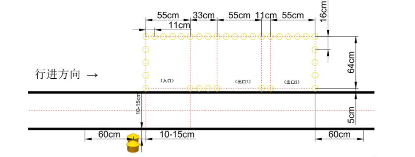
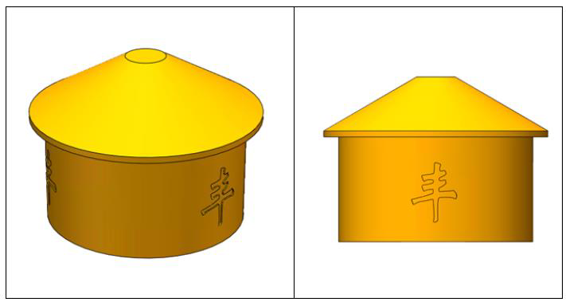
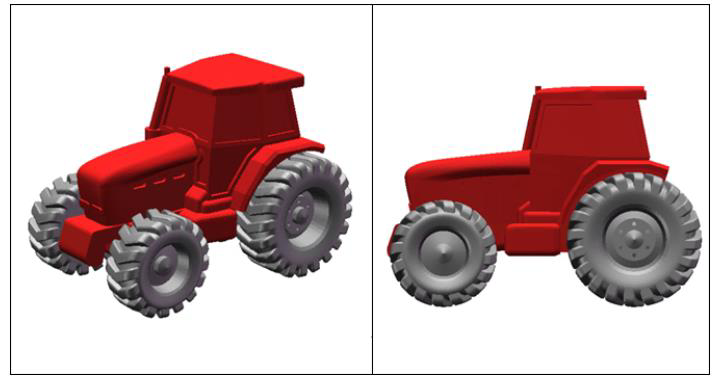
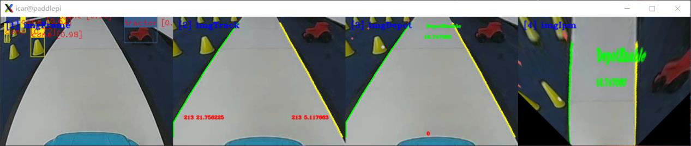

# 基于 AI 的赛道元素检测与识别实验 2——粮仓与维护区检测

## 目录

- [1.实验描述](#1.实验描述)
- [2.实验目标](#2.实验目标)
- [3.实验步骤](#3.实验步骤)
  - [步骤 1：粮仓区与车辆维护区介绍](#步骤1：粮仓区与车辆维护区介绍)
  - [步骤 2：明确 AI 检测与识别流程，准备模型](#步骤2：明确AI检测与识别流程，准备模型)
  - [步骤 3：将智能汽车与 PC 电脑相连接](#步骤3：将智能汽车与PC电脑相连接)
  - [步骤 4：打开 Visual Studio Code 学习部分源码逻辑](#步骤4：打开VisualStudioCode学习部分源码逻辑)
  - [步骤 5：AI 识别代码编写部分](#步骤5：AI识别代码编写部分)
- [1.启动 AI 推理](#1.启动AI推理)
- [2.粮仓区检测与路径规划（granary__detection.py）](#2.粮仓区检测与路径规划（granary__detection.py）)
- [3.车辆维护区检测与路径规划（depot_detection.py）](#3.车辆维护区检测与路径规划（depot_detection.py）)
  - [步骤 6：运行代码文件，查看结果](#步骤6：运行代码文件，查看结果)
  - [步骤 7：补全代码，修改优化](#步骤7：补全代码，修改优化)

——粮仓与维护区检测
## 1.实验描述

通过之前的理论与实践的讲解，我们已经了解并掌握了基本赛道识别方法、
环岛类型赛道的识别方法、十字路口的识别方法、车库出入库情况下的识别方法
等等。但是在有些场景中，必须要结合使用 AI 方法才能完成识别任务，比如赛
道上各种标志元素的识别。在智能汽车竞赛中，合计有 8 种赛道标志可以通过
AI 方法进行检测和识别，分别是锥桶标志、斑马线、拱桥、车辆维护标志、农
田标志、减速标志、动物出没和粮仓标志。
本次课程我们尝试通过源码编程完成对粮仓和维护区这两种代表性标志的
AI 识别任务。其中，图像来源既可以通过智能汽车的摄像头对赛道场景的三维
实物进行实时采集，也可以读取本地的“MP4”视频对赛道标志进行图像处理、
识别等操作。本次我们选取读取视频的方式完成任务。
## 2.实验目标

（1）理解赛道标志的深度学习检测与识别方法、程序及相关技术；
（2）通过源码调试、编程，完成智能汽车对粮仓的识别与通行任务；
（3）通过源码调试、编程，完成智能汽车对维护区的识别与通行任务。
## 3.实验步骤

### 步骤 1：粮仓区与车辆维护区介绍

（1）粮仓区
场地中设置有粮仓区域，粮仓区域由黄色的锥桶围成，分为 1 个入口和 2
144

---

基于 AI 的赛道元素检测与识别 2-粮仓与维护区检测
个出口。2 个出口距入口更近的为 1 号出口，远的为 2 号出口。粮仓区入口处前
路旁的实体粮仓标志数量代表出口号，1 个粮仓标志则从 1 号出口驶出，2 个粮
仓标志则从 2 号出口驶出即可。
图 12-1 粮仓区域
图 12-2 粮仓标志
（2）车辆维护区
车辆完成维护过程，如图 12-3 所示，车辆维护区具有车辆维护标志的另一
侧设置有锥桶摆放成的停车区域，车辆识别路旁的实体标志后，需完全驶入锥桶
区域且停车片刻后启动。
145

---

基于 AI 的赛道元素检测与识别 2-粮仓与维护区检测
图 12-3 车辆维护区
图 12-4 车辆维护标志
### 步骤 2：明确 AI 检测与识别流程，准备模型

智能汽车在赛道行驶中实时采集赛道标志的图像，实时识别并采取相应的控
制策略，前提是先经过 AI 训练，通过学习赛道标志的特征能够识别这些标志，
选用合适的算法模型是核心。基本步骤如下图 12-5 示：
146

---

基于 AI 的赛道元素检测与识别 2-粮仓与维护区检测
图 12-5 识别图像的步骤图
第一步，收集 8 种赛道标志的图像数据集，各种标志的图像数量要均衡合适，
动态图像与静态图像相结合，具体可参考教材内容；
第二步，把收集到的图片划分为训练集和测试集。对训练集图片中的交通标
志进行人工标记，为后续训练做准备；
第三步，基于百度飞桨平台，选用合适的模型，输入训练数据集，进行训练；
本次实验选用 yolov3_mobilenet_v1 模型开展赛道标志的检测工作；
第四步，通过测试集测试基于该模型进行赛道各种标志识别的成功率，如果
识别成功率可以达到 70%或者 80%及以上就可以确定采用本模型进行 AI 识别应
用；如果识别成功率较低，低于 50%，那么就需要通过增加图片数量或者重新收
集图片调整图片质量，或重新选择合适的模型，重新训练，直至识别成功率达到
标准。
第五步，将模型文件部署到 Edgeboard 边缘计算卡中的对应位置，便于智能
汽车实时采集赛道标识的图像并实时基于Edgeboard边缘计算卡进行检测和识别。
以上数据集准备及训练的具体过程在实训七有详细讲解，流程不熟悉的同学
可以返回之前的章节进行查阅；有关模型部署的操作可参考实训十“智能汽车模
型部署实验指导”。
第六步，采集图像，并对图像进行预处理，包括二值化、图像校正、透视变
换等操作，然后针对预处理后的图像，基于 yolov3_mobilenet_v1 模型进行各种
类型的赛道标志的检测与识别。
147

---

基于 AI 的赛道元素检测与识别 2-粮仓与维护区检测
此次实训重点介绍第六步的相关操作，通过源码编程实现实验目标。
### 步骤 3：将智能汽车与 PC 电脑相连接

第一步，插入网线，将智能汽车通过网线与 PC 相连。PC 电脑需要参照实
训一步骤设置好静态 IP 地址，并完成网络映射相关设置。
第二步，打开 MobaXterm，建立 SSH 远程连接，将本地 PC 与智能汽车
Edgeboard 板卡建立远程连接，进而可通过命令行的方式对智能汽车的源码进行
启动等操作。
通过 MobaXterm，我们可以在电脑上看到智能汽车 Edgeboard 板卡上所展示
的界面内容。
### 步骤 4：打开 Visual Studio Code 学习部分源码逻辑

在前面的环境准备阶段，我们已经安装了 Visual Studio Code，本次粮仓与维
护区的 AI 检测任务需要结合 EdgeBoard 嵌入式 AI 计算卡与本地计算机完成。
在上述步骤 3 基础上进行如下操作：
第 一 步 ， 把 部 署 在 EdgeBoard 嵌 入 式 AI 计 算 卡 中 的
intelligentcar_T710_python_v2 工程通过 Visual Studio Code 可视化界面打开。
第二步，准备视频。在该工程下，进入 res\samples 文件夹内，存放 AI 检测
使用的 MP4 视频。如果我们采用读取本地视频的方式进行本次实验，通过修改
代码中的读取视频源的方式从而读取本地的 MP4 视频。
第三步，准备源码文件。
在本实验中，通过路径“src\python”找到所提供的“granary__detection.py”
粮仓检测和“depot_detection.py”维护区检测实验的部分源码。
完成以上步骤后，该工程文件的文件结构如下图所示。
148

---

基于 AI 的赛道元素检测与识别 2-粮仓与维护区检测
图 12-6 工程文件结构
### 步骤 5：AI 识别代码编写部分

AI 识别的源码编程主要分为如下几步：引入函数库、类的转换、确认视频
的输入源是来自本地 MP4 视频还是摄像头、功能类的初始化、图片处理包括图
像校正、灰度图转换、二值化转换、赛道识别，启动 AI 推理以及对粮仓区和车
辆维护区标志检测的 AI 识别，其中 AI 识别部分包含赛道标志检测与对应的路
径规划。
粮仓区与维护区 AI 检测时，由于代码多处重叠此处不重复赘述，只有在赛
道标志检测与路径规划部分不同时再进行分别讲解。
（1）引入函数库
引入 Python OpenCV 的函数库、智能汽车 intelligentCar_v2 函数库以及一些
其他的在程序中使用到的函数库。
149

---

基于 AI 的赛道元素检测与识别 2-粮仓与维护区检测
import base64
import cv2
import numpy as np
import sys
sys.path.append("../lib") # 引用 C++库
import intelligentCar_v2
（2）类的转换
将 C++的 Mat 类转换到到 Python,numpy 类中进行解码。
def base64ToMat(base64_data):
img = base64.b64decode(base64_data)
nparr = np.fromstring(img, np.uint8)
img_np = cv2.imdecode(nparr, 1)
img_np = cv2.cvtColor(img_np, cv2.COLOR_BGR2RGB)
return img_np
将 Python,numpy 类转换到 C++,Mat 类中进行编码。
def matToBase64(rgb, img):
if rgb:
img = cv2.cvtColor(img, cv2.COLOR_RGB2BGR) # RGB 转 BGR
x = cv2.imencode(".jpg", img)[1].tobytes()
base64_data = base64.b64encode(x)
return base64_data
（3）确认输入源
根据自身情况调整输入源的输入方法并检测视频是否接受为放置死循环加
入 exit()方法。可切换选择本地视频或者选择摄像头的方式，同时设置分辨率为
320×240，这里我们选择本地视频输入的方式。
capture = cv2.VideoCapture("../../res/samples/granary.mp4") # 选择本地
视频
capture.set(cv2.CAP_PROP_FRAME_WIDTH, 320) # 设置视频分辨率
capture.set(cv2.CAP_PROP_FRAME_HEIGHT, 240)
# 检测视频是否接收到,加入 exit()防止死循环
if not capture.isOpened():
print("Cannot open camera")
exit()
rate = int(capture.get(cv2.CAP_PROP_FPS))
width = int(capture.get(cv2.CAP_PROP_FRAME_WIDTH))
height = int(capture.get(cv2.CAP_PROP_FRAME_HEIGHT))
print("Camera Param: frame rate = ", rate, " width = ", width, " height
= ", height)
150

---

基于 AI 的赛道元素检测与识别 2-粮仓与维护区检测
（4）初始化功能类
第一步，初始化智能汽车类，便于后续调用赛道处理、赛道识别的一些函数
功能；
第二步，透视变换（IPM）参数初始化。智能汽车在赛道运行时，需要借助
透视变换后的赛道图像进行运算与路径规划；
第三步，相机校正参数初始化，保证后续在进行图像识别时照片的准确性；
第四步，AI 模型初始化，智能汽车在赛道行驶时，遇到赛道标志时，只能
通过 AI 识别的方式去完成赛道任务，通过初始化该模型，我们就可以调用其中
的函数功能去解决不同区域的赛道标志识别。
# 初始化智能汽车类
icar = intelligentCar_sou.IntelligentCar()
# 透视变换（IPM）参数初始化
icar.ipmInit()
# 相机矫正参数初始化
icar.imageCorrecteInit()
# AI 模型初始化
icar.paddleModelInit()
（5）对每一帧图像进行处理
第一步，读取视频帧。无论是通过读取本地 MP4 视频的方式，还是实时赛
道采集的方式，在进行图像识别时都需要对每一帧的图像进行操作，进而从连续
帧的图像中分析得出结果。
while True:
# 读取视频帧
isTrue, imageFrame = capture.read()
try:
cv2.imshow("imageFrame", imageFrame)
except:
print("视频播放完毕")
break
第二步，图像校正。对智能汽车实车采集的图像进行校正。
base64Frame = matToBase64(False, imageFrame)
base64Corret = icar.imageCorrection(base64Frame)
imageCorret = base64ToMat(base64Corret)
151

---

基于 AI 的赛道元素检测与识别 2-粮仓与维护区检测
第三步，灰度图转换。对赛道 RGB 彩色图像进行灰度转换，方便后续图像
处理。
# RGB 图像转换成灰度图像
imageGray = cv2.cvtColor(imageCorret, cv2.COLOR_BGR2GRAY)
第四步，图像二值化，将图像转换为二值化黑白图像。
# 图像二值化
rel, imageBinary = cv2.threshold(imageGray, 0, 255, cv2.THRESH_OTSU)
第五步，赛道识别，识别一般赛道区域的行驶范围，供智能汽车行驶。
# 赛道识别
base64Binary = matToBase64(False, imageBinary)
icar.trackRecognition(base64Binary)
icar.trackDrawImage(base64Corret) # 可视化显示识别结果
（6）赛道标志的 AI 识别
启动 AI 推理，调用 AI 模型去完成粮仓区和车辆维护区这两个区域的赛道
标志检测与路径规划。
## 1.启动 AI 推理

# 启动 AI 推理
icar.AiDetection(base64Frame)
## 2.粮仓区检测与路径规划（granary__detection.py）

粮仓区域检测函数中先进行粮仓标志检测进行粮仓使能。根据检测到的粮仓
数量进行巡航使能，检测到几个粮仓就从对应出口驶出。检测逻辑阐述如下；
在该路段，智能汽车首先会遇到“粮仓标志”，当检测识别出此标志时，智
能汽车会切换行驶模式，从正常的赛道行驶模式切换为“粮仓使能”模式。
识别粮仓个数 0、1 或 2，为指定的出口。倘若识别结果为 1，那么后续就需
要从所对应的第 1 出口出口驶出，如果从第 2 个出口错误驶出，那么就会判定该
路段行驶失败。
识别锥桶：粮仓入口处、内部及出口都放置有锥桶，观察入口可以发现，智
能汽车想要驶入粮仓的入口是没有右侧赛道线的。驶入粮仓区域内的路径规划：
前一步识别锥桶和粮仓入口，规划路线，驶入区域后此时智能汽车上摄像头的视
野已经不包含有赛道的信息，没有赛道线指引的智能汽车就会冲出跑道。所以此
时的路径规划任务就是需要在粮仓区域内构建一个虚拟的左侧赛道线与右侧赛
道线，引导智能汽车在粮仓区域内正常行驶。
152

---

基于 AI 的赛道元素检测与识别 2-粮仓与维护区检测
根据识别的粮仓数量选择对应出口和出口锥桶，规划路线，在指定的出口驶
出粮仓。
图 12-7 粮仓区域检测与路径规划流程图
通过已经实例化的 icar 智能汽车类，调用 granaryDetection ()函数，完成粮仓
区赛道的检测与路径规划。
icar.granaryDetection()
base64Granary = matToBase64(True, imageCorret)
icar.granaryDrawImage(base64Granary) # 可视化显示识别结果
## 3.车辆维护区检测与路径规划（depot_detection.py）

车辆维护区域检测函数 depotDetection 的运行逻辑如下：
巡航使能，标准驶进此区域。在进站后需要进行停车操作，停车两秒后出站
153

---

基于 AI 的赛道元素检测与识别 2-粮仓与维护区检测
使能。
在该路段，智能汽车首先会遇到“车辆维护标志”，先进行车辆维护标志检
测，当检测识别出此标志时，智能汽车会切换行驶模式，从正常的赛道行驶模式
切换为“维修厂使能”模式，进行进站操作。
开始进站使能，驶入维修厂区域内的路径规划。车道未丢失，进行巡航；车
道线丢失时，巡航使能进行补线，构建一个虚拟的左侧车道线与右侧车道线，引
导智能汽车进入维修厂区域内。
在进站后需要进行停车操作，停车两秒后出站使能。
图 12-8 维护厂区域检测与路径规划流程图
通过已经实例化的 icar 智能汽车类，调用 depotDetection ()函数，完成车辆
154

---

基于 AI 的赛道元素检测与识别 2-粮仓与维护区检测
维护区车道线的检测与路径规划。
# 维修厂检测与路径规划
icar.depotDetection()
base64Depot = matToBase64(True, imageCorret)
icar.depotDrawImage(base64Depot) # 可视化显示识别结果
### 步骤 6：运行代码文件，查看结果

粮 仓 检 测 实 训 所 用 脚 本 文 件 为 granary__detection.py ， 可 使 用 “ cd
workspace/intelligentcar_T710_python_v2/src/python/”命令按回车键进入切换目录。
图 12-9 切换目录
输入 python3 granary__detection.py 运行粮仓区识别程序(注意空格)，运行后
即可在弹出的窗口查看结果（如需退出只需在终端界面按 Ctrl+c 即可）。
图 12-10 运行代码文件
图 12-11 粮仓区的标志识别效果
输入 python3 depot_detection.py 运行车辆维护区识别程序(注意空格)，运行
后即可在弹出的窗口查看维护区检测结果。
155

---

基于 AI 的赛道元素检测与识别 2-粮仓与维护区检测
图 12-12 运行代码文件
图 12-13 车辆维护区的标志识别效果
### 步骤 7：补全代码，修改优化

打开本实验项目的实践代码，对缺失代码的文件进行代码填充操作，进一步
掌握本工程代码实现方法。
图 12-13 粮仓区域检测代码补全文件
图 12-14 维修厂区域检测代码补全文件
将填充完毕的代码文件尝试替换智能汽车源文件中的对应文件，运行程序，
观察可视化运行结果，验证代码填充是否正确。为防止代码错误或丢失，务必将
源文件提前备份。
156

---