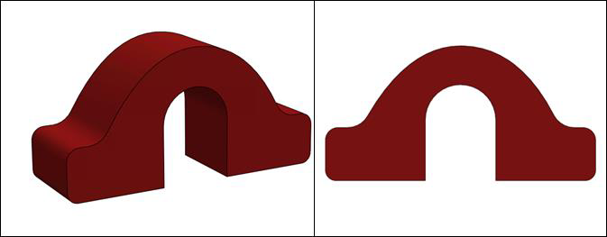
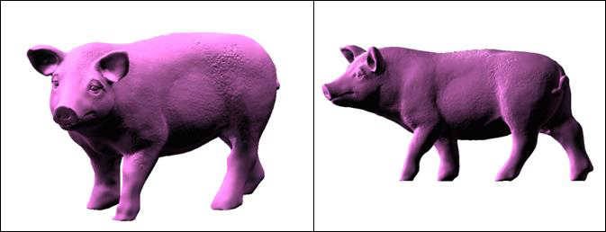

# 基于 AI 的赛道元素检测与识别实验 3——坡道与减速区检测

## 目录

- [1.实验描述](#1.实验描述)
- [2.实验目标](#2.实验目标)
- [3.实验步骤](#3.实验步骤)
  - [步骤 1：了解坡道与减速区标志及行驶要求](#步骤1：了解坡道与减速区标志及行驶要求)
  - [步骤 2：将智能汽车与 PC 电脑相连接](#步骤2：将智能汽车与PC电脑相连接)
  - [步骤 3：打开 Visual Studio Code 学习部分源码逻辑](#步骤3：打开VisualStudioCode学习部分源码逻辑)
  - [步骤 4：AI 识别代码逻辑](#步骤4：AI识别代码逻辑)
  - [步骤 5：运行代码文件，查看可视化结果](#步骤5：运行代码文件，查看可视化结果)
  - [步骤 6：补全代码，修改优化](#步骤6：补全代码，修改优化)

——坡道与减速区检测
## 1.实验描述

通过之前的理论与实践的讲解，我们已经了解并掌握了基本赛道识别方法、
环岛类型赛道的识别方法、十字路口的识别方法、车库出入库情况下的识别方法
等等。但是在有些场景中，必须要结合使用 AI 方法才能完成识别任务，比如赛
道上各种标志元素的识别。在智能汽车竞赛中，合计有 8 种赛道标志可以通过
AI 方法进行检测和识别，分别是锥桶标志、斑马线、拱桥、车辆维护标志、农
田标志、减速标志、动物出没和粮仓标志。
本次课程我们尝试通过源码编程完成对坡道和减速区这两种代表性标志的
AI 识别任务。其中，图像来源既可以通过智能汽车的摄像头对赛道场景的三维
实物进行实时采集，也可以读取本地的“MP4”视频对赛道标志进行图像处理、
识别等操作。本次我们选取读取视频的方式完成任务。
## 2.实验目标

（1）理解赛道标志的深度学习检测与识别方法、程序及相关技术；
（2）通过源码调试、编程，完成智能汽车对坡道的识别与通行任务；
（3）通过源码调试、编程，完成智能汽车对减速区的识别与通行任务；
（4）参考教材内容及源码文件，完成本实验的部分代码补全任务。
157

---

基于 AI 的赛道元素检测与识别 3-坡道与减速区检测
## 3.实验步骤

### 步骤 1：了解坡道与减速区标志及行驶要求

（1）坡道
智能汽车竞赛场地中设置有坡道，需要谨慎行驶，如图所示，坡道前路旁摆
放实体坡道标志，车辆识别标志便于提前预知坡道，从而自主判断形势并开展路
径规划，比如需要控速先加速后降速再通过。
图 13-1 坡道区域
图 13-2 坡道标志
（2）减速区
车辆通过动物出没路段，区域内设置减速带，需要减速慢行以减小颠簸对于
车身姿态和传感器的影响。如图所示，车辆需识别减速带前路旁的动物出没实体
标志——桃红色猪，自主判断形势进行降速等控制。
158

---

基于 AI 的赛道元素检测与识别 3-坡道与减速区检测
图 13-3 减速区
图 13-4 减速标志
### 步骤 2：将智能汽车与 PC 电脑相连接

第一步，插入网线，将智能汽车通过网线与 PC 相连。PC 电脑需要参照实
训一步骤设置好静态 IP 地址，并完成网络映射相关设置。
第二步，打开 MobaXterm，建立 SSH 远程连接，将本地 PC 与智能汽车
Edgeboard 板卡建立远程连接，进而可通过命令行的方式对智能汽车的源码进行
启动等操作。
通过 MobaXterm，我们可以在电脑上看到智能汽车 Edgeboard 板卡上所展示
的界面内容。
### 步骤 3：打开 Visual Studio Code 学习部分源码逻辑

在前面的环境准备阶段，我们已经安装了 Visual Studio Code，本次坡道与减
速区的 AI 检测任务需要结合 EdgeBoard 嵌入式 AI 计算卡与本地计算机完成。
159

---

基于 AI 的赛道元素检测与识别 3-坡道与减速区检测
在上述步骤 3 基础上进行如下操作：
第 一 步 ， 把 部 署 在 EdgeBoard 嵌 入 式 AI 计 算 卡 中 的
intelligentcar_T710_python_v2 工程通过 Visual Studio Code 可视化界面打开。
第二步，准备视频。在该工程下，进入 res\samples 文件夹内，存放 AI 检测
使用的 MP4 视频。如果我们采用读取本地视频的方式进行本次实验，通过修改
代码中的读取视频源的方式从而读取本地的 MP4 视频。
第三步，准备源码文件。
在本实验中，通过路径 src\python 找到所提供的“bridge_detection.py”坡道
检测和“slowzone_detection.py”减速区检测实验的部分源码。
完成以上步骤后，该工程文件的文件结构如下图所示。
图 13-5 工程文件结构
160

---

基于 AI 的赛道元素检测与识别 3-坡道与减速区检测
### 步骤 4：AI 识别代码逻辑

AI 识别的源码编程主要分为如下几步：引入函数库、类的转换、确认视频
的输入源是来自本地 MP4 视频还是摄像头、功能类的初始化、图片处理包括图
像校正、灰度图转换、二值化转换、赛道识别，启动 AI 推理以及对坡道区和减
速区标志检测的 AI 识别，其中 AI 识别部分包含赛道标志检测与对应的路径规
划。
坡道区与减速区 AI 检测时，由于代码多处重叠此处不重复赘述，只有在赛
道标志检测与路径规划部分不同时再进行分别讲解。
(1) 引入函数库
引入 Python OpenCV 的函数库、智能汽车 intelligentCar_v2 函数库以及一些
其他的在程序中使用到的函数库。
import base64
import cv2
import numpy as np
import sys
sys.path.append("../lib") # 引用 C++库
import intelligentCar_v2
(2) 类的转换
将 C++的 Mat 类转换到到 Python,numpy 类中进行解码。
def base64ToMat(base64_data):
img = base64.b64decode(base64_data)
nparr = np.fromstring(img, np.uint8)
img_np = cv2.imdecode(nparr, 1)
img_np = cv2.cvtColor(img_np, cv2.COLOR_BGR2RGB)
return img_np
将 Python,numpy 类转换到 C++，Mat 类中进行编码。
def matToBase64(rgb, img):
if rgb:
img = cv2.cvtColor(img, cv2.COLOR_RGB2BGR) # RGB 转 BGR
x = cv2.imencode(".jpg", img)[1].tobytes()
base64_data = base64.b64encode(x)
return base64_data
161

---

基于 AI 的赛道元素检测与识别 3-坡道与减速区检测
(3) 确认输入源
根据自身情况调整输入源的输入方法，并检测视频是否接受，为防止死循环
加入 exit()方法。可切换选择本地视频或者选择摄像头的方式，同时设置分辨率
为 320×240，这里我们选择本地视频输入的方式。
capture = cv2.VideoCapture("../../res/samples/bridge.mp4") # 选择本地视
频
capture.set(cv2.CAP_PROP_FRAME_WIDTH, 320) # 设置视频分辨率
capture.set(cv2.CAP_PROP_FRAME_HEIGHT, 240)
# 检测视频是否接收到,加入 exit()防止死循环
if not capture.isOpened():
print("Cannot open camera")
exit()
rate = int(capture.get(cv2.CAP_PROP_FPS))
width = int(capture.get(cv2.CAP_PROP_FRAME_WIDTH))
height = int(capture.get(cv2.CAP_PROP_FRAME_HEIGHT))
print("Camera Param: frame rate = ", rate,
" width = ", width, " height = ", height)
(4) 初始化功能类
第一步，初始化智能汽车类，便于后续调用赛道处理、赛道识别的一些函数
功能；
第二步，相机校正参数初始化，保证后续在进行图像识别时照片的准确性；
第三步，AI 模型初始化，智能汽车在赛道行驶时，遇到赛道标志时，只能
通过 AI 识别的方式去完成赛道任务，通过初始化该模型，我们就可以调用其中
的函数功能去解决不同区域的赛道标志识别。
# 初始化智能汽车类
icar = intelligentCar_v2.IntelligentCar()
# 相机矫正参数初始化
icar.imageCorrecteInit()
# AI 模型初始化
icar.paddleModelInit()
(5) 对每一帧图像进行处理
第一步，读取视频帧。无论是通过读取本地 MP4 视频的方式，还是实时赛
道采集的方式，在进行图像识别时都需要对每一帧的图像进行操作，进而从连续
162

---

基于 AI 的赛道元素检测与识别 3-坡道与减速区检测
帧的图像中分析得出结果。
while True:
# 读取视频帧
isTrue, imageFrame = capture.read()
if isTrue:
cv2.waitKey(1)
else:
print("视频播放完毕")
break
第二步，图像校正。对智能汽车实车采集的图像进行校正。
base64Frame = matToBase64(False, imageFrame)
base64Corret = icar.imageCorrection(base64Frame)
imageCorret = base64ToMat(base64Corret)
第三步，灰度图转换。对赛道 RGB 彩色图像进行灰度转换，方便后续图像
处理。
# RGB 图像转换成灰度图像
imageGray = cv2.cvtColor(imageCorret, cv2.COLOR_BGR2GRAY)
第四步，图像二值化，将图像转换为二值化黑白图像。
# 图像二值化
rel, imageBinary = cv2.threshold(imageGray, 0, 255, cv2.THRESH_OTSU)
第五步，赛道识别，识别一般赛道区域的行驶范围，供智能汽车行驶。
# 赛道识别
base64Binary = matToBase64(False, imageBinary)
icar.trackRecognition(base64Binary)
icar.trackDrawImage(base64Corret) # 可视化显示识别结果
(6) 赛道标志的 AI 识别
启动 AI 推理，调用 AI 模型去完成坡道和减速区这两个区域的赛道标志检
测与路径规划。
①启动 AI 推理
# 启动 AI 推理
icar.AiDetection(base64Frame)
②坡道（桥）检测与路径规划（bridge_detection.py）
通过已经实例化的 icar 智能汽车类，调用 bridgeDetection()函数，完成坡道
区赛道的检测与路径规划。
# 坡道（桥）检测与路径规划
icar.bridgeDetection()
163

---

基于 AI 的赛道元素检测与识别 3-坡道与减速区检测
base64Bridge = matToBase64(True, imageCorret)
icar.bridgeDrawImage(base64Bridge) # 可视化显示识别结果
识别坡道标志的底层代码逻辑阐述如下；
在该路段，智能汽车首先会遇到“坡道标志”，当检测识别出此标志时，智
能汽车会切换行驶模式，从正常的赛道行驶模式切换为“坡道使能”模式。
为防止智能汽车上坡道的过程中摄像头抬起，错误识别远方赛道引发转向，
我们将识别到的赛道图像切掉上面一半，使智能汽车保持直行。并且控制智能汽
车加速行驶，防止坡道角度过大不能驶过的情况。
然后通过计时的方法，当智能汽车大概驶过坡道最高点后，使“坡道使能”
失效，将速度降低到正常行驶速度，防止速度太快会冲出赛道。
图 13-6 坡道检测与路径规划流程图
164

---

基于 AI 的赛道元素检测与识别 3-坡道与减速区检测
③减速区检测与路径规划（slowzone_detection.py）
通过已经实例化的 icar 智能汽车类，调用 slowzoneDetection()函数，完成减
速区赛道的检测与路径规划。
# 减速区检测与路径规划
icar.slowzoneDetection()
icar.slowzoneDrawImage(base64Corret)
base64Slowzone = matToBase64(True, imageCorret)
icar.slowzoneDrawImage(base64Slowzone) # 可视化显示识别结果
识别减速区域标志的底层代码逻辑阐述如下；
在该路段，智能汽车首先会遇到“减速标志”，这里需要同时检测减速带标
志和路边的“猪”标志，当检测出二者任何一个标志时，智能汽车会切换行驶模
式，从正常的赛道行驶模式切换为“减速使能”模式，控制智能汽车减速慢行。
通过计时的方式，当智能汽车通过减速带时，“减速使能”失效，使速度提升到
正常行驶速度。
图 13-7 减速区检测与路径规划流程图
165

---

基于 AI 的赛道元素检测与识别 3-坡道与减速区检测
### 步骤 5：运行代码文件，查看可视化结果

坡 道 检 测 实 训 所 用 脚 本 文 件 为 bridge_detection.py ， 可 使 用 “ cd
workspace/intelligentcar_T710_python_v2/src/python/”命令按回车键进入切换目录。
图 13-8 切换目录
输入 python3 bridge_detection.py 运行坡道识别程序(注意空格)，运行后即可
在弹出的窗口查看可视化结果（如需退出只需在终端界面按 Ctrl+c 即可）。
图 13-9 运行代码文件
图 13-10 坡道标志识别效果
输入 python3 slowzone_detection.py 运行减速区识别程序(注意空格)，运行后
即可在弹出的窗口查看减速区检测结果。
166

---

基于 AI 的赛道元素检测与识别 3-坡道与减速区检测
图 13-11 运行代码文件
图 13-12 减速区的标志识别效果
### 步骤 6：补全代码，修改优化

打开本实验项目的实践代码，对缺失代码的文件进行代码填充操作，进一步
掌握本工程代码实现方法。
图 13-13 坡道检测代码补全文件
图 13-14 减速区域检测代码补全文件
将填充完毕的代码文件尝试替换智能汽车源文件中的对应文件，运行程序，
观察可视化运行结果，验证代码填充是否正确。为防止代码错误或丢失，务必将
167

---

基于 AI 的赛道元素检测与识别 3-坡道与减速区检测
源文件提前备份。
168

---