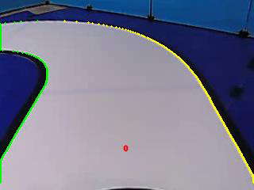
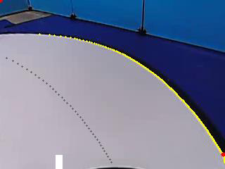
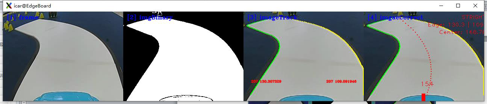
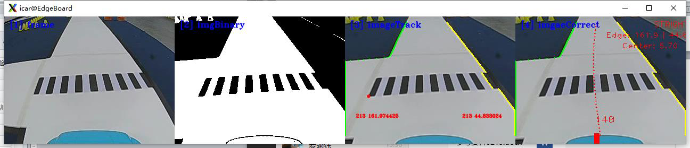

# 智能汽车控制与决策实验指导

## 目录

- [1.实验描述](#1.实验描述)
- [2.实验目标](#2.实验目标)
- [3.实验步骤](#3.实验步骤)
  - [步骤 1：将智能汽车与 PC 电脑相连接](#步骤1：将智能汽车与PC电脑相连接)
  - [步骤 2：打开 Visual Studio Code 学习部分源码逻辑](#步骤2：打开VisualStudioCode学习部分源码逻辑)
  - [步骤 3：智能汽车控制与决策](#步骤3：智能汽车控制与决策)
  - [步骤 4：运行代码文件，查看结果](#步骤4：运行代码文件，查看结果)
  - [步骤 5：补全代码，修改优化](#步骤5：补全代码，修改优化)

## 1.实验描述

通过前面 5 个模块的理论学习与实践操作，我们已经了解了智能汽车的硬件
控制架构，掌握了赛道图像的预处理技术，会进行环岛、十字路口等各种类型赛
道的识别，并能运用人工智能方法通过模型训练识别赛道上的农田区、减速区等
各种标志。在识别出车道线、车道标志、可行驶区域等内容后，智能汽车需要采
取相应的控制策略才能实现智能行驶。
本实验结合赛道识别及赛道标志识别结果为智能汽车规划行驶路线，并且通
过运动控制器对智能汽车进行 PD 姿态控制与速度控制。实践采用读取本地“MP4”
视频的方式，完成智能汽车行驶路径规划、控制与决策。
## 2.实验目标

（1）通过智能汽车运动控制的显示结果，理解智能汽车控制中心计算原理
与方法；
（2）进一步理解运动控制器的原理与使用方法；
（3）掌握智能汽车 PD 姿态控制与速度控制技术；
（4）参考教材内容及源码文件，完成本实验的部分代码补全任务。
## 3.实验步骤

### 步骤 1：将智能汽车与 PC 电脑相连接

第一步，插入网线，将智能汽车通过网线与 PC 相连。PC 电脑需要参照实
训一步骤设置好静态 IP 地址，并完成网络映射相关设置。
第二步，打开 MobaXterm，建立 SSH 远程连接，将本地 PC 与智能汽车
Edgeboard 板卡建立远程连接，进而可通过命令行的方式对智能汽车的源码进行
启动等操作。
169

---

智能汽车控制与决策
通过 MobaXterm，我们可以在电脑上看到智能汽车 Edgeboard 板卡上所展示
的界面内容。
### 步骤 2：打开 Visual Studio Code 学习部分源码逻辑

在前面的环境准备阶段，我们已经安装了 Visual Studio Code，本次车辆控制
任务需要结合 EdgeBoard 嵌入式 AI 计算卡与本地计算机完成。
在上述步骤 1 基础上进行如下操作：
第 一 步 ， 把 部 署 在 EdgeBoard 嵌 入 式 AI 计 算 卡 中 的
intelligentcar_T710_python_v2 工程通过 Visual Studio Code 可视化界面打开。
第二步，准备视频。在该工程下，进入 res/samples/文件夹，存放本实验使
用的 MP4 视频，如果我们采用读取本地视频的方式进行智能汽车控制，通过修
改代码中的读取视频源的方式读取 MP4 视频。本实验使用的 MP4 视频如下图：
图 14-1 视频存放位置
170

---

智能汽车控制与决策
第三步，准备控制与决策的源码文件。
在本实验中，通过路径 “src/python/motion_controller.py”找到本实验提供
的部分源码。
图 14-2 工程文件结构
### 步骤 3：智能汽车控制与决策

（1）引入函数库（src/python/motion_controller.py）
引入 Python OpenCV 的函数库、智能汽车 intelligentCar_v2 函数库以及一些
其他的在程序中使用到的函数库。
import base64
import cv2
import numpy as np
import sys
171

---

智能汽车控制与决策
sys.path.append("../lib") # 引用 C++库
import intelligentCar_v2
（2）确认输入源（src/python/motion_controller.py）
根据自身情况调整输入源的输入方法，可切换选择本地视频或者选择摄像头
的方式，同时设置分辨率为 320×240，这里我们选择本地输入视频的方式。
capture = cv2.VideoCapture("../../res/samples/demo.mp4") # 选择本地视频
capture.set(cv2.CAP_PROP_FRAME_WIDTH, 320) # 设置视频分辨率
capture.set(cv2.CAP_PROP_FRAME_HEIGHT, 240)
（3）实例对象初始化（src/python/motion_controller.py）
第一步，初始化智能汽车类，便于后续调用一些赛道处理的函数；
第二步，相机校正参数初始化，保证后续在进行图像识别时照片的准确性；
第三步，运动控制器初始化，保证智能汽车会根据识别效果对智能汽车进行
运动控制。
# 初始化智能汽车类
icar = intelligentCar_sou.IntelligentCar()
# 相机矫正参数初始化
icar.imageCorrecteInit()
# 运动控制器初始化
icar.motionInit()
（4）图片存储和读取（src/python/motion_controller.py）
定义函数，用于图片存储和读取，设置图片格式，保存路径以及 cv 读取图
片方式（读取名称和路径，设置分辨率）
def savPicture(img):
name = ".png"
global counter
counter += 1
img_path = "../res/samples/train/"
name = img_path + counter + ".png"
cv2.imwrite(name, img)
capture = cv2.VideoCapture("../../res/samples/demo.mp4") # 选择本地视频
capture.set(cv2.CAP_PROP_FRAME_WIDTH, 320) # 设置视频分辨率
capture.set(cv2.CAP_PROP_FRAME_HEIGHT, 240)
172

---

智能汽车控制与决策
（5）智能汽车运动控制（src/python/motion_controller.py）
第一步，读取视频的每一帧；
第二步，对这一帧的 RGB 彩色图像进行图像校正；
第三步，把 RGB 彩色图像转换成为灰度图；
第四步，把灰度图像转换成二值化图像；
第五步，根据传入的二值化图像完成赛道识别功能，并且可视化显示识别结
果；
第六步，基于前几个步骤处理的结果，完成智能汽车运动控制
while True:
# 读取视频帧
isTrue, imageFrame = capture.read()
cv2.imshow("imageFrame", imageFrame)
# 图像矫正
base64Frame = matToBase64(False, imageFrame)
base64Corret = icar.imageCorrection(base64Frame)
imageCorret = base64ToMat(base64Corret)
# RGB 图像转换成灰度图像
imageGray = cv2.cvtColor(imageCorret, cv2.COLOR_BGR2GRAY)
# 图像二值化
rel, imageBinary = cv2.threshold(imageGray, 0, 255, cv2.THRESH_OTSU)
cv2.imshow("imageBinary", imageBinary)
# 赛道识别
base64Binary = matToBase64(False, imageBinary)
icar.trackRecognition(base64Binary)
icar.trackDrawImage(base64Corret) # 可视化显示识别结果
# 智能汽车运动控制
icar.motionControl()
base64Motion = matToBase64(True, imageCorret)
icar.motionDrawImage(base64Motion) # 可视化显示识别结果
### 步骤 4：运行代码文件，查看结果

本 实 验 所 需 运 行 代 码 为 motion_controller.py 。 可 使 用 “ cd
173

---

智能汽车控制与决策
workspace/intelligentcar_T710_python_v2/src/python/”命令按回车键进入切换目录。
在输入 python3 motion_controller 命令运行代码文件，运行成功命令行如下图：
图 14-3 运行代码
路径规划的结果中有一个白色的矩形方块，这个方块沿着中心线偏左，表明
此时智能汽车正在向左转弯；如果这个方块沿着中心线偏右，表明此时智能汽车
正在向右转弯；如果两者重合，表明智能汽车正在直行。
左移或者右移的幅度表明左转弯或者右转弯的大小。
（a）赛道识别结果 （b）赛道路径规划的结果
图 14-4 即将进入左转弯路口
174

---

智能汽车控制与决策
（a）赛道识别结果 （b）赛道路径规划的结果
图 14-5 驶入左转弯道
（a）赛道识别结果 （b）赛道路径规划的结果
图 14-6 直行
图 14-7 Demo 代码运行实现效果 01
图 14-8 Demo 代码运行实现效果 02
175

---

智能汽车控制与决策
### 步骤 5：补全代码，修改优化

打开本实验项目的实践代码，对缺失代码的文件进行代码填充操作，进一步
掌握本工程代码实现方法。
图 14-9 代码文件
将填充完毕的代码文件尝试替换智能汽车源文件中的对应文件，运行程序，
观察可视化运行结果，验证代码填充是否正确。为防止代码错误或丢失，务必将
源文件提前备份。
此实训代码功能可供实车运行，将相关代码调试好后即可操控智能汽车在不
同环境下的标准场地中实际运行。需要注意的是，此前各个实训的非 AI 部分相
关功能，比如赛道识别、环岛识别、十字路口识别等，均可通过 motion_controller
进行实车运行测试。
176

---