# 《智能汽车实训》实验指导（python版）-V3.1-20240220

## Page 1

I10

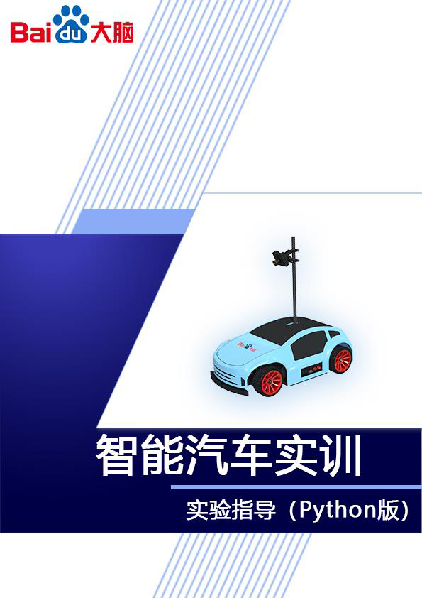

---

## Page 2

目 录
一、智能汽车配置实验指导............................................1
二、智能汽车图像感知实验指导.......................................32
三、图像采集实验指导...............................................38
四、相机标定与图像校正实验指导.....................................48
五、赛道图像的透视变换实验指导.....................................61
六、赛道图像预处理实验指导.........................................68
七、赛道元素识别模型训练实验指导...................................75
八、赛道与环岛识别实验指导........................................100
九、十字路口与车库识别实验指导....................................108
十、智能汽车 AI 模型部署实验指导...................................117
十一、基于 AI 的赛道元素检测与识别实验 1——农田检测 ...............135
十二、基于 AI 的赛道元素检测与识别实验 2——粮仓与维护区检测 .......144
十三、基于 AI 的赛道元素检测与识别实验 3——坡道与减速区检测 .......157
十四、智能汽车控制与决策实验指导..................................169
I

---

## Page 3

智能汽车配置
一、智能汽车配置实验指导
1.实验描述
智能汽车课程包含人工智能、无人驾驶、图像处理与运动控制等相关内容的
教学，理论+实践共 48 课时，所有实践均基于智能汽车实训平台及百度飞桨平台
进 行。课 程 支 持 C++/Python 两 种 语 言 编 程 ， 基 于 实 训 平 台 及 百 度 飞 桨
（PaddlePaddle）AI 框架和 OpenCV 图像处理技术，可实现在线 AI 模型训练、
移动端部署、赛道识别与交通标志检测，车辆控制以及巡线导航等功能。
本实验为智能汽车实训课程的第一次实验，本次课我们将对智能汽车、赛道
场地、基本参数有一个实际的接触和了解，同时完成对智能汽车实训平台的环境
部署，包括软件部署与硬件部署，然后学习了解智能汽车源码程序，掌握软硬件
结合的基本操作方法，为后续实验开展奠定良好的基础。
2.实验目标
（1）了解智能汽车产品清单，熟悉智能汽车硬件架构；
（2）熟悉智能汽车赛道场地，包括赛道尺寸、不同赛道类型等；
（3）了解智能汽车基本参数；
（4）安装开发软件，进行实训平台的软件部署，包括安装编译工具及可视
化工具、电脑静态 IP 设置、建立网络映射、建立 SSH 远程连接等；
（5）学习搭建赛道场地与智能汽车，完成硬件环境部署，掌握车检方法；
（6）熟悉智能汽车工程源码文件，并进行程序试运行。
3.实验步骤
步骤 1：了解智能汽车产品清单
熟悉智能汽车实训箱内物品，了解智能汽车产品清单如下（仅列出部分，详
细可看使用说明书的产品清单）：
1

---

## Page 4

智能汽车配置
表 1-1 产品清单
名称 数量 备注
智能汽车 *1
手柄遥控器 *1
USB 无线网卡 *1
资料 U 盘 *1
网线 *1
Type-C 充电线 *1
电源适配器 *1
步骤 2：认识智能汽车硬件架构
（1）认识智能汽车主体架构
第一步，认识智能汽车，智能汽车由摄像头、碳纤杆、壳体、侧面接口与轮
子等组成。
图 1-1 智能汽车
① 摄像头 ② 碳纤杆 ③ 壳体
④ 接口 ⑤ 轮子
2

---

## Page 5

智能汽车配置
第二步，认识智能汽车侧面。侧面分右侧与左侧，有电源开关、type-c、按
钮、USB、电源接口、网口以及轮子等部位。
图 1-2 智能汽车左侧 图 1-3 智能汽车右侧
①电源开关，控制电源开与关 ②Type-c 接口，调试使用
③复位按钮 ④模式按钮，两种模式切换
⑤两个 USB 2.0 接口 ⑥网口，RJ45 接口
⑦电源/充电接口 ⑧四个轮子
⑨摄像头，640*480 30 万像素
第三步，认识智能汽车内部。内部亦分右侧与左侧，有舵机、MCB 板、MDB
板、EdgeBoard 计算卡（T710 开发板）、电机等部件。
图 1-4 智能汽车内部
3

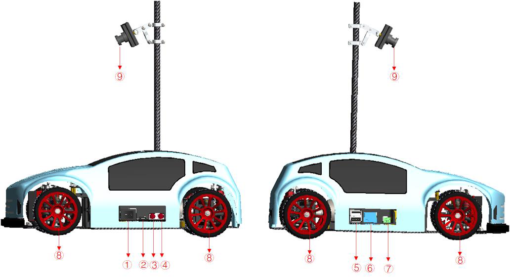

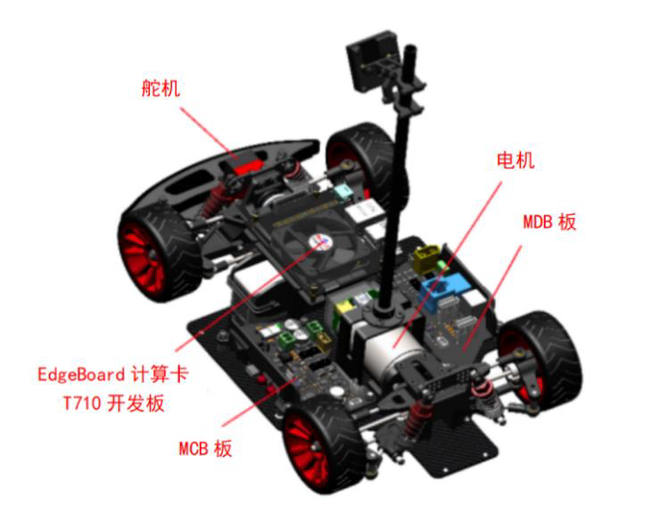

---

## Page 6

智能汽车配置
（4）速度设置
可调节智能汽车的速度，并显示实测速度。
图 1-5 速度设置
速控模式有“闭环 PID 控制”与“开环控制”两个选项。车检时，不同模式下的车速需
要注意，开环情况下可以从 10 开始，闭环情况下可以从 0.1 开始。
图 1-6 速控模式
（5）固件升级
点击“固件升级”按钮升级智能汽车固件。
图 1-7 固件升级
（6）电池状态
4

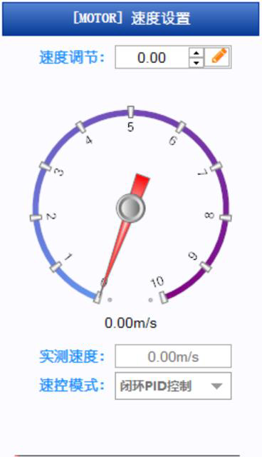

---

## Page 7

智能汽车配置
显示当前智能汽车电池电量与电压。
图 1-8 电池状态
（2）了解赛道场地
本智能汽车适用完全模型组赛道。赛道场地为室内循环赛道，并在此基础上
增加任务元素，即赛道由基础赛道、赛道标志、任务锥桶三个部分组成。其中基
础赛道是由 PVC 切割而成的赛道元素、斜坡和黑白胶带共同组成。
如下图示，该赛道包含了室内循环赛道的大部分基础元素，如直线赛道、曲
线弯道、交叉路口、坡道、环岛、三岔路口、车库等元素。根据不同赛事主题，
其各元素均有差别，故赛道视具体主题及赛事要求而定。
图 1-9 赛道场地示例
（3）基本参数
基础参数包含智能汽车基本参数与赛道场地基本参数。
5

---

## Page 8

智能汽车配置
表 1-2 基本参数
类别 名称 参数
尺寸 316*190*310mm
系统环境 Linux 系统
控制主板 EdgeBoard 计算卡（T710 开发板）
控制单元 GD32 系列单片机
转向方式 舵机控制阿克曼转向
最小转弯半径 25cm
动力布局 单电机后驱
电机 直流高速电机，额定电压 12V，空载转速 12000rpm
智能汽车基础参数
舵机 高精度数字舵机 0.14Sec/60°
最大速度 10m/s
电池 3S 25C 锂电池，标称 11.1V ，容量 2200mAh
640*480 分辨率
摄像头
30 万像素摄像头
轮胎 橡胶轮胎
车壳 工程塑料
通信方式 支持 Ethernet、USB、UART、CAN、RS485
材质 PVC
赛道场地 尺寸 7.5m*5.5m 与 7.5m*8m 两种规格
基本参数 坡道 木质 150cm*60cm*14cm
路肩 厚度 2cm；宽度 2.5cm；长度 25cm
6

---

## Page 9

智能汽车配置
锥桶 直径 74mm；高度 74mm；
标定板 21cm*29.7cm
实体标志 若干（见下表）
为了引导比赛任务的完成，在比赛赛道的任务元素和特殊元素区域的前方路
旁的指定区域放有三维模型实体标志。以车辆行驶的方向看去，实体标志的角度
与正面图中角度相当，摆放偏差不超过±45 度。实体标志的样式和含义如下表
所示：
表 1-3 实体标志功能指标
序号 名称 说明 图示
功能描述：表示前方车辆维护站，需要
车辆 在指定范围内停车片刻。
1 维护区
模型尺寸：154.5×92×109mm
标志
颜色：大红色红、黑色
功能描述：表示前方农田，非常规道路，
需要依据锥桶围出的场地行驶。
农田2
模型尺寸：120×120×170mm
标志 颜色：中黄色、葱绿色
动物出 功能描述：表示前方动物出没，减速慢
没（减 行。
3
速 标 模型尺寸：144×55×72mm
志） 颜色：桃红色
功能描述：表示道路前方有坡道。
坡道 模型尺寸：138.5×44×69mm
4
标志 颜色：大红色
功能描述：表示前方为粮仓，车辆需要
驶入粮仓并按照指定的出口驶出，模拟定点
粮仓
5 卸货
标志
模型尺寸：109×109×80mm
颜色：中黄色
脱离基础赛道的任务区域由可以移动的
任务 锥桶在基础赛道的边缘临时搭建而成。
6
锥桶 模型尺寸：直径 75mm，高度 75mm
颜色：黄色纯色
7

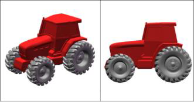

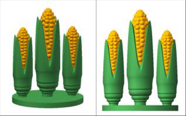

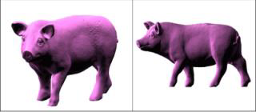

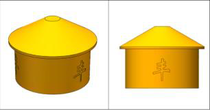

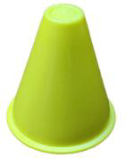

---

## Page 10

智能汽车配置
步骤 3：实训平台软件部署
（1）Visual Studio Code 编译工具安装
首先要安装编译工具 Visual Studio Code，后续程序查看与代码修改主要基于
该软件进行。
第一步，打开“智能汽车安装支持包”->“Visual Studio Code 安装包”。
图 1-11 智能汽车安装支持包 图 1-12 Visual Studio Code 安装包
第二步，双击 VSCodeUserSetup-x64-1.67.2 进行安装，默认安装即可，可更
改路径。安装完成后重启计算机。
图 1-13 Visual Studio Code 安装文件
（2）MobaXterm 远程终端安装
智能汽车远程终端可视化操作需要基于 MobaXterm 软件进行。
第一步，打开“智能汽车安装支持包”->“MobaXterm_Installer_v23.0.zip”安装
压缩包。
图 1-14 MobaXterm 安装压缩包
8

---

## Page 11

智能汽车配置
第二步，双击 MobaXterm_installer_23.0.msi 安装，默认安装即可，可更改路
径。
图 1-15 MobaXterm 安装文件
图 1-16 可改安装路径
图 1-17 安装完成
9

---

## Page 12

智能汽车配置
（3）智能汽车车检助手安装
第一步，打开“智能汽车安装支持包”->“智能汽车车检助手安装包”。
图 1-18 智能汽车车检助手安装包
第二步，双击智能汽车车检助手.exe 进行安装，默认安装即可，可更改路径。
安装完成后重启计算机。
图 1-19 智能汽车车检助手安装文件
步骤 4：智能汽车硬件部署
硬件部署内容包含场地部署搭建与智能汽车部署。其中，课程教学所用的场
地搭建可参照智能汽车使用说明书的步骤进行操作完成，班级共用 1——2 个智
能汽车赛道场地即可。此处重点介绍智能汽车的硬件部署方法。
第一步，从智能汽车实训箱中取出智能汽车，同时熟悉实训箱内配件；
第二步，用适配器对智能汽车充电，同时打开智能汽车开关，红灯亮起。这
样后续可以边充电边进行学习操作，以免后续操作出现电量不足的情况；
第三步，将智能汽车通过实训箱内配置的网线连接笔记本相应接口，即可基
于 MobaXterm 软件对汽车进行可视化操作及结果查看。
10

---

## Page 13

智能汽车配置
图 1-20 网路连接
图 1-21 连接智能汽车
需要实际在场地运行时，可参考以下步骤：
第一步，将智能汽车放在赛道斑马线上。
第二步，可通过实训箱内提供的遥控器采集赛道图像。遥控手柄上各按键对
应的功能如下图示，可分别对行驶方向、行驶速度进行调整，对图像采集方式进
行相关控制：
图 1-22 遥控器
11

---

## Page 14

智能汽车配置
步骤 5：智能汽车车辆自检
智能汽车车检助手主要用于检测智能汽车相关硬件，打开软件后默认会出现
首页，方向设置、串口连接、速度设置、固件升级与智能汽车自检模块。
注：自检过程中，请将智能汽车悬空放置，避免自检过程损伤车辆！
图 1-23 首页
（1）串口连接
首先连接串口，通过 USB-typeC 线缆连接电脑与智能汽车后，打开车检助
手以及智能汽车的电源，车检助手会自动连接汽车，连接按钮一直转圈，表示连
接成功。
图 1-24 串口连接
（2）方向设置
可调节轮子方向，并可以设置左转阈值、舵机中值与右转阈值。
12

---

## Page 15

智能汽车配置
图 1-25 方向设置
（3）智能汽车自检
点击“SelfCheck/智能汽车自检”按钮，自检电机+编码器、舵机、USB+UART、
蜂鸣器+灯、按钮等硬件。
图 1-26 自检 图 1-27 正在自检
13

---

## Page 16

智能汽车配置
在自检过程中会信息交互，请确认“正常”与“故障”。
图 1-28 信息交互
自检结束后，障碍会红色显示，绿色显示正常。
图 1-29 自检结果
14

---

## Page 17

智能汽车配置
步骤 6：为本地电脑配置静态 IP
需要为电脑配置静态 IP 才能进行后续操作。
（1）硬件连接
使用网线将智能汽车 RJ45 接口的网口与电脑本身网口连接。智能汽车同时
充电，以免电量不足影响后续操作。
（2）PC 端修改静态 IP
以 WIN10 系统为例，其它系统具体操作略有不同、
首先，Windows 电脑通过网线与智能汽车连接，并打开车辆电源开关，确保
车辆正常待机。
Windows 电脑打开“控制面板”，选择“网络和 Internet”选项：
图 1-30 控制面板
选择点击“网络和共享中心”：
15

---

## Page 18

智能汽车配置
图 1-31 网络和共享中心
接下来，点击“更改适配器设置”选项：
图 1-32 更改适配器设置
右键修改目标以太网口（与智能车连接）的网络属性：
图 1-33 更改以太网属性
16

---

## Page 19

智能汽车配置
鼠标左键选中“Internet 协议版本 4（TCP/IPv4）”，并点击“属性”选
项：
图 1-34 IPv4 属性
按照下图参数配置静态 IP：
图 1-35 修改以太网静态 IP
17

---

## Page 20

智能汽车配置
（3）注意事项
⚫ 牢记此时设置的静态 IP 地址，后续需要以此 IP 作为 PC 默认 IP 通过
MobaXterm 对智能车操作编辑。子网掩码与默认网关可以默认，不修改。
⚫ 如若需要使用修改过的网络端口连接其他网络，例如需要接入互联网，
则需要再按以上步骤，将模式修改为之前的自动获得 IP 地址即可。但重新连接
智能车时需重复上述步骤。
⚫ 由于修改完静态 IP 属性，以太网无法正常启动网络访问服务，故用户需
根据实际需求修改静态/动态 IP。
步骤 7：建立网络映射
打开“我的电脑”，右键空白地方选择添加一个网络配置
图 1-36 网络配置
点 击 下 一 页 后 ， 双 击 选 择 自 定 义 网 络 位 置 ， 在 地 址 栏 中 输 入
\\192.168.1.254\root”后选择进入下一页。这是实训箱内智能汽车的默认 IP 地址。
18

---

## Page 21

智能汽车配置
图 1-37 自定义网络位置
在弹出页面可自行设置网络名称(默认亦可)，设置完成后进入下一页。
图 1-38 设置网络名称
选中“单机‘完成’时打开这个网络位置”后，点击完成即可进入智能汽车工
程代码文件列表。
19

---

## Page 22

智能汽车配置
图 1-39 打开网络位置
图 1-40 代码文件列表
至此即可在连接网线的情况下，通过网络映射访问打开智能汽车 EdgeBoard
中源代码。（在后续步骤中，可使用 VScode 完成对代码的查看、编辑和修改等
工作）
需要注意的是：
⚫ 填入 Internet 地址时的 IP 192.168.1.254 为智能车默认 IP 地址，不可修改
添加；
⚫ 在第一次点击完成后会弹出登陆界面，只需输入用户名和密码，均为 root。
20

---

## Page 23

智能汽车配置
步骤 8：MobaXterm 远程终端建立 SSH 连接
MobaXterm 是一款强大好用的远程终端登录利器，提供所有重要的远程网
络工具（SSH、X11、RDP、VNC、FTP、MOSH…）和 Unix 命令（bash、ls、
cat、sed、grep、awk、rsync…） ，简单安装即可方便的使用。
图 1-41 MobaXterm 首页
（1） 新建远程会话
打开 MobaXterm 软件，单击左上 session 建立新会话。
图 1-42 新会话
21

---

## Page 24

智能汽车配置
（2） SSH 远程连接
在 session setting 页面中选择 SSH 进入 SSH 创建界面。
通过 SSH 远程连接的方式，可将本地 PC 与智能汽车 Edgeboard 板卡建立远
程连接，从而可以通过命令行的方式对智能汽车的源码进行启动和编译等操作。
其中，工程的源码文件需要通过 make 等方式进行编译后再运行。
其中，SSH 为 Secure Shell 的缩写，是建立在应用层基础上的安全协议，
由 IETF 的网络小组（Network Working Group）所制定，是较为可靠的专为远
程登录会话和其他网络服务提供安全性的协议。利用 SSH 协议可以有效防止远
程管理过程中的信息泄露问题。
第一次实验连接成功后，后续实验中无需重新配置，直接连接即可。
图 1-43 SSH 创建界面
在 remote host 后的文本框中输入智能车的 Ip 地址 192.168.1.254，后面访问
智能汽车用户名：root，点击 OK 即完成 SSH 远程连接。
22

---

## Page 25

智能汽车配置
图 1-44 SSH 远程连接
在弹出的界面中输入密码为 root（Linux 系统下密码输入并不显示），输入
完成按回车键进入系统。
图 1-45 密码输入界面
23

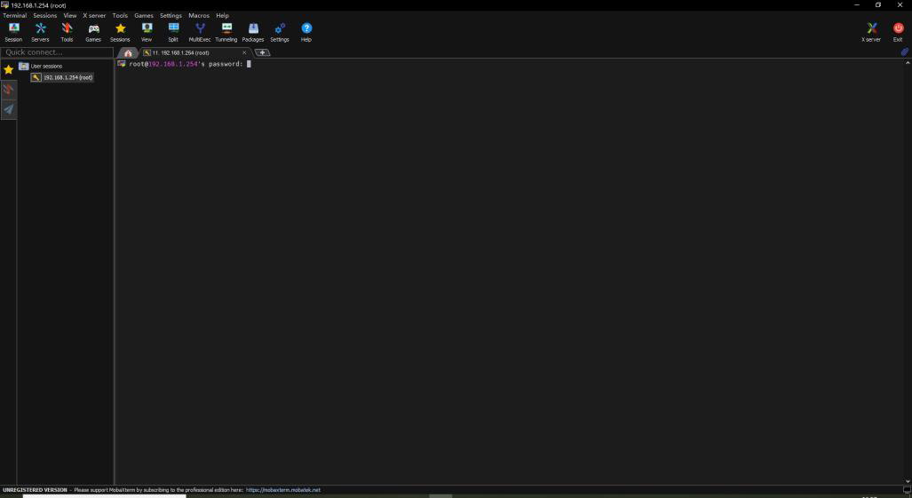

---

## Page 26

智能汽车配置
图 1-46 输入成功，进入工程
弹出的窗口为密码保存，如若需要保存按其指引步骤进行操作即可保存，不
影响后续的使用。
（3） 同步 IP
完成上述操作后，在左侧工程栏中找到.bashrc 文件,双击进入：
24

---

## Page 27

智能汽车配置
图 1-47 Bashrc 文件所在位置
在整体窗口最底部找到 export DISPLAY ，在“=“后面加入之前设置的 PC
静态 IP(如果没有，则在尾部手动输入即可，注意写入格式。)
图 1-48 静态 IP
25

---

## Page 28

智能汽车配置
按 Ctrl+s 或上方工具栏 save files 保存,并在弹出窗口点击 yes to all，返回初
始界面。
图 1-49 初始界面
在右侧输入栏中输入 source ~/.bashrc 后按回车键运行并保存上述操作：
图 1-50 输入
需要注意以下几点：
1. 在 SSH 远程连接时输入的 remote host ip 地址为智能车地址不可变。
2. 双击选择.Bashrc 文件时，若其背景为白色 则
是文件命名，只需点击空白处后再进行其他操作即可。
3. 进入 Bashrc 文件窗口输入的 IP 地址需和步骤 5 中所设置的静态 IP 严格
一致。
步骤 9：程序试运行
在右侧命令行中输入 cd workspace/intelligentcar_T710_python_v2/src/python
后按回车进入子目录(可使用键盘 Tab 键补齐)。确认进入目录后，输入 python3 +
脚 本 文 件 名 称 按 回 车 即 可 运 行 示 例 程 序 。 ( 下 面 以 道 桥 检 测 的 文 件
bridge_detection 为例)：
26

---

## Page 29

智能汽车配置
图 1-51 切换目录
弹出的窗口均点击“是”，即可运行程序并弹出可视化视频窗口查看智能汽
车运行状况。如果未弹出窗口则需要关闭防火墙。
图 1-52 弹出窗口
图 1-53 运行成功
27

---

## Page 30

智能汽车配置
图 1-54 可视化窗口
如需退出工程，只需在命令行按键盘 Ctrl+c 即可。程序运行过程中出现的
可视化窗口无需放大，放大后可能卡顿，如果出现问题可以点击窗口右上方的退
出按钮，窗口会重新开启。
需要结束整体工程退出 MobaXterm，则只需点击主页面右上角的红色退出按
钮。
图 1-55 代码工程页面
步骤 10：代码查看与修改优化
在“此电脑”中打开步骤 6 创建命名的网络映射，找到并进入 root 文件夹。
28

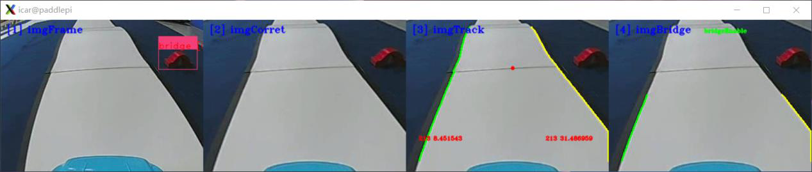

---

## Page 31

智能汽车配置
图 1-56 root 文件夹
进入 root 中 workspace 文件夹后，拖动 intelligentcar_T710_python_v2
文件至 Vscode 编译软件中即可查看和修改源码。
需要注意的是，直接拖动工程文件可能会无权限访问，此时可以先打开
Vscode，然后通过 Open Folder 方式打开：
先打开 Vscode
选择此电脑-网络位置-root-root-workspace-intelligentcar_T710_ python_v2：
29

---

## Page 32

智能汽车配置
接着如下图打勾并选择“允许（Allow）”，继而进行下一步：
打开后的工程文件结构如下图示：
图 1-57 代码工程文件结构
30

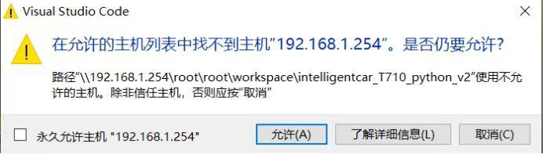

---

## Page 33

智能汽车配置
图 1-58 打开代码界面
步骤 11：其它安全注意事项
1．使用设备时，应注意仪器适用的电压范围，使用原装适配器进行供电；
2．无人看管时，禁止对电池充电；
3．配置过程中，建议将智能汽车悬空放置，避免误操作运行损伤车辆；
4. 运行程序时注意将电脑的防火墙关闭，否则可视化运行界面可能无法呈
现。
31

---

## Page 34

智能汽车图像感知
二、智能汽车图像感知实验指导
1.实验描述
通过智能汽车车辆架构与控制模块的内容学习，我们了解了智能汽车主要应
用高清摄像头进行赛道环境感知，主要通过高清摄像头采集赛道图像进行后续的
图像处理与识别；还熟悉了智能汽车的运动执行部件，了解了电机、舵机等工作
原理及作用，并学习了智能汽车的 edgeboard 板卡是如何与运动控制等系统进行
通信交互的。
那么，接下来我们将围绕摄像头与智能汽车成像的相关知识，进一步学习摄
像头在智能汽车中的安装调试技巧，以及图像感知方面的内容。摄像头在智能汽
车上的位置是否端正、镜头与路面的角度是否合适等因素都会影响图像感知的质
量。
2.实验目标
（1）熟悉智能汽车摄像头安装与成像方式，学习摄像头硬件调试技巧；
（2）掌握智能汽车图像感知编程技能；
（3）参考教材内容及源码文件，完成本实验的部分代码补全任务。
3.实验步骤
步骤 1：将智能汽车与 PC 电脑相连接
第一步，插入网线，将智能汽车通过网线与 PC 相连。PC 电脑需要参照实
训一步骤设置好静态 IP 地址，并完成网络映射相关设置。
第二步，打开 MobaXterm，建立 SSH 远程连接，将本地 PC 与智能汽车
Edgeboard 板卡建立远程连接，进而可通过命令行的方式对智能汽车的源码进行
启动等操作。
通过 MobaXterm，我们可以在电脑上看到智能汽车 Edgeboard 板卡上所展示
32

---

## Page 35

智能汽车图像感知
的界面内容。
步骤 2：打开 Visual Studio Code 学习源码逻辑
在前面的环境准备阶段，我们已经安装了 Visual Studio Code，本次图像感知
任务需要结合 EdgeBoard 嵌入式 AI 计算卡与本地计算机完成。
在上述步骤 1 基础上进行如下操作：
第 一 步 ， 把 部 署 在 EdgeBoard 嵌 入 式 AI 计 算 卡 中 的
intelligentcar_T710_python_v2 工程通过 Visual Studio Code 可视化界面打开。
第二步，准备图像感知源码文件。
在本实验中，通过路径 src/python/camera_display.py 找到本项目实验的部分
源码，工程文件结构如下图所示。
图 2-1 工程文件结构
33

---

## Page 36

智能汽车图像感知
步骤 3：新建文件夹，用于存储采集的图像
在该工程下，进入 res/samples/文件夹内，新建名字为 train 的文件夹，用于
存放通过摄像头收集的图片。收集的图像数据可以用于本节课，也可以用于后续
课程实验。
步骤 4：端正摄像头——代码解读
通过何种方式去校正摄像头在智能汽车中的位置呢？
我们需要连接智能汽车，通过运行 camera_display.py 代码去打开摄像头，在
PC 上实时观测摄像头传回来的图像，观测位置是否合适。但是由于周围的环境
可能会比较复杂，通过肉眼直接观测无法更好的校正摄像头的位置，那么我们采
用了这样一种方法，在摄像头实时采集的图像上绘制网格线，通过网格线中的横
线、竖线与采集图像的实物进行位置的比对和标定，达到可以通过人工肉眼的方
式近似精确的调整摄像头的角度，从而端正摄像头的位置。
在 camera_display.py 文件中，绘制田字格作为基准线的核心步骤包括：
（1） 绘制 8 行基准线；
（2） 绘制 10 列基准线。
整体代码如下：
① 调用外部库 CV2：
import cv2
② 接收视频数据并设定分辨率为 320*240：
cap = cv2.VideoCapture(0)
cap.set(cv2.CAP_PROP_FRAME_WIDTH, 320)
cap.set(cv2.CAP_PROP_FRAME_HEIGHT, 240)
③检测视频是否接收到,加入 exit()防止死循环：
if not cap.isOpened():
print("Cannot open camera")
exit()
③ 设置视频图像各类参数，如帧率、宽、高等：
rate = int(cap.get(cv2.CAP_PROP_FPS))
width = int(cap.get(cv2.CAP_PROP_FRAME_WIDTH))
height = int(cap.get(cv2.CAP_PROP_FRAME_HEIGHT))
34

---

## Page 37

智能汽车图像感知
print("Camera Param: frame rate = ", rate, " width = ", width, " height
= ", height)
while 1:
ret, frame = cap.read()
if not ret:
print("Cannot open camera")
exit()
k = cv2.waitKey(1)
# 设定退出信号
if k == ord("q"):
break
④ 绘制田字格作为基准线：
rows = int(height / 30)
cols = int(width / 32)
for i in range(1, rows):
ptStart = (0, 30 * i)
ptEnd = (width - 1, 30 * i)
cv2.line(frame, ptStart, ptEnd, (211, 211, 211), 1)
for i in range(1, cols):
if i == cols / 2:
ptStart = (32 * i, 0)
ptEnd = (32 * i, height - 1)
cv2.line(frame, ptStart, ptEnd, (0, 0, 255), 1)
else:
ptStart = (32 * i, 0)
ptEnd = (32 * i, height - 1)
cv2.line(frame, ptStart, ptEnd, (211, 211, 211), 1)
# 视频窗口名称设定与显示
cv2.imshow("frame", frame)
cv2.waitKey(10)
cap.release()
⑤代码如下，请在空缺的代码处进行补全（代码解读可参考课程讲义）：
//绘制田字格：基准线
// # #### 代码填空开始处 #### #
"""
代码填空提示：
1. 绘制 8 行基准线；2.绘制 10 列基准线。
"""
// # #### 代码填空结束处 #### #
for (size_t i = 1; i < rows; i++)
35

---

## Page 38

智能汽车图像感知
{
line(frame, Point(0, 30 * i), Point(frame.cols - 1, 30 * i), Scalar
(211, 211, 211), 1);
}
for (size_t i = 1; i < cols; i++)
{
if (i == cols / 2)
line(frame, Point(32 * i, 0), Point(32 * i, frame.rows - 1), Scal
ar(0, 0, 255), 1);
else
line(frame, Point(32 * i, 0), Point(32 * i, frame.rows - 1), Scal
ar(211, 211, 211), 1);
}
步骤 5：运行代码文件，查看实验结果
本次实训所用脚本文件为 camera_display.py，可使用 cd 命令找到 src/python
文件目录下按回车键进入：
图 2-2 运行代码
输入 python3 camera_display.py(注意空格)，运行后即可在弹出的可视化窗口
查看结果。
根据摄像头传输的网格线图像，用手端正或调整摄像头的位置。需注意网格
线图像是实时传输的，并不会存储到本地，网格线图如下所示。
图 2-3 摄像头画面
36

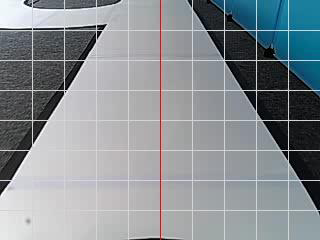

---

## Page 39

智能汽车图像感知
如需退出只需在终端按 Ctrl+c 即可。
步骤 6：补全代码，尝试实车运行，观察可视化运行结果
打开本实验项目的实践代码，对缺失代码的文件进行代码填充操作，进一步
掌握本工程代码实现方法。
图 2-4 代码文件
将填充完毕的代码文件尝试替换智能汽车源文件中的对应文件，运行程序，
观察可视化运行结果，验证代码填充是否正确。为防止代码错误或丢失，务必将
源文件提前备份。
37

---

## Page 40

图像采集
三、图像采集实验指导
1.实验描述
智能汽车主要通过高清摄像头进行赛道环境感知，由高清摄像头采集赛道图
像再进行后续的图像处理与识别。采集图片是计算机视觉算法展开的第一步。由
于初始状态的智能汽车是不会自动去采集图片信息的，所以本次实验将通过手柄
遥控器控制智能汽车在赛道上采集图像，同时也通过手柄遥控器控制智能汽车的
行驶方向和速度，也进一步理解智能汽车的环境感知系统、运动控制系统及其通
信机制。
2.实验目标
（1）掌握遥控智能汽车进行图像采集的方法；
（2）掌握利用手柄遥控器控制智能汽车在前、后、左、右方向进行行驶的
基本方法，学会调速，进一步理解智能汽车的通信机制与运动控制系统；
（3）参考教材内容及源码文件，完成本实验的部分代码补全任务。
3.实验步骤
步骤 1：将智能汽车与 PC 电脑相连接
第一步，插入网线，将智能汽车通过网线与 PC 相连。PC 电脑需要参照实训
一步骤设置好静态 IP 地址，并完成网络映射相关设置。
第二步，打开 MobaXterm，建立 SSH 远程连接，将本地 PC 与智能汽车
Edgeboard 板卡建立远程连接，进而可通过命令行的方式对智能汽车的源码进行
启动等操作。
通过 MobaXterm，我们可以在电脑上看到智能汽车 Edgeboard 板卡上所展示
的界面内容。
38

---

## Page 41

图像采集
步骤 2：打开 Visual Studio Code 学习部分源码逻辑
在前面的环境准备阶段，我们已经安装了 Visual Studio Code，本次相机标定
任务需要结合 EdgeBoard 嵌入式 AI 计算卡与本地计算机完成。
在上述步骤 1 基础上进行如下操作：
第 一 步 ， 把 部 署 在 EdgeBoard 嵌 入 式 AI 计 算 卡 中 的
Intelligentcar_T710_python_v2 工程通过 Visual Studio Code 可视化界面打开。
在该工程下，进入 res/samples/文件夹内，新建名字为 train 的文件夹，用于
存放通过摄像头收集的图片。收集的图像可以用于本节课，也可供后续实验使用。
第二步，准备图像采集源码文件。
在本实验中，通过路径 src/python/image_collection.py 找到本实验提供的部
分源码，这个文件中的代码可以实现图像采集。工程文件结构如下图所示。
图 3-1 工程文件结构
39

---

## Page 42

图像采集
步骤 3：熟悉手柄遥控器的按键规则
手柄遥控器上按键众多，按键都有特定的规则去对智能汽车进行速度控制、
采图控制、方向控制等操作，按键功能如下图所示，采集的图像会存储到
res\samples\train 目录文件中。
图 3-2 手柄
（1）摇杆负责车辆方向的控制，包括上、下、左、右；
（2）按 Y 按钮，可控制摄像头进行连续采图；
（3）按 X 按钮，可控制摄像头进行单帧采图；
（4）按 A 按钮，可控制摄像头停止采图；
（5）手摇右前方“两档车速调节”按钮，可控制智能汽车的速度；
（6）其它任意键可控制智能汽车停止当前行动。
需要注意的是：
手柄左上方有信号灯闪烁，分为三种模式：红灯常亮为无线手柄 B，绿灯常
亮为无线手柄 A，双灯均亮为故障。使用时，需先连接手柄并开机，观察信号灯
具体闪烁情况，根据红/绿灯改变手柄模式。具体修改方式详见后续代码部分。
40

---

## Page 43

图像采集
步骤 4：遥控智能汽车进行运动与图像采集
image_collection.py 主要逻辑如下：
首先定义手柄类（手柄和摄像头的初始化），采集类（定义手柄功能），然
后定义遥控手柄线程（接收手柄信号），最后手柄及摄像头多线程并发实现使用
手柄操作并调用摄像头进行图像采集。
初始定义处可根据连接手柄的亮灯显示来修改手柄类型。
PWMSERVOMAX = 1900 # 舵机 PWM 最大值（左）
PWMSERVOMID = 1500 # 舵机 PWM 中值
PWMSERVOMIN = 1100 # 舵机 PWM 最小值（右）
JOYSTICK_MODE = 3 # 2/无线手柄 A（单绿灯常亮） 3/无线手柄 B（单红灯常亮））
（1） 定义手柄类
手柄和摄像头进行初始化设置：
class JoyStick:
def __init__(self):
print("avaliable devices")
for fn in os.listdir("/dev/input"):
if fn.startswith("js"):
print("/dev/input/%s" % fn)
self.fn = "/dev/input/js0"
self.x_axis = 0
def open(self):
self.jsdev = open(self.fn, "rb")
def read(self):
self.evbuf = self.jsdev.read(8)
return struct.unpack("IhBB", self.evbuf)
def type(self, type_):
if type_ & 0x01:
return "button"
if type_ & 0x02:
return "axis"
def button_state(self):
return 1
41

---

## Page 44

图像采集
def get_x_axis(self):
time, value, type_, number = struct.unpack("IhBB", self.evbuf)
if number == 1:
fvalue = value / 32767
return fvalue
（2） 定义采集类
初始化操作，定义智能车参数、采图使能以及保存路径等。
class Collecte:
def __init__(self):
self.camera = cv2.VideoCapture(0)
self.speed = 0.0 # 车速：m/s
self.forward = True # 车辆行驶方向
self.steer = PWMSERVOMID
self.appExit = False # 程序退出标志
self.cotMore = False # 连续图像采样使能
self.cotOnce = False # 单次图像采样使能
self.index = 0
self.counterHeart = 0 # 串口发送心跳计数器
self.saveDir = "../../res/samples/train"
if not os.path.exists(self.saveDir):
os.makedirs(self.saveDir)
if not self.camera.isOpened():
print("camera open faild!")
self.exit()
codec = cv2.VideoWriter_fourcc("M", "J", "P", "G")
self.camera.set(cv2.CAP_PROP_FOURCC, codec)
self.camera.set(cv2.CAP_PROP_FPS, 30)
self.camera.set(cv2.CAP_PROP_FRAME_WIDTH, 320)
self.camera.set(cv2.CAP_PROP_FRAME_HEIGHT, 240)
定义运动模式、方式，采图形式函数：运行分为高速与低速运行两档速度，
及前后左右四个方向。
# 高速运行
def speedHigh(self):
if self.forward:
self.speed = 0.7
else:
self.speed = -0.7
uart.carControl(self.speed, self.steer)
# 低速运行
42

---

## Page 45

图像采集
def speedLow(self):
if self.forward:
self.speed = 0.3
else:
self.speed = -0.3
uart.carControl(self.speed, self.steer)
# 连续采图
def collecteMore(self):
self.cotMore = True
self.cotOnce = False
# 单帧采图
def collecteOnce(self):
self.cotMore = False
self.cotOnce = True
# 停止采图
def collecteStop(self):
self.cotMore = False
self.cotOnce = False
# 向前运动
def frontRun(self):
self.forward = True
if self.speed < 0:
self.speed = -self.speed
# 向后运动
def backRun(self):
self.forward = False
if self.speed > 0:
self.speed = -self.speed
# 左右转
def turn(self, turn):
self.steer = PWMSERVOMID + turn * (PWMSERVOMID - PWMSERVOMIN) /
32767
uart.carControl(self.speed, self.steer)
图像采集函数：
首先使用心跳信号传递小部分数据，保证设备间通信链路连接正常；然后使
用 cv2 对已采样的图片进行读取，再使用 cv2 库中 putText 函数设置显示各类格
43

---

## Page 46

图像采集
式最终输出 UI 显示。
def sample(self):
if self.counterHeart > 5:
uart.carControl(self.speed, self.steer)
self.counterHeart = 0
else:
self.counterHeart += 1
return_value, image = self.camera.read()
if self.cotMore or self.cotOnce:
path = "{}/{}.jpg".format(self.saveDir, self.index)
cv2.imwrite(path, image)
print("saveimage: {}.jpg".format(self.index))
self.index += 1
if self.cotOnce:
self.cotOnce = False
cv2.putText(
image,
str(self.index),
(10, 30),
cv2.FONT_HERSHEY_SIMPLEX,
1,
(0, 0, 254),
1,
cv2.LINE_AA,
)
cv2.imshow("frame", image) # UI 显示
cv2.waitKey(10)
（3）定义手柄线程，接收信号：
def joystick_thread():
js.open()
while not collecte.state():
time, value, type_, number = js.read()
if inital and JOYSTICK_MODE == 3:
if js.type(type_) == "button":
# print("button:{} state: {}".format(number, value))
if number == 3 and value > 0: # 连续采图
collecte.collecteMore()
elif number == 2 and value > 0: # 单帧采图
44

---

## Page 47

图像采集
collecte.collecteOnce()
elif number == 0 and value > 0: # 停止采图
collecte.collecteStop()
elif number == 5: # 高速档
if value == 1:
collecte.speedHigh()
elif value == 0:
collecte.carStop()
else:
collecte.carStop()
if js.type(type_) == "axis":
# print("axis:{} state: {}".format(number, value))
if number == 1: # 车辆行驶方向
if value < 0:
collecte.frontRun()
elif value > 0:
collecte.backRun()
elif number == 0: # 左右转向移动
collecte.turn(value)
elif number == 5: # 低速档
if value >= 1:
collecte.speedLow()
elif value <= 0:
collecte.carStop()
print("JoyStick's thread out!")
（4）手柄多线程并发。
if __name__ == "__main__":
# 开启遥控手柄多线程
threadJok = threading.Thread(target=joystick_thread, args=())
threadJok.start()
time.sleep(1)
inital = True
while not collecte.state():
collecte.sample()
collecte.exit()
threadJok.join()
uart.carControl(0, PWMSERVOMID)
45

---

## Page 48

图像采集
步骤 5：运行代码文件，查看结果
（1）确认 train 文件夹已建立。
前面步骤中已经建立 train 文件夹，确认在 res/samples/目录下有空的 train 文
件夹。
运行代码文件，将棋盘格、赛道线放置于摄像头可视区域内，调整到合适角
度进行图像采集。
（2）运行图像采集的程序代码
运行代码之前，关掉电脑防火墙，打开 MobaXterm 界面，在 SSH 连接完成
的 前 提 下 ， 在 命 令 行 中 输 入 “ cd
workspace/intelligentcar_T710_python_v2/src/python”进入代码目录下；
之后输入“python3 image_collection ”回车即可运行程序。
图 3-3 运行程序
出现下面的窗口，选择“是”即可：
图 3-4 弹窗
随后将会出现可视化窗口，等待代码运行完成。
（3）查看图像采集的图片
进入智能汽车项目工程的根目录下，进入 res\samples\train 目录文件夹查看
智能汽车通过摄像头采集的图片。
46

---

## Page 49

图像采集
图 3-5 Demo 样例采集的部分图片
步骤 6：补全代码，尝试实车运行，观察可视化运行结果
打开本实验项目的实践代码，对缺失代码的文件进行代码填充操作，进一步
掌握本工程代码实现方法。
图 3-6 代码文件
将填充完毕的代码文件尝试替换智能汽车源文件中的对应文件，运行程序，
观察可视化运行结果，验证代码填充是否正确。为防止代码错误或丢失，务必将
源文件提前备份。
47

---

## Page 50

相机标定与图像校正
四、相机标定与图像校正实验指导
1.实验描述
通过前两个章节的学习，我们对智能汽车的架构和控制系统有一个全方位的
了解。
智能汽车是通过计算机视觉的图像处理技术对赛道各类图像进行处理、识别，
进而去完成赛道上的各项任务，通过摄像头采集的图片可能会发生径向畸变、切
向畸变、薄透镜畸变等情况，那么我们就需要通过相机标定的方法对摄像头采集
的图片进行标定，并且把最终标定的图片进行校正，供后续车辆使用各种算法进
行决策。
本次课程，我们尝试通过相机标定算法对标定板图片进行标定和图像校正。
2.实验目标
（1）理解相机标定原理；
（2）掌握张正友相机标定法，掌握标定图片的代码实现方法，并对标定结
果进行评价；
（3）掌握图片校正的相关方法与技术；
（4）参考教材内容及源码文件，完成本实验的部分代码补全任务。
3.实验步骤
步骤 1：将智能汽车与 PC 电脑相连接
第一步，插入网线，将智能汽车通过网线与 PC 相连。PC 电脑需要参照实
训一步骤设置好静态 IP 地址，并完成网络映射相关设置。
第二步，打开 MobaXterm，建立 SSH 远程连接，将本地 PC 与智能汽车
Edgeboard 板卡建立远程连接，进而可通过命令行的方式对智能汽车的源码进行
启动等操作。
通过 MobaXterm，我们可以在电脑上看到智能汽车 Edgeboard 板卡上所展示
48

---

## Page 51

相机标定与图像校正
的界面内容。
步骤 2：打开 Visual Studio Code 学习部分源码逻辑
在前面的环境准备阶段，我们已经安装了 Visual Studio Code，本次相机标定
任务需要结合 EdgeBoard 嵌入式 AI 计算卡与本地计算机完成。
在上述步骤 1 基础上进行如下操作：
第 一 步 ， 把 部 署 在 EdgeBoard 嵌 入 式 AI 计 算 卡 中 的
Intelligentcar_T710_python_v2 工程通过 Visual Studio Code 可视化界面打开。
第二步，准备标定板图片。在该工程下，进入 res/calibration/文件夹,该文件
夹 用 于 存 放 相 机 标 定 所 使 用 的 图 片 。 实 操 时 ， 可 以 删 除 已 经 存 在 的
calibration/temp 文件夹，学习重新新建该文件夹，然后将自己拍摄的棋盘格照片
（30 张左右即可）存入此文件夹中用于随后标定（打印所需的棋盘格图片文件
存放于项目根目录下）。
第三步，准备相机标定源码文件。
在本实验中，通过路径 src/python/camera_calibrate.py 找到本实验提供的部分
源码，这个文件中的代码可以实现相机标定与图像校正。
工程文件结构如下图所示。
49

---

## Page 52

相机标定与图像校正
图 4-1 工程文件结构
步骤 3：理解相机标定主要流程
在 camera_calibrate.py 文件中，相机标定与图像校正的核心代码流程主要分
为 5 个步骤：
（1）初始化头文件（src/python/camera_calibrate.py）
导入本实验所需要的一些函数库。
import sys
import os
import numpy as np
import cv2
50

---

## Page 53

相机标定与图像校正
import glob
import xml.etree.ElementTree as ET
from xml.etree.ElementTree import Element
import shutil
（2）主函数（src/python/camera_calibrate.py）
初始化操作，包括确定输入图像文件夹、确定输出图像文件夹、确定标定板
规格：11*8、格点长度 20mm、图像类型为 jpg 类型。其中，11*8 在 opencv 中
为内角点个数，为可输入参数。
if __name__ == "__main__":
inputFolder = "../../res/calibration/temp/" # 输入图像文件夹
outputFolder = "../../res/calibration/" # 输出图像文件夹
calibrationPlateSize = (11, 8) # opencv 输入参数为内角点个数，所以输入
参数为 11*8
latticeLength = 0.02 # 格点长度 20mm
imageType = "jpg" # 图像类型
（3）相机标定（src/python/camera_calibrate.py）
调 用 CalibrationCamera 函 数 可 以 直 接 进 行 相 机 标 定 。 下 面 对
CalibrationCamera 函数的定义过程以及相机标定的逻辑进行分步介绍，代码相应
拆解并进行分步解释说明。
① CalibrationCamera 函数功能主要是计算内参矩阵、畸变参数、平均误差、
标注角点集图片，理解函数返回值。
(internalMatrix, distortionCofficients, averageError,) =
CalibrationCamera(
calibrationPlateSize, latticeLength, inputFolder, imageType,
outputFolder
) # 相机标定
②函数定义如下，首先规定标定板规格，初始化角点与多维结构，初始化世
界坐标系等信息，定义好角点照片保存路径。
CalibrationCamera 函 数 中 涉 及 到 的 一 些 变 量 及 参 数 名 称 如 下 ：
calibrationPlateSize，标定板尺寸；latticeLength，格点长度；inputFolder，输入文
件夹；imageType，图片类型；返回值 return: 内参矩阵、畸变参数、平均误差、
标注角点集图片。
def CalibrationCamera(
calibrationPlateSize, latticeLength, inputFolder, imageType,
outputFolder
51

---

## Page 54

相机标定与图像校正
):
"""
用相机对张正友标定法的棋盘格进行不同角度的拍摄，得到一组图像；
对图像中的特征点如标定板角点进行检测，得到标定板角点的像素坐标值，根据已知的棋
盘格大小和世界坐标系原点，计算得到标定板角点的物理坐标值；
根据物理坐标值和像素坐标值的关系，求解相机内参矩阵，计算径向畸变参数。
:param calibrationPlateSize: 标定板尺寸
:param latticeLength: 格点长度
:param inputFolder: 输入文件夹
:param imageType: 图片类型
:outputFolder:输出路径
:return: 内参矩阵，畸变参数，平均误差，标注角点集图片
"""
width, height = calibrationPlateSize # 标定板规格
cornerPointInt = np.zeros((width * height, 3), np.float32) # 初始
化角点
cornerPointInt[:, :2] = np.mgrid[0:width, 0:height].T.reshape(-1,
2) # 初始化多维结构
# #### 代码填空开始处 #### #
"""
代码填空提示：
1. 初始化世界坐标，用初始化焦点数量 cornerPointInt×格点长度
latticeLength；
2. 初始化保存世界坐标列表：objectPoints；
3. 初始化保存像素坐标列表：imagePoints；
"""
# #### 代码填空结束处 #### #
imageNames = [] # 保存有效照片名称
imageCorners = [] # 保存标注角点的图片
# 角点照片保存路径
outputCorners = outputFolder + "corners/"
if not os.path.exists(outputCorners): # 判断文件夹是否存在
os.makedirs(outputCorners) # 如果文件夹不存在，则创建文件夹
else:
shutil.rmtree(outputFolder + "corners")
os.makedirs(outputCorners) # 如果文件夹不存在，则创建文件夹
③获取需要标定的图像数据，同时将图像转换为灰度图像；
images = glob.glob(inputFolder + os.sep + "**." + imageType) # 获取
指定文件夹下的指定文件
for fileName in images:
image = cv2.imread(fileName) # 获取图像数据
grayImage = cv2.cvtColor(image, cv2.COLOR_BGR2GRAY) # 图像转换
为灰度
52

---

## Page 55

相机标定与图像校正
④通过上传这组图像，对图像中的特征点如标定板的角点进行检测，得到标
定板中角点的像素坐标值，根据已知的棋盘格的大小和世界坐标系原点，计算得
到标定板角点的物理坐标值；
mark, cornerPointImage = cv2.findChessboardCorners(
grayImage, (width, height), None
) # 查找棋盘内角的位置，cornerPointImage 为像素空间中的角点。
if mark == True: # 如果 ret 为 True，则保存。
objectPoints.append(cornerPointWorld) # 世界坐标集
imagePoints.append(cornerPointImage) # 像素坐标集
cv2.drawChessboardCorners(
image, (width, height), cornerPointImage, mark
) # 将检测到的角点集画出来。
imageCorners.append(image) # 保存绘制角点集的图片
# 保存角点照片名称
imageName = fileName.split(os.sep)[-1] # 获取图片名称
imageNames.append(imageName)
⑤根据物理坐标值和像素坐标值的关系，求解相机内参矩阵，计算径向畸变
参数。
try:
(
mark,
internalMatrix,
distortionCofficients,
rotationVectors,
translationVectors,
) = cv2.calibrateCamera(
objectPoints, imagePoints, grayImage.shape[::-1], None, None
) # 标定相机，依据世界坐标和像素坐标
except:
print("failure:相机标定-棋盘尺寸/格点长度/图片类型有误！")
sys.exit(0)
with open("../../res/calibration/assessment.txt", "w") as f:
head = "相机标定分辨率: 320x240"
f.write(head) # 写入头
f.write("\n")
head = "每幅图像的标定误差: "
f.write(head)
f.write("\n")
f.close()
totalError = 0
for i in range(len(objectPoints)):
imagePointsPlane, temp = cv2.projectPoints(
53

---

## Page 56

相机标定与图像校正
objectPoints[i],
rotationVectors[i],
translationVectors[i],
internalMatrix,
distortionCofficients,
) # 投影 3D 指向一个图像平面。
error = cv2.norm(imagePoints[i], imagePointsPlane, cv2.NORM_L2)
/ len(
imagePoints
) # 计算数组的绝对范数
with open("../../res/calibration/assessment.txt", "a") as f:
errorprint = "第" + str(i + 1) + "幅图像的平均误差:" + str(error)
f.write(errorprint) # 写入每一幅图像的误差
f.write("\n")
f.close()
cv2.putText(
imageCorners[i],
"error:" + str(round(error, 3)),
(10, 20),
cv2.FONT_HERSHEY_SIMPLEX,
0.5,
(0, 0, 255),
1,
)
cv2.imwrite(
outputCorners + os.sep + imageNames[i],
imageCorners[i],
) # 存储角点图片
cv2.imshow("calibration", imageCorners[i])
cv2.waitKey(500)
⑥计算径向畸变参数，返回内参矩阵，畸变参数，平均误差，标注角点集图
片。
totalError += error
averageError = totalError / len(objectPoints) # 平均误差
with open("../../res/calibration/assessment.txt", "a") as f:
averageerror = "总体平均误差:" + str(averageError)
internalmatrix = "相机内参数矩阵: " + str(internalMatrix)
cofficients = "相机畸变系数: " + str(distortionCofficients)
f.write("\n")
f.write(averageerror) # 写入平均误差
f.write("\n")
f.write(internalmatrix) # 写入内参矩阵
f.write("\n")
54

---

## Page 57

相机标定与图像校正
f.write(cofficients) # 写入相机畸变系数
f.write("\n")
f.close()
return (
internalMatrix,
distortionCofficients,
averageError,
) # 返回内参矩阵，畸变参数，平均误差，标注角点集图片
（4）处理畸变图像（src/python/camera_calibrate.py）
根据上一个步骤的内参矩阵和畸变参数，对原图进行校准，处理畸变图像。
主要是依据上一步骤所计算出来的一些用于相机标定的数据结合张正友标定法
完成对原图像的校准。畸变图像处理通过 DedistortionDeal 函数进行。
DedistortionDeal 函数中涉及到的一些变量及参数名称如下：
calibrationPlateSize，标定板尺寸；inputFolder，输入文件夹；imageType，图
片类型；outputFolder，输出文件夹；internalMatrix，内参矩阵；distortionCofficients，
畸变参数；angularPointImages，标注角点集的图片；
函数定义如下：
def DedistortionDeal(
inputFolder,
imageType,
outputFolder,
internalMatrix,
distortionCofficients,
):# 处理畸变图片
"""
根据内参矩阵和畸变参数对原图进行校准，并且拼接保存
:param inputFolder: 输入文件夹
:param imageType: 图片类型
:param outputFolder: 输出文件夹
:param internalMatrix: 内参矩阵
:param distortionCofficients: 畸变参数
"""
images = glob.glob(inputFolder + os.sep + "**." + imageType) # 获
取指定文件夹下的指定文件
outputCorrent = outputFolder + "correct/"
if not os.path.exists(outputCorrent): # 判断文件夹是否存在
os.makedirs(outputCorrent) # 如果文件夹不存在，则创建文件夹
else:
55

---

## Page 58

相机标定与图像校正
shutil.rmtree(outputFolder + "correct")
os.makedirs(outputCorrent) # 如果文件夹不存在，则创建文件夹
for index, fileName in enumerate(images):
imageName = fileName.split(os.sep)[-1] # 获取图片名称
image = cv2.imread(fileName) # 获取图片数据
imageCorrect = cv2.undistort(
image, internalMatrix, distortionCofficients, None,
internalMatrix
) # 变换图像以补偿镜头畸变
cv2.putText(image, "old", (10, 20), cv2.FONT_HERSHEY_SIMPLEX, 1,
(0, 0, 255), 1)
cv2.putText(
imageCorrect,
"New",
(10, 20),
cv2.FONT_HERSHEY_SIMPLEX,
1,
(0, 0, 255),
1,
)
jointImage = np.concatenate([image, imageCorrect], axis=1) # 水
平拼接
cv2.imwrite(outputCorrent + os.sep + imageName, jointImage) # 存
储图片
cv2.imshow("calibration", jointImage)
cv2.waitKey(500)
（5）将相机标定参数写入 Xml 文件，为图像预处理等后续操作
做好数据准备。（src/python/camera_calibrate.py）
通过 creatMatrixTree 函数与 creatCoeffsTree 得到内参矩阵的一些数据，通过
__indent 函数最终按照标准格式输出到 xml 文件中，具体函数代码请各位同学在
源码工程中查阅，本实验只展示主函数中调用过程。
# 将相机标定参数写入 Xml 文件
root = ET.Element("opencv_storage")
tree = ET.ElementTree(root)
root.append(creatMatrixTree(internalMatrix))
root.append(creatCoeffsTree(distortionCofficients))
__indent(root)
# [temp]文件夹下存放临时测试文件，[valid]文件夹下放置有效的标定文件
tree.write(
"../../res/calibration/calibration.xml",
56

---

## Page 59

相机标定与图像校正
encoding="utf-8",
xml_declaration=True,
)
在"../../res/calibration/valid/"文件路径下存放有效的标定文件。
步骤 4：运行代码文件，查看结果
（1）收集图片素材
参照实训 3 图像采集方法，可以通过手柄遥控智能汽车上的摄像头采集标定
板图像，进入智能汽车项目工程的根目录下，按照 res\calibration\temp 路径查看
收集的图片。
图 4-2 素材图片
（2）运行相机标定的程序代码
运行代码之前，关掉电脑防火墙，打开 MobaXterm 界面，在 SSH 连接完成
的 前 提 下 ， 在 命 令 行 中 输 入 “ cd
workspace/intelligentcar_T710_python_v2/src/python/”命令后按回车，再在命令行
输入“python3 camare_calibration.py”回车：
图 4-3 代码运行
出现下面的窗口，选择“是”即可：
57

---

## Page 60

相机标定与图像校正
图 4-4 弹窗
随后将会出现可视化窗口，等待代码运行完成。
（3）查看相机标定的图片
进入智能汽车项目工程的根目录下，按照 res\calibration\valid\corner 路径可
查看相机标定后的图片。
图 4-5 标定后图片
（4）查看图像矫正的图片
进入智能汽车项目工程的根目录下，按照 res\calibration\valid\correct 路径可
查看图像矫正后的图片。
58

---

## Page 61

相机标定与图像校正
图 4-6 校正后图片
（5）评价相机标定结果
进入智能汽车项目工程的根目录下，按照 res\calibration\valid\calibration.xml
路径查看生成的误差文件，包括每幅图像的平均误差、相机内参数矩阵、畸变系
数，以及每一幅图像的旋转向量、旋转矩阵、平移向量。
图 4-7 标定文件
步骤 5: 补全代码，尝试实车运行，观察可视化运行结果
打开本实验项目的实践代码，对缺失代码的文件进行代码填充操作，进一步
掌握本工程代码实现方法。
59

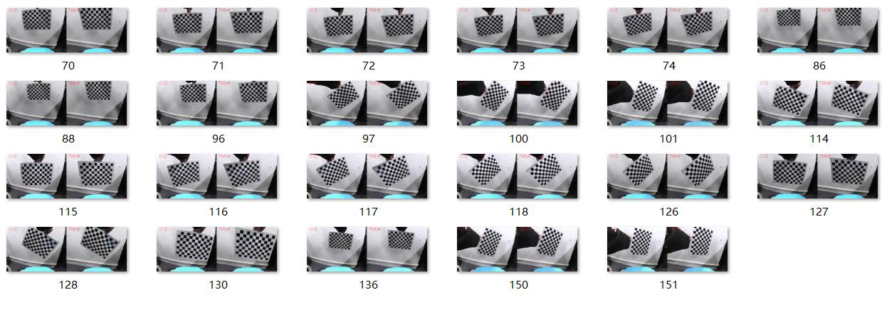

---

## Page 62

相机标定与图像校正
图 4-8 代码文件
将填充完毕的代码文件尝试替换智能汽车源文件中的对应文件，运行程序，
观察可视化运行结果，验证代码填充是否正确。为防止代码错误或丢失，务必将
源文件提前备份。
60

---

## Page 63

赛道图像的透视变换
五、赛道图像的透视变换实验指导
1.实验描述
在智能汽车中，车载摄像头有一定的俯视角度，采集到的道路图像不利于赛
道理解与识别，需要将道路图像转换成俯视图进行分析和处理，这种转换过程叫
透视变换，其本质是将图像投影到一个新的视平面，为智能汽车的下一步赛道识
别与检测做准备。
实验中赛道图像来源一方面可以通过摄像头对赛道进行实时采集，也可以读
取本地的“MP4”视频对视频中的赛道图像进行处理。本次课程我们选择读取视
频的方式完成赛道透视变换处理的任务。
2.实验目标
（1）掌握道路图像进行透视变换的方法；
（2）进一步理解透视变换的基本原理；
（3）参考教材内容及源码文件，完成本实验的部分代码补全任务。
3.实验步骤
步骤 1：将智能汽车与 PC 电脑相连接
第一步，插入网线，将智能汽车通过网线与 PC 相连。PC 电脑需要参照实
训一步骤设置好静态 IP 地址，并完成网络映射相关设置。
第二步，打开 MobaXterm，建立 SSH 远程连接，将本地 PC 与智能汽车
Edgeboard 板卡建立远程连接，进而可通过命令行的方式对智能汽车的源码进行
启动等操作。
通过 MobaXterm，我们可以在电脑上看到智能汽车 Edgeboard 板卡上所展示
的界面内容。
61

---

## Page 64

赛道图像的透视变换
步骤 2：打开 Visual Studio Code 学习部分源码逻辑
在前面的环境准备阶段，我们已经安装了 Visual Studio Code，本次任务需要
结合 EdgeBoard 嵌入式 AI 计算卡与本地计算机完成。
在上述步骤 1 基础上进行如下操作：
第 一 步 ， 把 部 署 在 EdgeBoard 嵌 入 式 AI 计 算 卡 中 的
Intelligentcar_T710_python_v2 工程通过 Visual Studio Code 可视化界面打开。
第二步，准备进行图像透视变换的视频。在该工程下，进入 res/samples/文
件夹内，存放本次实验使用的 MP4 视频，如果我们采用读取本地视频的方式进
行图像透视变换，通过修改代码中的读取视频源的方式读取本地的 MP4 视频。
第三步，准备赛道图像透视变换的源码文件。在本实验中，通过路径
src/python/perspective_mapping.py 找到本实验提供的部分源码供学习、参考和练
习。
工程文件结构如下图所示。
62

---

## Page 65

赛道图像的透视变换
图 5-1 工程文件结构
63

---

## Page 66

赛道图像的透视变换
步骤 3：图像透视变换
在“src/python/perspective_mapping.py”文件中，图像透视变换主要分为三
个步骤：OpenCV 读取摄像头画面、图像校正、图像透视变换（逆）。
（1）引入函数库（src/python/perspective_mapping.py）
引入 Python OpenCV 的函数库，同时引用我们自己开发的智能汽车功能库
intelligentCar_v2，可以调用相机矫正参数初始化功能的函数、透视变换功能的函
数去完成本次实验。
import base64
import cv2
import numpy as np
import string
import os
import sys
sys.path.append("../lib") # 引用 C++库
import intelligentCar_v2
（2）读取本地视频（src/python/perspective_mapping.py）
在代码测试阶段，智能汽车无法回到赛道上去实时采集图像，这时就需要读
取本地提前录制好的视频，并且设置视频的分辨率为 320×240。
capture = cv2.VideoCapture("../../res/samples/demo.mp4") # 读取本
地视频
capture.set(cv2.CAP_PROP_FRAME_WIDTH, 320) # 设置视频分辨
率:320*240
capture.set(cv2.CAP_PROP_FRAME_HEIGHT, 240)
（3）初始化智能汽车类(src/python/perspective_mapping.py）
初始化智能汽车类，并进行透视变换参数及相机矫正参数的初始化。
# 初始化智能汽车类
icar = intelligentCar_v2.IntelligentCar()
# 透视变换（IPM）参数初始化
icar.ipmInit()
# 相机矫正参数初始化
icar.imageCorrecteInit()
64

---

## Page 67

赛道图像的透视变换
（4）图像透视变换（src/python/perspective_mapping.py）
——补全代码
第一步，读取源视频帧；
第二步，对录制的源视频或者实时采集的赛道图像信息进行图像校正，用于
后续透视变换使用，并且展示图像校正后的赛道图像；
第三步，调用透视变换的函数对校正后的赛道图像进行透视变换处理。
while True:
# 读取视频帧
isTrue, imageFrame = capture.read()
# 图像矫正
base64Frame = matToBase64(imageFrame)
base64Corret = icar.imageCorrection(base64Frame)
imageCorret = base64ToMat(base64Corret)
if isTrue:
cv2.waitKey(1)
else:
print("视频播放完毕")
Break
# 透视变换
base64Ipm = icar.ipmHomography(base64Corret)
imageIpm = base64ToMat(base64Ipm)
imageIpm = cv2.resize(imageIpm, (320, 240))
cv2.putText(imageFrame, "[1] frame",(10, 30),
cv2.FONT_HERSHEY_TRIPLEX, 1,(255, 0, 0), 1)
cv2.putText(imageIpm, "[2] imgIpm",(10, 30),
cv2.FONT_HERSHEY_TRIPLEX, 1,(255, 0, 0), 1)
preprocess = np.hstack((imageFrame, imageIpm))
cv2.imshow("imageIpm", preprocess)
步骤 4：运行代码文件，查看结果
运行代码之前，关掉电脑防火墙，打开 MobaXterm 界面，在 SSH 连接完成
的 前 提 下 ， 在 命 令 行 中 输 入 “ cd
workspace/intelligentcar_T710_python_v2/src/python/”切换目录命令后按回车，再
次输入命令“python3 perspective_mapping.py”回车运行代码文件。
65

---

## Page 68

赛道图像的透视变换
图 5-2 运行代码
出现下面的窗口，选择“是”即可：
图 5-3 弹窗
随后将会出现图像透视变换的可视化窗口，等待代码运行完成。如下几幅图
片可以观察到在不同的赛道部分包括斑马线、弯道与十字路口，通过透视变换算
法处理的赛道结果。
图 5-4 斑马线透视变换处理结果
图 5-5 弯道透视变换处理结果
66

---

## Page 69

赛道图像的透视变换
图 5-6 十字路口透视变换处理结果
步骤 5：补全代码，尝试实车运行，观察可视化运行结果
打开本实验项目的实践代码，对缺失代码的文件进行代码填充操作，进一步
掌握本工程代码实现方法。
图 5-7 代码文件
将填充完毕的代码文件尝试替换智能汽车源文件中的对应文件，运行程序，
观察可视化运行结果，验证代码填充是否正确。为防止代码错误或丢失，务必将
源文件提前备份。
67

---

## Page 70

赛道图像预处理
六、赛道图像预处理实验指导
1.实验描述
通过本章节前几部分的理论和实践学习，我们对智能汽车的图像采集、相机
标定、图像校正方法都有一定的了解和掌握，接下来我们要结合这些实践，完成
智能汽车赛道图像预处理的任务。
对摄像头采集到的赛道图像进行实时的预处理，包括图像校正、图像二值化、
图像合成视频等操作；也可以读取本地的“MP4”视频对赛道进行图像预处理相
关操作。本次课程我们尝试读取视频完成赛道图像的预处理实验。
2.实验目标
（1）理解图像预处理作用及原理；
（2）掌握图像校正、图像二值化、图像合成方法，了解二值化图像在智能
汽车项目中的应用；
（3）参考教材内容及源码文件，完成本实验的部分代码补全任务。
3.实验步骤
步骤 1：将智能汽车与 PC 电脑相连接
第一步，插入网线，将智能汽车通过网线与 PC 相连。PC 电脑需要参照实
训一步骤设置好静态 IP 地址，并完成网络映射相关设置。
第二步，打开 MobaXterm，建立 SSH 远程连接，将本地 PC 与智能汽车
Edgeboard 板卡建立远程连接，进而可通过命令行的方式对智能汽车的源码进行
启动等操作。
通过 MobaXterm，我们可以在电脑上看到智能汽车 Edgeboard 板卡上所展示
的界面内容。
68

---

## Page 71

赛道图像预处理
步骤 2：打开 Visual Studio Code 学习部分源码逻辑
在前面的环境准备阶段，我们已经安装了 Visual Studio Code，本次任务需要
结合 EdgeBoard 嵌入式 AI 计算卡与本地计算机完成。
在上述步骤 1 基础上进行如下操作：
第 一 步 ， 把 部 署 在 EdgeBoard 嵌 入 式 AI 计 算 卡 中 的
Intelligentcar_T710_python_v2 工程通过 Visual Studio Code 可视化界面打开。
第二步，准备进行图像预处理的视频。在该工程下，进入 res/samples/文件
夹内，存放图像预处理使用的 MP4 视频，如果我们采用读取本地视频的方式进
行图像预处理，通过这个文件路径读取对应的视频文件。
第 三 步 ， 准 备 图 像 预 处 理 源 码 文 件 。 在 本 实 验 中 ， 通 过 路 径
src/python/image_preprocess.py 找到本实验提供的图像校正、图像二值化部分源
码。通过路径 src/python/image2video.py 找到本实验提供的图像合成视频部分源
码。
工程文件的结构如下图所示。
69

---

## Page 72

赛道图像预处理
图 6-1 工程文件结构
步骤 3：图像预处理
在“src/python/image_preprocess.py”文件中，图像预处理主要分为四个步骤：
OpenCV 读取摄像头画面、图像校正、RGB 图像转换成灰度图像、图像二值化。
在“src/python/image2video.py”文件中将会实现图像合成视频。
（1）引入函数库（src/python/ image_preprocess.py）
引入 Python OpenCV 的函数库，同时引入我们自己开发的智能汽车函数库
intelligentCar_v2，在关于赛道处理的过程中可以调用 intelligentCar_v2 库中的函
数功能帮助我们完成实验任务。
70

---

## Page 73

赛道图像预处理
import base64
import cv2
import numpy as np
import sys
sys.path.append("../lib") # 引用 C++库
import intelligentCar_v2 # 引用图像预处理库
（2）读取本地视频（src/python/ image_preprocess.py）
在代码测试阶段，智能汽车无法回到赛道上去实时采集图像，这时就可以读
取本地提前录制好的视频，并且设置视频的分辨率为 320×240。
capture = cv2.VideoCapture("../../res/samples/demo.mp4") # 选择本
地视频
capture.set(cv2.CAP_PROP_FRAME_WIDTH, 320) # 设置视频分辨
率:320*240
capture.set(cv2.CAP_PROP_FRAME_HEIGHT, 240)
（3）初始化智能汽车类（src/python/ image_preprocess.py）
# 初始化智能汽车类
icar = intelligentCar_v2.IntelligentCar()
# 相机矫正参数初始化
icar.imageCorrecteInit()
（4）图像二值化（src/python/ image_preprocess.py）——补
全代码
第一步，读取视频帧，展示源视频的效果，用于对照组；
while True:
# 读取视频帧
isTrue, imageFrame = capture.read()
if isTrue:
cv2.waitKey(1)
else:
print("视频播放完毕")
break
第二步，图像校正，对录制的源视频或者实时采集的赛道图像信息进行图像
校正，供下一步骤使用；
# 图像矫正
base64Frame = matToBase64(imageFrame)
base64Corret = icar.imageCorrection(base64Frame)
71

---

## Page 74

赛道图像预处理
imageCorret = base64ToMat(base64Corret)
第三步，将 RGB 彩色图像转换成灰度图像；
# RGB 图像转换成灰度图像
imageGray = cv2.cvtColor(imageCorret, cv2.COLOR_BGR2GRAY)
第四步，图像二值化，调用图像二值化的函数对经过第二步与第三步处理后
的图像进行二值化转换，把视频中的每一帧图像转换为二值化图像（黑白图像）。
有缺失代码需要填充补全。
# 图像二值化
# #### 代码填空开始处 #### #
"""
代码填空提示：
1. 调用 cv2 库中的 threshold 函数完成图像的二值化；
2.这个函数有四个参数：第一个为原图像，第二个为进行分类的阈值，
第三个是高于（低于）阈值时赋予的新值，第四个是一个方法选择参数，填写为
cv2.THRESH_OTSU
"""
# #### 代码填空结束处 #### #
imageBinary = np.expand_dims(imageBinary, axis=2) #
将单通道灰度图转换成 RGB
imageBinary = np.concatenate((imageBinary, imageBinary,
imageBinary), axis=-1)
cv2.putText(imageFrame, "[1] frame",(10, 30),
cv2.FONT_HERSHEY_TRIPLEX, 1,(255, 0, 0), 1)
cv2.putText(imageCorret, "[2] imgCorret",(10, 30),
cv2.FONT_HERSHEY_TRIPLEX, 1,(255, 0, 0), 1)
cv2.putText(imageBinary, "[3] imgBinary",(10, 30),
cv2.FONT_HERSHEY_TRIPLEX, 1,(255, 0, 0), 1)
preprocess = np.hstack((imageFrame, imageCorret))
preprocess = np.hstack((preprocess, imageBinary))
cv2.imshow("preprocess", preprocess)
缺失代码填写可参考步骤 4 列出的源码文件。
步骤 4：图像合成视频(src/python/image2video.py)
视频实质是连续的图像序列，包含多幅图像，并包含图像的运动信息。由于
人眼识别图像的频率有限，这个频率一般为每秒 25 张图片，即 25 帧/秒。当单
位时间内看到的图像数量超过一定数目时，给人造成的感觉就是画面是运动的，
72

---

## Page 75

赛道图像预处理
这就是所谓的视频。
在本实验中，设置生成的视频帧率为 30 帧每秒，分辨率为 320×240 。参
照如下代码，设定好生成的视频路径与名称，帧率，视频格式，即可将图片添加
并合成为相应视频。
video_dir = "../../res/samples/sample.mp4" # 生成的视频路径和名称
width = 320 # 照片的大小
height = 240
fps = 30 # 视频的帧率
fourcc = cv2.VideoWriter_fourcc(*"mp4v") # 将转化后的视频格式设置为 mp4
videoWriter = cv2.VideoWriter(video_dir, fourcc, fps, (width,
height)) # 将照片添加到视频中
img_dir = "../../res/samples/train/"
for i in range(5000):
image = cv2.imread(img_dir + str(i + 1) + ".jpg")
if image is not None:
videoWriter.write(image)
print("index = ", i + 1)
videoWriter.release() # 资源释放
print("finished!")
步骤 5：运行代码文件，在 PC 查看可视化结果
运行代码之前，关掉电脑防火墙，打开 MobaXterm 界面，在 SSH 连接完成
的 前 提 下 ， 在 命 令 行 中 输 入 “ cd
workspace/intelligentcar_T710_python_v2/src/python/”切换目录命令后按回车，再
次输入命令“python3 image_preprocess.py”回车：
图 6-2 运行代码
出现下面的窗口，选择“是”即可：
73

---

## Page 76

赛道图像预处理
图 6-3 弹窗
随后将会出现可视化窗口，等待代码运行完成。如下图所示，左侧 frame 为
原图，中间 imgCorrect 为图像校正的效果，右侧 imgBinary 为图像校正之后继而
进行二值化处理的效果。
图 6-4 运行结果
步骤 6：补全代码，尝试实车运行，观察可视化运行结果
打开本实验项目的实践代码，对缺失代码的文件进行代码填充操作，进一步
掌握本工程代码实现方法。
图 6-5 代码文件
将填充完毕的代码文件尝试替换智能汽车源文件中的对应文件，运行程序，
观察可视化运行结果，验证代码填充是否正确。为防止代码错误或丢失，务必将
源文件提前备份。
74

---

## Page 77

赛道元素识别模型训练
七、赛道元素识别模型训练实验
1.实验描述
通过前面模块内容的学习与实践，我们知道本课程中智能汽车主要通过高清
摄像头这种视觉传感器采集道路图像。在全国大学生智能汽车竞赛中，赛道上会
放置拱桥(Bridge)、谷仓(Corn)、斑马线（CrossWalk）、拖拉机(Tractor)等赛道元
素。通过摄像头采集这些赛道元素图像并通过去噪、二值化等预处理后，智能汽
车还需要识别这些赛道元素，才能采取相应的控制策略前行、转弯或降速等。对
赛道元素的识别是通过深度学习方法实现的，在采集各种赛道标志元素图像数据
集后，通过构建人工神经网络进行模型训练，才能真正识别谷仓、坡道等赛道元
素。
2.实验目标
（1）学习数据集的标注、划分等操作，完成数据集准备；
（2）掌握百度飞桨 AI Studio 平台进行模型训练的基本方法；
（3）理解模型训练结果的评估指标，知道如何优化模型。
3.实验步骤
步骤 1：准备数据集
（1）数据集下载及说明
本次 AI 目标检测（Detection）模型训练建议使用赛曙科技开源数据集资源
“智能汽车竞赛交通标志 v230112”版本，文件名为“DataListVoc_320x240_v23
0112.zip”。数据集地址：https://aistudio.baidu.com/aistudio/datasetdetail/186919 。
此数据集作为标准内容，在后续其他操作中也会使用到。
75

---

## Page 78

赛道元素识别模型训练
图 7-1 数据集下载
文件内包含赛道基础元素及特殊的三维实体任务元素的图像信息。
图 7-2 DataListVoc_320x240_v230112 数据集组成
将“DataListVoc_320x240_v230112.zip”文件解压后，可以观察到：文件夹
中包含两个文件夹和三个文本文件。其中“Annotations”文件夹内为数据标注文
件（.xml 文件）、“JPEGImages”文件夹内为图像源文件（.jpg 文件）；标签文
本文件（.txt）为数据集的文本说明，“label_list.txt”表示标签内容，“train.txt”
表示训练集所需的图片和标注，“valid.txt”表示验证集所需的图片和标注。AI 模
型训练时需要这些素材。
76

---

## Page 79

赛道元素识别模型训练
图 7-3 数据集文件夹内容
图 7-4 标注文件和图像文件
图 7-5 文本文件
77

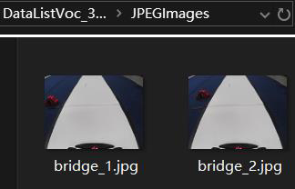

---

## Page 80

赛道元素识别模型训练
（2）自行准备数据集
如果想要使用自己的数据集，则需要从头开始进行图片收集、图片标注，之
后进行数据集划分的操作。
1）图像采集：在之前的实验中，我们已经学习了使用智能汽车去收集赛道
图像的操作，比如环岛图像、十字路口图像或车库等图像。本次实验是有关赛道
元素的识别，所以需要采集的是赛道上各类标志元素的图像，包括锥桶（cone）、
谷仓(granary)、拱桥(bridge)、拖拉机(tractor)、玉米(corn)、猪(pig)、斑马线
（crosswalk）、减速带(bump)一共 8 种赛道元素可以采用深度学习方法进行识别。
通过智能汽车采集到的图片如下图所示：
图 7-6 采集到的赛道元素图片
把收集到的图片，存放到本地文件夹“JPEGImages”中，并确保图片的尺
寸为 320×240。
2）图像标注：对于通过智能汽车摄像头采集的原始图像数据，需要进行标
注。标注的目的是为了将图片中需要识别的内容标识出来，方便模型训练时使用。
Labelme 与 EasyData 都是常用于图像标注的工具，它们有各自的特点和优势。
Labelme 是一个开源工具，相对来说更加简便易用，并且无需支付任何费用，是
一个受欢迎的数据标注工具。而 EasyData 则是一个商业产品，提供了更多的高
级功能和技术支持，在用户界面和交互设计上更加注重用户体验。具体操作方法
可以参阅课程提供的参考资料“[07]Labelme 与 EasyData 数据标注方法概述”。
78

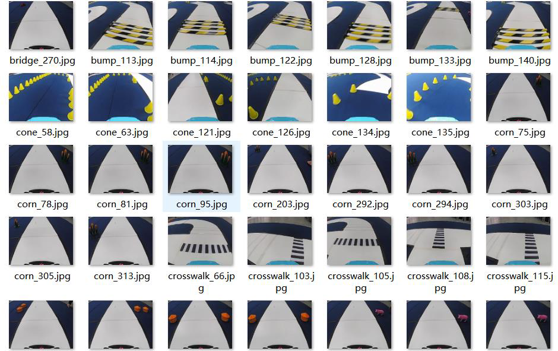

---

## Page 81

赛道元素识别模型训练
下面仅概要介绍 EasyData 数据标注方法。
登录 EasyData 数据服务平台网站，地址为：https://console.bce.baidu.com/eas
ydata/app/proj-b3a37d35a8194236/datav/dataset/list。进入网站界面后需要创建数据
集。
图 7-7 EasyData 数据服务平台
点击创建数据集按钮，随后继续填写数据集名称，选择数据类型（图片）、
标注类型（物体检测）、标注模板（矩形框标注）以及保存位置（平台存储），
完成后点击“创建并导入”。
图 7-8 创建数据集
79

---

## Page 82

赛道元素识别模型训练
上传数据前先将前面准备的图片文件夹“JPEGImages”打包成压缩文件（.zip
格式）。然后选择“本地导入”--“上传压缩包”，接着单击“上传压缩包”按
钮将图片压缩包上传，上传完成后单击确认并返回。
图 7-9 上传图片压缩包
返回数据集管理界面后，等待导入完成。导入完成后选择数据集操作中的标
注。
图 7-10 数据集管理
80

---

## Page 83

赛道元素识别模型训练
标注页面中，先在右侧标签栏中添加识别物体的标签内容，内容可参照标签
文本文件“label_list.txt”。添加标签完成后，使用左键在图片上框选需要识别的
目标，然后单击右键添加标签，添加完成后，记得保存本次标注的图片。最后，
在最下方选择新图片继续标注操作，或者按照平台中提示快捷操作方式进行切换。
图 7-11 图像标注
全部标注完成后，返回到数据集管理界面，选择导出按键，导出标注完成的
图像。
图 7-12 数据集管理
按照下图设置后，选择“开始导出”，在导出记录中选择“查看 ”可以查
看数据集导出进度及记录。导出完成后单击“下载”按钮。
81

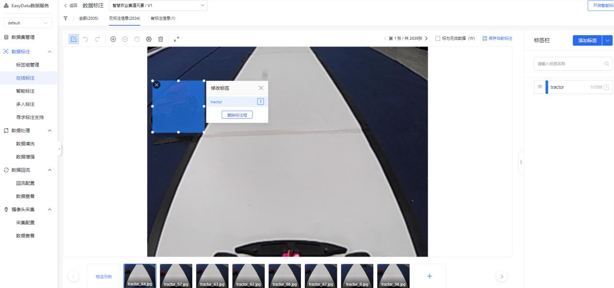

---

## Page 84

赛道元素识别模型训练
图 7-13 数据集导出
图 7-14 查看数据集导出记录
下载的文件为压缩包，解压后可得到对应的图片文件和和标注文件。首先在
文件夹中添加 label_list.txt 文件，可直接使用云端下载的数据集中的同名文件，
也可以自行创建 txt 文本并编辑内容，文件内容与云端数据集同名文件相同；然
后将“Images”文件夹重命名为“JPEGImages”。完成后将整个数据集的文件名
重命名为“DataListVoc_320x240_v230112”并打包成压缩文件以备后续的数据集
划分操作使用。
图 7-15 数据集压缩包准备完成
82

---

## Page 85

赛道元素识别模型训练
步骤 2：模型训练项目创建
模型训练使用的平台是百度飞浆 AI Studio，该平台支持用户自定义创建和
拷贝开源项目两种方式。
（1）创建训练项目
用户登录 AI Studio 官网，选择“项目”选项，地址为：https://aistudio.bai
du.com/projectoverview/public。点击“创建项目”按钮开始创建目标检测项目，
并选择类型为“Notebook”。
图 7-16 创建模型训练项目
除了直接创建外，也可以根据开源数据集创建项目，同样也选择类型为“N
otebook”。
图 7-17 基于开源数据集创建项目
类型选择完成后需要添加项目名称（自行编写），并在高级配置中选择
Notebook 版本（BML Codelab）以及选择项目框架（PaddlePaddle2.2.2），其他
内容选填。
83

---

## Page 86

赛道元素识别模型训练
图 7-18 创建 Notebook
完成后选择“创建”，创建完成后即可直接进入项目。
图 7-19 项目主页
已创建的项目也可以在“我的项目”中找到。
84

---

## Page 87

赛道元素识别模型训练
图 7-20 我的项目
（2）拷贝开源项目
登录 AI Studio 后，访问开源项目链接，地址为 https://aistudio.baidu.com/
aistudio/projectdetail/5143716。进入后选择“运行一下”会直接将开源的项目内
容复制到本账户，包含数据集与训练脚本等，复制完成后会直接进入项目。也可
以直接点击“Fork”按钮。
图 7-21 拷贝开源项目
拷贝的项目同样也能在“我的项目”中查看。关于拷贝项目的相关操作可以
在学习完全部的操作流程后自行研究，本次实训不做详细描述。
图 7-22 通过拷贝创建的项目
85

---

## Page 88

赛道元素识别模型训练
步骤 3：模型训练准备
（1）进入项目
关于项目的基础操作均需要在项目主页进行。进入项目主页后，点击“进入”
即可进入云端训练环境，点击“停止”即可终止当前训练的项目，另外还可以修
改、删除、设置为公开等。
图 7-23 项目主页
在项目主页选择“进入”后，会弹窗提示运行环境选择。用户可以根据账户
剩余的算力情况选择合适的版本（算力每日均有），推荐新手日常学习选择基础
版本，此版本不消耗算力值，但是无法启动 GPU 加速，可能导致训练耗时加倍
或者无法训练。当基础版本的环境配置完毕，训练流程熟悉，训练任务成功跑通
之后，用户再切换至 GPU 版本开展正式训练。算力值从进入环境后开始计算，
一直到停止项目后中止计时，因此如果无需训练，切记要在项目主页中停止项目，
否则算力点会随着使用时间的增加而耗尽。
训练过程中也可以进行环境切换，同样也会弹出此界面，后面会详细说明，
在配置环节首先选择基础版。
图 7-24 运行环境选择
86

---

## Page 89

赛道元素识别模型训练
点击“确定”按钮启动环境，等待环境启动成功后，在弹窗中点击“进入”
按钮进入飞桨云端训练环境。
图 7-25 进入训练环境
（2）训练准备
AI Studio 云端训练环境可以看作是一台“无图形化桌面的 Linux 电脑”，
主要功能包括可任意上传/下载/删除/编辑的文件系统和命令终端，熟悉 Linux
操作系统的用户应该不会陌生。
左侧为功能选择，中间为文件系统，右侧为终端窗口界面，单击窗口上方的
“+”可以增加新的终端窗口，其中终端是进行模型训练时的关键操作窗口，单
击终端即可创建对应的终端窗口。
文件系统中“work”文件夹用于存放脚本工具源码、系统 Log 等文件，“data”
文件夹下存放数据集、预训练模型、标签等文件。 若用户根据前述步骤在开源
数据集下创建项目，或者 Fork 开源项目，“data” 文件夹下默认已有数据集等
资料。否则，需要在“data”文件夹下上传数据集：
图 7-26 云端训练环境
在训练环境中，需要准备的内容包括训练套件及数据集。
1）套件准备
87

---

## Page 90

赛道元素识别模型训练
在左侧选择“套件”，然后选择 PaddleDetection v2.4.0，单击下载，下载完
成后平台会自动解压，解压完成后网页右下角会出现对应提示。
图 7-27 下载模型训练套件
图 7-28 网页右下角的提示
解压完成后在文件界面右键单击下载的套件，重命名为 PaddleDetection，并
将其拖拽至“work”文件夹中。
图 7-29 重命名并移动套件文件夹
2）数据集准备
88

---

## Page 91

赛道元素识别模型训练
进入“data 文件夹”，单击“上传文件”按钮，将步骤 1 中从云端下载的数
据集压缩包上传，中间出现警告提示继续上传即可。如果上传后文件目录无变化，
可以单击刷新按钮
图 7-30 上传按钮（左）和刷新按钮（右）
图 7-31 上传数据集压缩包
上传完成后可以在终端输入指令“unzip -oqd /home/aistudio/work/PaddleDet
ection/dataset/ /home/aistudio/data/DataListVoc_320x240_v230112.zip”将压缩包解
压到 work/PaddleDetection/dataset 目录内，此指令为解压指令，其中“unzip -oq
d”表示解压指令。“/home/aistudio/work/PaddleDetection/dataset/”表示解压文件
夹，“/home/aistudio/data/DataListVoc_320x240_v230112.zip”表示待解压文件。
使用此指令时如果文件名称或路径不同则无法使用。除了使用指令外也可以
通过鼠标右键的“解压选中文件”、“复制”、“粘贴”操作将数据集文件夹进
行移动。
89

---

## Page 92

赛道元素识别模型训练
图 7-32 解压后的文件夹及其内容
如图 7-32 所示，因为是下载完整的数据集，所以训练集合和验证集合都已
经被划分完成。
注意事项 1：如果是基于开源数据集创建的项目，则自带数据集压缩包，根
据 前 面 的 操 作 将 数 据 集 文 件 夹 DataListVoc_320x240_v230112 移 动 到
work/PaddleDetection/dataset 即可。因为是创建项目时直接加载的数据集，所以
会生成一个随机文件“data186919”用于嵌套数据集，使用指令时需要注意文件
路径和名称。
图 7-33 开源数据集
注意事项 2：如果是自行准备的已完成标注的数据集，则将数据集压缩包上
传至云端“data”路径下，右键单击数据集压缩包并选择“解压选中文件”，并
在解压后的文件夹内上传数据集划分脚本“dataSplite.py”。
90

---

## Page 93

赛道元素识别模型训练
图 7-34 解压数据集压缩包并上传数据集划分脚本
接着在终端中依次输入并运行指令：“cd data/DataListVoc_320x240_v230112”
和“python3 dataSplite.py”，前者用于进入数据集的文件路径，后者用于执行数
据集划分脚本。脚本执行完成后在左侧的目录即可看到生成了“train.txt”和
“valid.txt”。
数据集划分完成后即可将数据集文件夹“DataListVoc_320x240_v230112”移
动到路径“work/PaddleDetection/dataset”（脚本文件 dataSplite.py 不需要移动）。
图 7-35 数据集划分操作
步骤 4：脚本编辑及环境配置
准备工作完成后，接下来是对训练所需的脚本以及训练环境进行配置。
91

---

## Page 94

赛道元素识别模型训练
（1）脚本配置
数据集配置文件路径及名称为“PaddleDetection/configs/datasets/voc.yml”，
此文件主要用于在模型训练时读取数据集内容。打开此文件并按照下图所示进行
相关设置（注释部分即为修改内容），比如本实验可识别的赛道元素数量即标签
类别为 8，数据集路径等务必保持一致。修改完成后按“Ctrl”+“S” 保存，页
面底部有保存成功提示。
图 7-36 数据集配置文件
图 7-37 保存成功提示
训练环境配置的文件为“PaddleDetection/configs/runtime.yml”，此文件主要用于配
置训练环境以及输出日志等内容，无需修改，使用默认配置即可。
训练过程配置的文件为“PaddleDetection/configs/yolov3/_base_/optimizer_270e.yml”，
文件中包含训练轮次，学习率等训练过程参数。参数 epoch 表示训练轮数，训练
轮数会影响到训练时长以及模型准确率，实际使用时可根据需要调整。如果想要
快速熟悉流程，可将参数设为 10。其它参数无需修改。
92

---

## Page 95

赛道元素识别模型训练
图 7-38 训练过程配置文件
模型配置文件为 PaddleDetection/configs/yolov3/_base_/yolov3_mobilenet_v1.yml，此
文件是对目标检测模型 yolov3_mobilenet_v1 进行配置，无需修改,使用默认配置
即可。
模型推理配置文件为 PaddleDetection/configs/yolov3/_base_/yolov3_reader.yml，此文
件是对推理过程中的相关参数进行配置，需要修改的内容为模型的图像输入尺寸，
数值为 320×320。修改时按照下图中的注释部分修改。
93

---

## Page 96

赛道元素识别模型训练
图 7-39 模型推理配置文件
（2）环境配置
配置环境需要安装对应的依赖包，打开终端，输入指令“cd work/PaddleDe
tection”并运行，进入 PaddleDetection 路径下；接着输入指令“pip install -r re
quirements.txt”并运行，等待环境依赖包安装完成。
图 7-40 环境依赖安装完成
接着继续输入指令“python setup.py install”进行依赖项的配置，等待配置完
成即可使用 PaddleDetection 2.4.0 进行模型训练过程了。
图 7-41 依赖项配置完成
94

---

## Page 97

赛道元素识别模型训练
此步骤完成后即可进行模型训练。需要注意的是，环境配置步骤在切换环境
后需要重新进行。切换环境时，选择左侧“环境”，然后选择下方“切换环境”，
弹出界面后选择所需环境，选择完成后点击确定，即可进入切换流程。切换时如
果长时间无反应，可刷新网页或重新进入项目。进入项目后重新进行环境配置的
步骤即可，其他步骤无需改动。
这里根据算力值切换成 GPU 版本（CPU 基础版无法进行后续训练过程），
如果页面上方提示文件过大无法切换环境，则在文件选项下保存全部文件后，在
项目页面停止并重新进入环境。进入时选择 GPU 版本。重新进入环境后记得先
核查一下数据集及脚本。防止意外差错导致模型训练失败。
图 7-42 切换环境
95

---

## Page 98

赛道元素识别模型训练
图 7-43 保存文件
步骤 5：模型训练及导出
（1）模型训练
前面的步骤全部完成后，即可在终端中进行模型训练。
首先输入指令“cd work/PaddleDetection”，进入到 PaddleDetection 文件路
径。
接着输入指令“export CUDA_VISIBLE_DEVICES=0”，此指令是用于配置
单卡 GPU 进行模型训练，需要在 GPU 环境下执行。
最后输入指令“python tools/train.py -c configs/yolov3/yolov3_mobilenet_v1
_ssld_270e_voc.yml --eval”即可启动模型训练，“--eval”指令将在训练过程中
同时评估模型，自动输出最佳模型（best_model）。
图 7-44 模型训练中
训练过程中模型将输出至路径 PaddleDetection/output/yolov3_mobilenet_v1_s
96

---

## Page 99

赛道元素识别模型训练
sld_270e_voc。其中“best_model.pdopt”和“best_model.pdparams”为每轮训练
后的最优模型文件。
图 7-45 模型输出文件夹
图 7-46 模型训练完成
除了模型文件外，终端中 mAP 的数值表示了平均准确率，实际应用中当准
确率高于 85%时，即可进行使用。如果准确率较低，可以通过修改训练轮数来提
高。
（2）模型导出
模型训练完成后，在 PaddleDetection 文件路径下，在终端输入指令“pytho
n tools/export_model.py -c configs/yolov3/yolov3_mobilenet_v1_ssld_270e_voc.y
ml -o weights=output/yolov3_mobilenet_v1_ssld_270e_voc/best_model.pdparams -
-output_dir=output_inference”即可导出模型文件。
模型文件最终将导出至 PaddleDetection/output_inference/yolov3_mobilenet_v
1_ssld_270e_voc 路径下。其中.yml 为配置文件，其他为模型文件。将四个文件
全部下载至本地，后续进行模型编译和部署时需要使用。
97

---

## Page 100

赛道元素识别模型训练
图 7-47 模型导出操作
图 7-48 最终导出的文件
步骤 6：模型预测
根据路径“work/PaddleDetection/output/”新建“sample”文件夹，将想要测
试的一些图片放置于该文件夹内容，或者提前准备好想要测试的图像内容，上传
至“sample”文件夹内。
图 7-49 sample 文件夹
为了便于演示，本次在文件夹内存放了一张待测试图片。
98

---

## Page 101

赛道元素识别模型训练
图 7-50 待测试图片
切换到终端，输入指令“cd ~/work/PaddleDetection/ && python tools/infer.
py \-c configs/yolov3/yolov3_mobilenet_v1_ssld_270e_voc.yml \-o weights=outpu
t/yolov3_mobilenet_v1_ssld_270e_voc/best_model.pdparams \--infer_dir=output/sa
mple \--output_dir=output/test”完成模型预测，即可在 output 文件夹下生成 tes
t 文件夹。
图 7-51 生成测试文件夹
点击进去，查看预测效果。如下图小方框所框选的内容为预测的目标。
图 7-52 结果预测
根据模型预测的好坏，就可以确定最终是否要使用该模型。
99

---

## Page 102

赛道与环岛识别
八、赛道与环岛识别实验指导
1.实验描述
通过前面几部分的理论与实践学习，我们掌握了赛道图像采集与预处理的基
本原理与方法，熟悉了赛道元素识别模型训练的基本程序，对车辆行驶路径搜索
的理论和技术都有一定的理解，接下来我们需要结合曾经实验的学习经验，在赛
道各类图像采集与预处理的基础上，完成赛道识别的任务。
具体任务是通过摄像头对赛道进行实时识别，或者读取本地的“MP4”视频
对赛道进行识别，一方面可以识别基本的赛道线；另外还可以识别出环岛类型的
赛道。本次课程我们选择读取视频的方式完成任务。
2.实验目标
（1）理解赛道识别的基本原理，掌握普通赛道识别的基本方法；
（2）掌握智能汽车识别环岛类型赛道的基本方法；
（3）参考教材内容及源码文件，完成本实验的部分代码补全任务。
3.实验步骤
步骤 1：将智能汽车与 PC 电脑相连接
第一步，插入网线，将智能汽车通过网线与 PC 相连。PC 电脑需要参照实
训一步骤设置好静态 IP 地址，并完成网络映射相关设置。
第二步，打开 MobaXterm，建立 SSH 远程连接，将本地 PC 与智能汽车
Edgeboard 板卡建立远程连接，进而可通过命令行的方式对智能汽车的源码进行
启动等操作。
通过 MobaXterm，我们可以在电脑上看到智能汽车 Edgeboard 板卡上所展示
的界面内容。
100

---

## Page 103

赛道与环岛识别
步骤 2：打开 Visual Studio Code 学习源码逻辑
在前面的环境准备阶段，我们已经安装了 Visual Studio Code，本次图像感知
任务需要结合 EdgeBoard 嵌入式 AI 计算卡与本地计算机完成。
在上述步骤 1 基础上进行如下操作：
第 一 步 ， 把 部 署 在 EdgeBoard 嵌 入 式 AI 计 算 卡 中 的
Intelligentcar_T710_python_v2 工程通过 Visual Studio Code 可视化界面打开。
第二步，准备环岛识别和赛道识别的工程源码文件。
在 本 实 验 中 ， 通 过 路 径 src/python/ring_recognition.py 和
src/python/track_recognition.py 找到本实验提供的环岛识别和赛道识别部分源码
文件。工程文件结构如下图所示。
图 8-1 工程文件结构
101

---

## Page 104

赛道与环岛识别
步骤 3：新建文件夹，用于存储采集的图像或视频源
在该工程下，进入 res/samples/文件夹内，存放本次实验使用的 MP4 视频，
如果我们采用读取本地视频的方式进行赛道及环岛识别，通过修改代码中的读取
视频源的方式读取本地的 MP4 视频。
步骤 4：赛道识别与环岛识别
（1）引入函数库（src/python/ring_recognition.py）
引入 Python OpenCV 的函数库、智能汽车 intelligentCar_v2 函数库以及一些
其他的在程序中使用到的函数库。
import base64
import cv2
import numpy as np
import sys
sys.path.append("../lib") # 引用 C++库
import intelligentCar_v2
（2）确认输入源（src/python/ring_recognition.py）
根据自身情况调整输入源的输入方法，可切换选择本地视频或者选择摄像头
的方式，同时设置分辨率为 320×240，这里我们选择本地输入视频的方式。
capture = cv2.VideoCapture("../../res/samples/ring.mp4") # 选择本地视频
capture.set(cv2.CAP_PROP_FRAME_WIDTH, 320) # 设置视频分辨率
capture.set(cv2.CAP_PROP_FRAME_HEIGHT, 240)
（3）实例对象初始化（src/python/ring_recognition.py）
第一步，初始化智能汽车类，便于后续调用一些赛道处理的函数；
第二步，相机校正参数初始化，保证后续在进行图像识别时照片的准确性。
# 初始化智能汽车类
icar = intelligentCar_v2.IntelligentCar()
# 相机矫正参数初始化
icar.imageCorrecteInit()
102

---

## Page 105

赛道与环岛识别
（4）赛道识别与环岛识别（src/python/ring_recognition.py）
——代码补全
第一步，读取视频的每一帧；
第二步，对这一帧的 RGB 彩色图像进行图像校正；
第三步，把 RGB 彩色图像转换成为灰度图；
第四步，把灰度图像转换成二值化图像；
第五步，根据传入的二值化图像完成赛道识别功能，绘制赛道线，并且可视
化显示识别结果；
第六步，根据传入的赛道识别结果，完成环岛识别功能。
while True:
# 读取视频帧
isTrue, imageFrame = capture.read()
if isTrue:
cv2.waitKey(1)
else:
print("视频播放完毕")
break
# 图像矫正
base64Frame = matToBase64(False, imageFrame)
base64Corret = icar.imageCorrection(base64Frame)
imageCorret = base64ToMat(base64Corret)
# RGB 图像转换成灰度图像
imageGray = cv2.cvtColor(imageCorret, cv2.COLOR_BGR2GRAY)
# 图像二值化
rel, imageBinary = cv2.threshold(imageGray, 0, 255, cv2.THRESH_OTSU)
# 赛道识别
base64Binary = matToBase64(False, imageBinary)
icar.trackRecognition(base64Binary)
icar.trackDrawImage(base64Corret) # 绘制赛道线
# 环岛识别
icar.ringRecognition(base64Binary)
base64Ring = matToBase64(True, imageCorret)
icar.ringDrawImage(base64Ring) # 可视化显示识别结果
103

---

## Page 106

赛道与环岛识别
步骤 5：运行代码文件，查看环岛的识别结果
进入 python 文件夹下使用命令 python3 ring_recognition.py 运行环岛识别事
例代码，通过处理智能汽车摄像头提前录制好的赛道视频，实现环岛识别的实验
效果。
输 入 “cd workspace/intelligentcar_T710_python_v2/src/python/” 命 令 进 入
python 文件夹：
图 8-2 切换目录
运行环岛识别文件 python3 ring_recognition.py：
图 8-3 运行代码
如需退出，只需在终端按 Ctrl+c 即可。
1. 环岛检测
比赛场地中，道路两侧的车道线一般分为左侧和右侧，如果智能汽车即将驶
入左环岛，那么就检测左侧是否有内侧半圆与右侧直行的车道线；如果智能汽车
即将驶入右环岛，那么就检测右侧是否有内侧半圆与左侧直行的车道线。
104

---

## Page 107

赛道与环岛识别
图 8-4 环岛检测
2. 入环岛识别
识别到环的位置，智能汽车即将入环，需要依据识别内圆的位置、岔路口角
点的位置以及右侧的车道线进行车道线绘制，完整的规划出智能汽车的行驶范围。
图 8-5 入环岛识别
3. 环岛内识别
环岛内特征较为明显，图像中只存在车道线的单边轨迹。
105

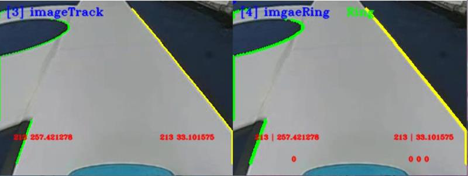

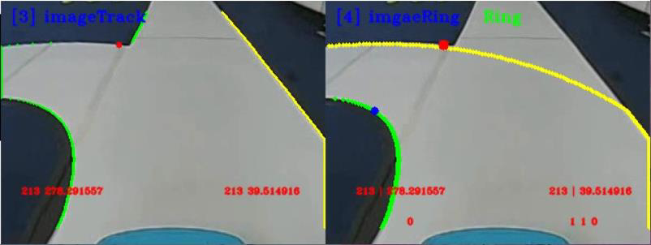

---

## Page 108

赛道与环岛识别
图 8-6 环岛内识别
4. 出环岛识别
执行出环岛的拐角识别、对侧直道边进行识别、车道线路径规划，完成智能
汽车的出环。
图 8-7 出环岛识别
5. 结束
出环岛后，虽然依旧会检测到拐角点，但此时可以同时检测到左侧车道线与
右侧车道线。
106

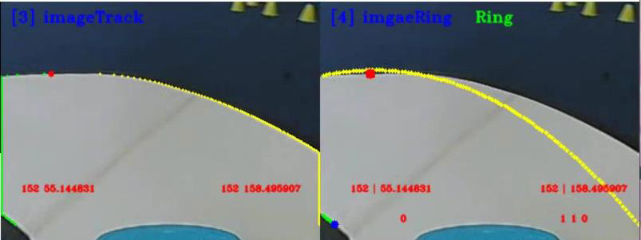

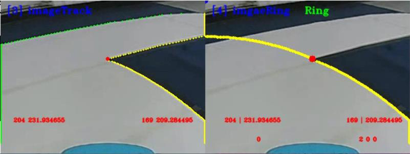

---

## Page 109

赛道与环岛识别
图 8-8 驶出环岛
步骤 6：补全代码，尝试实车运行，观察可视化运行结果
打开本实验项目的实践代码，对缺失代码的文件进行代码填充操作，进一步
掌握本工程代码实现方法。
图 8-9 代码文件
将填充完毕的代码文件尝试替换智能汽车源文件中的对应文件，运行程序，
观察可视化运行结果，验证代码填充是否正确。为防止代码错误或丢失，务必将
源文件提前备份。
107

---

## Page 110

十字路口与车库识别
九、十字路口与车库识别实验指导
1.实验描述
通过之前课程理论与实践的学习，我们已经初步了解赛道的基本识别方法和
遇到环岛情况下的识别策略，接下来我们要对其他几种类型的赛道情况进行讨论
和实践，并在本实验完成智能汽车对十字路口和车库的识别。
实践中可通过摄像头对赛道实时拍照进行识别，也可以读取本地的“MP4”
视频文件对视频中的赛道进行十字路口和车库的识别。本次课程我们选择读取视
频的方式完成任务。
2.实验目标
（1）理解十字路口识别的原理，掌握十字路口的识别方法；
（2）理解车库识别的原理，掌握车库识别的源码编程方法；
（3）参考教材内容及源码文件，完成本实验的部分代码补全任务。
3.实验步骤
步骤 1：连接智能汽车，查看板卡代码
第一步，插入网线，将智能汽车通过网线与 PC 相连。
第二步，打开 MobaXterm，通过 SSH 远程连接的方式，将本地 PC 与智能
汽车 Edgeboard 板卡建立远程连接，进而通过命令行的方式对智能汽车的源码进
行启动和编译等操作，具体操作见实训 1。
步骤 2：打开 Visual Studio Code 学习部分源码逻辑
在前面的环境准备阶段，我们已经安装了 Visual Studio Code，本次赛道识别
相关任务需要结合 EdgeBoard 嵌入式 AI 计算卡与本地计算机完成。
在上述步骤 1 基础上进行如下操作：
108

---

## Page 111

十字路口与车库识别
第 一 步 ， 把 部 署 在 EdgeBoard 嵌 入 式 AI 计 算 卡 中 的
intelligentcar_T710_python_v2 工程通过 Visual Studio Code 可视化界面打开。
第二步，准备十字路口与车库识别的源码文件。
在 本 实 验 中 ， 通 过 路 径 1“src/python/cross_recognition.py” 、 路 径 2
“src//python/garage_recognition.py”找到本实验提供的十字路口和车库识别的部
分源码。
工程文件结构如下图所示。
v
图 9-1 工程文件结构
109

---

## Page 112

十字路口与车库识别
步骤 3：新建文件夹，用于存储采集的图像或视频
在该工程下，进入 res/samples/文件夹内，存放本次实验使用的 MP4 视频，
如果我们采用读取本地视频的方式进行赛道及环岛识别，可通过修改代码中的读
取视频源的方式读取本地的 MP4 视频。
步骤 4：十字路口识别与车库识别
（1）引入函数库（src/python/ cross_recognition.py 或者
garage_recognition.py）
引入 Python OpenCV 的函数库、智能汽车 intelligentCar_v2 函数库以及一些
其他的在程序中使用到的函数库。
import base64
import cv2
import numpy as np
import sys
sys.path.append("../lib") # 引用 C++库
import intelligentCar_v2
（2）确认输入源（src/python/ cross_recognition.py 或者
garage_recognition.py）
根据自身情况调整输入源的输入方法，可切换选择本地视频或者选择摄像头
的方式，同时设置分辨率为 320×240，这里我们选择本地输入视频的方式。
capture = cv2.VideoCapture("../../res/samples/garage.mp4") # 选择本地视
频
capture.set(cv2.CAP_PROP_FRAME_WIDTH, 320) # 设置视频分辨率
capture.set(cv2.CAP_PROP_FRAME_HEIGHT, 240)
（3）实例对象初始化（src/python/cross_recognition.py 或
者 garage_recognition.py）
第一步，初始化智能汽车类，便于后续调用一些赛道处理的函数；
第二步，相机校正参数初始化，保证后续在进行图像识别时照片的准确性。
# 初始化智能汽车类
110

---

## Page 113

十字路口与车库识别
icar = intelligentCar_v2.IntelligentCar()
# 相机矫正参数初始化
icar.imageCorrecteInit()
（ 4 ） 赛 道 识 别 （ src/python/cross_recognition.py 或 者
garage_recognition.py）
第一步，读取视频的每一帧；
第二步，对这一帧的 RGB 彩色图像进行图像校正；
第三步，把 RGB 彩色图像转换成为灰度图；
第四步，把灰度图像转换成二值化图像；
第五步，根据传入的二值化图像完成赛道识别功能，并且可视化显示车道线
的识别结果；
while True:
# 读取视频帧
isTrue, imageFrame = capture.read()
if isTrue:
cv2.waitKey(1)
else:
print("视频播放完毕")
break
# 图像矫正
base64Frame = matToBase64(False, imageFrame)
base64Corret = icar.imageCorrection(base64Frame)
imageCorret = base64ToMat(base64Corret)
# RGB 图像转换成灰度图像
imageGray = cv2.cvtColor(imageCorret, cv2.COLOR_BGR2GRAY)
# 图像二值化
rel, imageBinary = cv2.threshold(imageGray, 0, 255, cv2.THRESH_OTSU)
# 赛道识别
base64Binary = matToBase64(False, imageBinary)
icar.trackRecognition(base64Binary)
icar.trackDrawImage(base64Corret) # 可视化显示识别结果
111

---

## Page 114

十字路口与车库识别
（5）十字路口识别（src/python/cross_recognition.py）
直接调用 icar.crossRecognition()十字路口识别函数：
# 十字道路识别
icar.crossRecognition()
base64Cross = matToBase64(True, imageCorret)
icar.crossDrawImage(base64Cross)
（6）车库识别（src/python/ garage_recognition.py）
直接调用 icar.garageRecognition()函数进行车库识别：
# 车库识别
icar.garageRecognition()
base64Garage = matToBase64(True, imageCorret)
icar.garageDrawImage(base64Garage) # 可视化显示识别结果
步骤 5：运行代码文件，查看可视化运行结果
与先前实验步骤相同，先进入 python 文件夹，然后分别运行十字路口识别
代码和车库识别代码。
输 入 “cd workspace/intelligentcar_T710_python_v2/src/python/” 命 令 进 入
python 文件夹：
图 9-2 切换目录
运行十字路口识别代码 python3 cross_recognition.py：
图 9-3 运行识别十字路口代码
运行车库识别代码 python3 garage_recognition.py：
112

---

## Page 115

十字路口与车库识别
图 9-4 运行识别车库代码
如需退出，只需在终端按 Ctrl+c 即可。
1.十字路口识别
如下图所示，左侧图为车道线识别，右侧图为环岛入口的十字路口识别，可
以从图中观测出，此时智能汽车正在左转入弯，视野只有两个角点，根据紫色和
粉色两点，使用最小二乘法规划路线，向上延伸，补齐缺口部分。右转弯入十字
路口同理。
图 9-5 十字路口检测
如下图所示，左侧图为车道线识别，右侧图为十字路口识别，可以从图中观
测出，此时的智能汽车即将直入十字路口，可以观测到 3-4 个角点，左侧两角点，
向上延伸规划路径；右侧两角点向上延伸规划路径。驶出十字路口同理。
113

---

## Page 116

十字路口与车库识别
图 9-6 十字路口检测
2．出库识别
车库前的斑马线通过 AI 与传统图像处理技术共同检测，双重确认智能汽车
是否进入出入库状态。如下图中第一张图片所示，有一个白框将斑马线圈了起来
即为 AI 检测结果。当检测到斑马线后，程序默认规划向左转的路线。如下方第
四张图所示，为结合贝塞尔曲线规划的出库路径。
图 9-7 出库，检测斑马线
图 9-8 出库
114

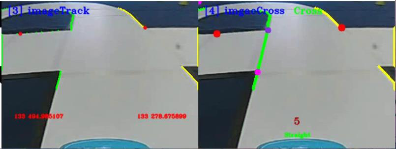

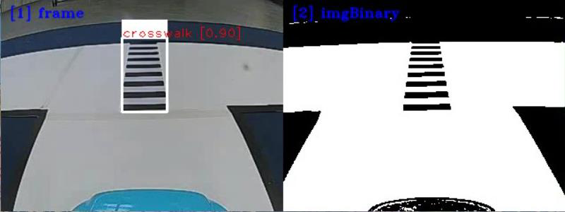

---

## Page 117

十字路口与车库识别
3．入库识别
出库只有一次，入库也只有一次。入库时同样是利用 AI 技术与传统图像处
理技术共同检测斑马线，以判断是否进入入库状态。
图 9-9 入库，检测斑马线
图 9-10 入库
入库分为两种情况，一种是智能汽车压过斑马线之前，另一种是智能汽车压
过斑马线后，入库过程如下图所示。具体识别策略可参考课程讲义内容，以进一
步理解代码逻辑。
图 9-11（a） 入库，未压过斑马线 图 9-11(b) 入库，未压过斑马线
115

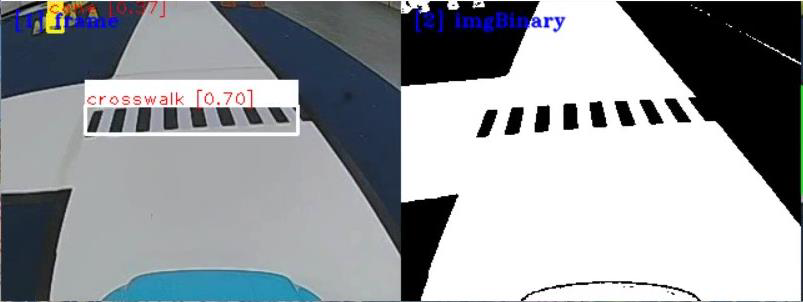

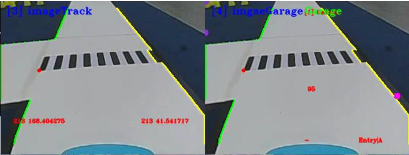

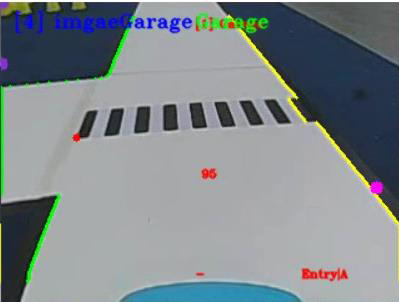

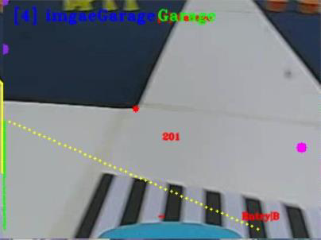

---

## Page 118

十字路口与车库识别
图 9-12（a） 入库，压过斑马线 图 9-12（b） 入库，压过斑马线
步骤 6：补全代码，尝试实车运行，观察可视化运行结果
打开本实验项目的实践代码，对缺失代码的文件进行代码填充操作，进一步
掌握本工程代码实现方法。
图 9-13 代码文件
将填充完毕的代码文件尝试替换智能汽车源文件中的对应文件，运行程序，
观察可视化运行结果，验证代码填充是否正确。为防止代码错误或丢失，务必将
源文件提前备份。
116

---

## Page 119

智能汽车 AI 模型部署
十、智能汽车 AI 模型部署实验指导
1.实验描述
前面实训中基于百度飞桨 AI Studio 平台，通过对智能汽车采集的赛道图像
数据进行目标检测模型训练，已导出了相应的模型文件。但智能汽车实际运行过
程中，我们需要把训练后的模型部署到智能汽车的 EdgeBoard 边缘计算卡上，智
能汽车才能在行驶中实时的采集赛道图像并进行识别。将训练成功的 AI 模型部
署到智能汽车本地 EdgeBoard 板卡，才算是真正的部署成功。
本次课程将学习目标检测模型的编译和部署步骤，将前面实训中训练所得的
模型文件进行编译后，部署到智能汽车的工程文件中，从而在后续的赛道元素识
别中实现实际应用。
2.实验目标
（1）学习模型编译所需的环境配置步骤；
（2）对前面训练所得的模型文件进行编译；
（3）将编译完成的模型部署到智能汽车的工程文件中。
3.实验步骤
通过前面的实训，已经得到了对应的模型文件，但是在部署之前，还需要通
过编译步骤将得到的模型文件转换成可调用的文件类型，以此才能在工程文件中
利用并对目标进行识别。因此在部署模型之前，需要先配置编译环境并将模型文
件编译，从而得到可用的模型文件。
步骤 1：编译环境配置
（1）电脑设置
安装编译所需的环境之前，需要先在本地电脑开启 Hyper-V 功能。
Hyper-V 是微软开发的一款虚拟化产品，它允许用户在同一台物理计算机上
117

---

## Page 120

智能汽车 AI 模型部署
创建和运行多个虚拟机。其主要功能包括：虚拟机管理、高可用性、灾难恢复、
数据备份和恢复等。通过使用 Hyper-V，用户可以将不同的操作系统和应用程序
部署在虚拟机上，并对其进行集中管理和控制。在编译模型时，就需要通过
Hyper-V 功能在本地创建一个 Linux 系统，并在 Linux 系统中完成模型的编译。
开启功能之前，先确认电脑已启用虚拟化。打开任务管理器（快捷键：
Ctrl+Shift+Esc），选择“性能”--“CPU”，确认 PC 已开启虚拟化。
图 10-1 查看虚拟化功能
如果未开启虚拟化，则需要根据电脑的品牌在网上查找开启虚拟化的方法。
不同品牌的电脑操作不同，本次实训中不做详细说明。
虚拟化开启完成后，打开电脑的“控制面板”，选择“程序”，在“程序和
功能”中选择“启用或关闭 windows 功能”。
图 10-2 打开“启动或关闭 Windows 功能”
在打开的选项卡中确保 Hyper-V 功能正常启用，设置完成后等待功能生效。
118

---

## Page 121

智能汽车 AI 模型部署
图 10-3 启用 Hyper-V 功能
如果未找到 Hyper-v 选项，需要在桌面单击右键创建文本文档，命名为
“Hyper-V.txt”。命名完成后在文件内填写如下内容。
pushd "%~dp0"
dir /b %SystemRoot%\servicing\Packages\*Hyper-V*.mum >hyper-v.txt
for /f %%i in ('findstr /i . hyper-v.txt 2^>nul') do dism /online
/norestart /addpackage:"%SystemRoot%\servicing\Packages\%%i"
del hyper-v.txt
Dism /online /enable-feature /featurename:Microsoft-Hyper-V-All
/LimitAccess /ALL
图 10-4 创建文件并填写内容
填写完成后保存文件，右键单击文件将文件重命名为“Hyper-V.bat”。然后
鼠标右键单击“Hyper-V.bat”文件并且用管理员身份运行，运行后会自动弹出终
119

---

## Page 122

智能汽车 AI 模型部署
端窗口并执行功能，执行完成后会自动关闭终端窗口。
图 10-5 重命名并运行文件
（2）环境安装
电脑设置完成后，即可进行编译环境的安装。本次实训使用的编译环境是基
于 Docker。
Docker 是一个开源的应用容器引擎，它允许开发者将应用程序以及依赖包
打包到一个可移植的容器中，然后发布到任何流行的 Linux 或 Windows 操作系
统的机器上，实现虚拟化。前面开启虚拟化的步骤也是为了支持 Docker 以及后
续的镜像系统的运行。
单击此链接可在浏览器中下载 Docker 安装包：https://desktop.docker.com/wi
n/main/amd64/Docker%20Desktop%20Installer.exe。
图 10-6 Docker 安装包
鼠标左键双击 Docker Desktop installer.exe 文件进行安装操作，在弹出的窗
口中点击“OK”，接着等待程序安装。
120

---

## Page 123

智能汽车 AI 模型部署
图 10-7 配置界面
图 10-8 安装过程
安装完成后，点击“Close”，桌面上便出现 Docker 的快捷方式。
图 10-9 安装完成
121

---

## Page 124

智能汽车 AI 模型部署
图 10-10 快捷方式
双击快捷方式，等待软件打开。打开后会出现订阅服务协议，选择“Accept”。
图 10-11 接受订阅服务协议
接着进行基本设置，直接选择“Finish”即可。
图 10-12 完成设置
接着会进入到 Docker 的启动界面，直接跳过登录界面和使用方法。
122

---

## Page 125

智能汽车 AI 模型部署
图 10-13 跳过登录和使用方向
接下来便进入到 Docker 的操作界面。需要说明的是，由于个人电脑系统不
同，该部分可能受阻，这主要是因为电脑没有下载 Ubuntu 的子系统导致 Docker
软件无法正常启动。后续会继续进行镜像下载和容器操作，操作时需要保证 Do
cker 处于运行状态。
图 10-14 Docker 界面
Docker 安装完成后，可以在命令行中检查其安装版本。使用快捷键“win”
123

---

## Page 126

智能汽车 AI 模型部署
+“R”调出运行命令，输入“cmd”并确定。在打开的终端中，输入指令“doc
ker --version”即可在终端中查询 Docker 的版本信息。
图 10-15 打开中断
图 10-16 查看 Docker 版本
（3）镜像部署
在电脑上创建新文件夹“work”，确保此文件夹所在磁盘有不低于 15G 的
存储空间。进入此文件夹后，在输入框输入“cmd”并按下回车打开终端。同时
还需要保证 Docker 在后台运行中。
124

---

## Page 127

智能汽车 AI 模型部署
图 10-17 新建文件夹并进入终端
在打开的终端中输入指令“docker pull pphub/ppnc2.0:v1.0”，此指令用于
下载镜像文件。下载速度受到网速限制，需要等待下载完成。下载完成后会重新
出现路径提示。
图 10-18 镜像下载中
图 10-19 镜像下载完成
125

---

## Page 128

智能汽车 AI 模型部署
接下来建立本地文件夹和容器内相应文件夹的映射关系。输入指令时需要根
据本地文件夹”work“所在的路径进行对应的修改。
详细指令为“docker run -it --name ppnc2.0 -v C:\Users\EDY\Desktop\work:
/home/edgeboard/workspace pphub/ppnc2.0:v1.0 /bin/bash”。
其中：“ppnc2.0”为容器名称；“C:\Users\EDY\Desktop\work:”为本地电
脑上要映射给容器的文件夹路径，实际使用时根据自己创建的 work 文件夹路径
进行对应修改；“/home/edgeboard/workspace”为容器中被映射到的路径。
指令完成后会自动进入到容器中，可以观察到路径提示发生了变化，这是因
为本地文件路径和容器内的文件路径是不同的。
图 10-20 创建文件夹映射
镜像安装完成后，在 Docker 软件中也可以查看到镜像信息。
图 10-21 镜像信息
在终端中使用容器时，直接输入指令即可，进入容器后文件路径提示会发生
变化。这是因为本地文件夹和容器内的文件夹是映射关系，进入到容器相当于进
入了另一个操作系统，因此路径会发生改变。
关于容器的基本操作指令，主要有以下几个：
126

---

## Page 129

智能汽车 AI 模型部署
1）启动容器：docker start ppnc2.0
2）进入容器：docker exec -it ppnc2.0 /bin/bash
3）导入环境变量：export PPNC_HOME=/usr/local/ppnc
4）导入相关路径：source /usr/local/ppnc/scripts/activate_env.sh
5）退出容器：exit
需要注意操作 3）和操作 4）在每次重新进入容器时都需要重新执行一遍。
图 10-22 容器操作及其运行效果
使用容器时需要保持 Docker 软件运行中。否则会出现错误提示。
图 10-23 错误提示
步骤 2：模型及编译文件配置
（1）模型文件准备
打开前面创建的用于映射容器的文件夹“work”，将模型编译脚本文件夹下
127

---

## Page 130

智能汽车 AI 模型部署
的配置文件压缩包“compiler.zip”复制到此文件夹并解压。
图 10-24 解压配置文件压缩包
在解压后的“compiler”文件夹下创建一个新文件夹“yolov3”，在其内部
创建两个新文件夹“model”和“image”。
图 10-25 创建新文件夹
在“model”文件夹中，放置实训七中 AI Studio 平台上导出的模型文件；在
“image”文件夹下准备大于 50 张并覆盖所有标签种类的用于校正的赛道元素
图片文件，可从数据集的图片文件夹中自行选取。
图 10-26 添加模型文件
128

---

## Page 131

智能汽车 AI 模型部署
图 10-27 添加图片文件
（2）编译文件配置
打开“compiler”文件夹中的“config.json”文件进行配置。
其中，model_dir 的参数表示模型文件所在的路径，使用的是镜像内的路径；
shape 表示模型输入尺寸，需要与模型实际尺寸保存一致，这里直接设置为[320，
320]；split 参数使用默认设置 true 即可。
图 10-28 配置“config.json”文件
接着打开“compile”文件夹下的脚本文件“split.py”，找到如图所示的模
型输出张量数值，将其修改成与 AIstudio 平台上导出的模型文件的输出张量数值
相同。
129

---

## Page 132

智能汽车 AI 模型部署
图 10-29 修改“split.py”脚本中的输出张量数值
AI Studion 平台导出的模型文件的输出张量数据可通过在线深度学习模型可
视化平台 NETRON 查看，网址为 https://netron.app/。打开网址后选择“Open
Model”，将下载好的模型文件（后缀为.pdmodel）上传即可查看模型结构。
图 10-30 模型可视化平台 NETRON
130

---

## Page 133

智能汽车 AI 模型部署
图 10-31 上传模型文件
将打开的模型结构拉到最下方选择“concat”，其中第 3 个数据即为输出张
量的数值。“concat”指的是连接操作，即将两个或多个张量（或称为多维数组）
在某个维度上进行拼接。其目的是为了将不同层的输出合并在一起，以传递给下
一层。
前面的脚本文件“split.py”中的输出张量数值需要和模型中的输出张量数值
一致。
图 10-32 查看模型结构及输出张量数值
接着修改“compiler”文件夹下“res”文件夹内的“io_paddle.json”配置文
件，将其中的 shape 参数将其改成模型尺寸 320×320。
131

---

## Page 134

智能汽车 AI 模型部署
图 10-33 修改“io_paddle.json”配置文件中的模型尺寸
至此编译所需的相关文件已全部配置完成。
步骤 3：模型编译及部署
（1）模型编译
根据前面编译环境配置中的容器操作，进入容器并导入环境变量和相关路径
后，输入指令“cd home/edgeboard/workspace/compiler/”进入到“compiler“路径
下，接着输入模型编译指令“python3 compile.py config.json”并运行。程序运行
完成后即可在文件路径“work\compiler\build\”下生成编译好的模型文件压缩包
“inference.zip”，将此文件解压并打开即可获得编译好的模型文件。
图 10-34 操作容器进行模型编译
132

---

## Page 135

智能汽车 AI 模型部署
图 10-35 模型编译完成
图 10-36 解压最终的模型编译压缩文件
133

---

## Page 136

智能汽车 AI 模型部署
图 10-37 编译文件夹中的模型文件
（2）模型部署
通过网络映射使用 VSCode 打开智能汽车的工程文件目录，将“inference”
文件夹下的所有文件以及数据集文件夹中的“label_list.txt”文件一起复制到工程
文件夹的“res\model\yolov3_mobilenet_v1”路径下。至此，模型部署过程即全部
完成。
图 10-38 “label_list.txt”文件
图 10-39 工程文件中的文件部署
134

---

## Page 137

基于 AI 的赛道元素检测与识别 1-农田检测
十一、基于 AI 的赛道元素检测与识别实验 1
——农田检测
1.实验描述
通过之前的理论与实践的讲解，我们已经了解并掌握了基本赛道识别方法、
环岛类型赛道的识别方法、十字路口的识别方法、车库出入库情况下的识别方法
等等。但是在有些场景中，必须要结合使用 AI 方法才能完成识别任务，比如赛
道上各种标志元素的识别。在智能汽车竞赛中，合计有 8 种赛道标志可以通过
AI 方法进行检测和识别，分别是锥桶标志、斑马线、拱桥、车辆维护标志、农
田标志、减速标志、动物出没和粮仓标志。
本次课程我们尝试通过源码编程完成对农田标志的 AI 识别任务。其中，图
像来源既可以通过智能汽车的摄像头对赛道场景的三维实物进行实时采集，也可
以读取本地的“MP4”视频对赛道标志进行图像处理、识别等操作。本次我们选
取读取视频的方式完成任务。
2.实验目标
（1）理解赛道标志的深度学习检测与识别方法、程序及相关技术；
（2）通过源码调试、编程，完成智能汽车对农田的识别与通行任务；
（3）参考教材内容及源码文件，完成本实验的部分代码补全任务。
3.实验步骤
步骤 1：了解农田区标志与特点
智能汽车竞赛场地中设置有农田区域，此区域为非常规道路（断路区），需
要依据黄色的锥桶围出的场地路线行驶。
135

---

## Page 138

基于 AI 的赛道元素检测与识别 1-农田检测
图 11-1 农田区域
图 11-2 农田标志
步骤 2：明确 AI 检测与识别流程，准备模型
智能汽车在赛道行驶中实时采集赛道标志的图像，实时识别并采取相应的控
制策略，前提是先经过 AI 训练，通过学习赛道标志的特征能够识别这些标志，
选用合适的算法模型是核心。基本步骤如下图 11-3 示：
图 11-3 识别图像的步骤图
第一步，收集 8 种赛道标志及 1 个背景的图像数据集，各种标志的图像数量
要均衡合适，动态图像与静态图像相结合，具体可参考教材内容；
136

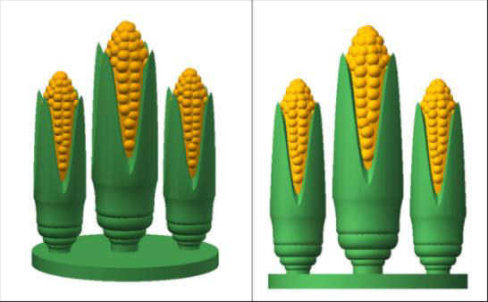

---

## Page 139

基于 AI 的赛道元素检测与识别 1-农田检测
第二步，把收集到的图片划分为训练集和测试集。对训练集图片中的交通标
志进行人工标记，为后续训练做准备；
第三步，基于百度飞桨平台，选用合适的模型，输入训练数据集，进行训练；
本次实验选用 yolov3_mobilenet_v1 模型开展赛道标志的检测工作；
第四步，通过测试集测试基于该模型进行赛道各种标志识别的成功率，如果
识别成功率可以达到 70%或者 80%及以上就可以确定采用本模型进行 AI 识别应
用；如果识别成功率较低，低于 50%，那么就需要通过增加图片数量或者重新收
集图片调整图片质量，或重新选择合适的模型，重新训练，直至识别成功率达到
标准。
第五步，将模型文件部署到 Edgeboard 边缘计算卡中的对应位置，便于智能
汽车实时采集赛道标识的图像并实时基于Edgeboard边缘计算卡进行检测和识别。
第六步，采集图像，并对图像进行预处理，包括二值化、图像校正、透视变
换等操作，然后针对预处理后的图像，基于 yolov3_mobilenet_v1 模型进行各种
类型的赛道标志的检测与识别。
此次实训重点介绍第六步的相关操作，通过源码编程实现实验目标。
步骤 3：将智能汽车与 PC 电脑相连接
第一步，插入网线，将智能汽车通过网线与 PC 相连。PC 电脑需要参照实
训一步骤设置好静态 IP 地址，并完成网络映射相关设置。
第二步，打开 MobaXterm，建立 SSH 远程连接，将本地 PC 与智能汽车
Edgeboard 板卡建立远程连接，进而可通过命令行的方式对智能汽车的源码进行
启动等操作。
通过 MobaXterm，我们可以在电脑上看到智能汽车 Edgeboard 板卡上所展示
的界面内容。
步骤 4：打开 Visual Studio Code 学习部分源码逻辑
在前面的环境准备阶段，我们已经安装了 Visual Studio Code，本次农田区的
AI 检测任务需要结合 EdgeBoard 嵌入式 AI 计算卡与本地计算机完成。
在上述步骤 3 基础上进行如下操作：
137

---

## Page 140

基于 AI 的赛道元素检测与识别 1-农田检测
第 一 步 ， 把 部 署 在 EdgeBoard 嵌 入 式 AI 计 算 卡 中 的
intelligentcar_T710_python_v2 工程通过 Visual Studio Code 可视化界面打开。
第二步，准备视频。在该工程下，进入 res/samples/文件夹内，存放 AI 检测
使用的 MP4 视频。如果我们采用读取本地视频的方式进行本次实验，通过修改
代码中的读取视频源的方式从而读取本地的 MP4 视频。
第三步，准备源码文件。
在本实验中，通过路径“src\python”找到所提供的“farmland_detection.py”
农田检测实验的部分源码。
完成以上步骤后，该工程文件的文件结构如下图所示。
图 11-4 工程文件结构
138

---

## Page 141

基于 AI 的赛道元素检测与识别 1-农田检测
步骤 5：学习 AI 识别代码逻辑
AI 识别的源码编程主要分为如下几步：引入函数库、类的转换、确认视频
的输入源是来自本地 MP4 视频还是摄像头、功能类的初始化、图片处理包括图
像校正、灰度图转换、二值化转换、赛道识别，启动 AI 推理以及对农田标志检
测的 AI 识别，其中 AI 识别部分包含赛道标志检测与对应的路径规划。
（1）引入函数库
引入 Python OpenCV 的函数库、智能汽车 intelligentCar_v2 函数库以及一些
其他的在程序中使用到的函数库。
import base64
import cv2
import numpy as np
import sys
sys.path.append("../lib") # 引用 C++库
import intelligentCar_v2
（2）类的转换
将 C++的 Mat 类转换到到 Python,numpy 类中进行解码。
智能汽车工程底层代码是 C++编程，在 C++的编程体系下,Mat 类在 OpenCV
中是最重要的一种图像表示形式(即为 Matrix)，可以指定存储的数据类型、行列
数,以及每个元素中的数值个数(通道数)等等。但在 Python 中主要通过 numpy 进
行相关数据处理，故需进行解编码操作。
def base64ToMat(base64_data):
img = base64.b64decode(base64_data)
nparr = np.fromstring(img, np.uint8)
img_np = cv2.imdecode(nparr, 1)
img_np = cv2.cvtColor(img_np, cv2.COLOR_BGR2RGB)
return img_np
将 Python,numpy 类转换到 C++,Mat 类中进行编码。
def matToBase64(rgb, img):
if rgb:
img = cv2.cvtColor(img, cv2.COLOR_RGB2BGR) # RGB 转 BGR
x = cv2.imencode(".jpg", img)[1].tobytes()
base64_data = base64.b64encode(x)
return base64_data
139

---

## Page 142

基于 AI 的赛道元素检测与识别 1-农田检测
（3）确认输入源
根据自身情况调整输入源的输入方法并检测视频是否接受，为防止死循环加
入 exit()方法。可切换选择本地视频或者选择摄像头的方式，同时设置分辨率为
320×240，这里我们选择本地视频输入的方式。
capture = cv2.VideoCapture("../../res/samples/farmland.mp4") # 选择本
地视频
capture.set(cv2.CAP_PROP_FRAME_WIDTH, 320) # 设置视频分辨率
capture.set(cv2.CAP_PROP_FRAME_HEIGHT, 240)
# 检测视频是否接收到,加入 exit()防止死循环
if not capture.isOpened():
print("Cannot open camera")
exit()
rate = int(capture.get(cv2.CAP_PROP_FPS))
width = int(capture.get(cv2.CAP_PROP_FRAME_WIDTH))
height = int(capture.get(cv2.CAP_PROP_FRAME_HEIGHT))
print("Camera Param: frame rate = ", rate, " width = ", width, " height
= ", height)
（4）初始化功能类
第一步，初始化智能汽车类，便于后续调用赛道处理、赛道识别的一些函数
功能；
第二步，透视变换（IPM）参数初始化。智能汽车在赛道运行时，需要借助
透视变换后的赛道图像进行运算与路径规划；
第三步，相机校正参数初始化，保证后续在进行图像识别时照片的准确性；
第四步，AI 模型初始化，智能汽车在赛道行驶时，遇到赛道标志时，只能
通过 AI 识别的方式去完成赛道任务，通过初始化该模型，我们就可以调用其中
的函数功能去解决不同区域的赛道标志识别。
# 初始化智能汽车类
icar = intelligentCar_v2.IntelligentCar()
# 透视变换（IPM）参数初始化
icar.ipmInit()
# 相机矫正参数初始化
icar.imageCorrecteInit()
# AI 模型初始化
140

---

## Page 143

基于 AI 的赛道元素检测与识别 1-农田检测
icar.paddleModelInit()
（5）对每一帧图像进行处理
第一步，读取视频帧。无论是通过读取本地 MP4 视频的方式，还是实时赛
道采集的方式，在进行图像识别时都需要对每一帧的图像进行操作，进而从连续
帧的图像中分析得出结果。
while True:
# 读取视频帧
isTrue, imageFrame = capture.read()
if isTrue:
cv2.waitkey(1)
else:
print("视频播放完毕")
break
第二步，图像校正。对智能汽车实车采集的图像进行校正。
base64Frame = matToBase64(False, imageFrame)
base64Corret = icar.imageCorrection(base64Frame)
imageCorret = base64ToMat(base64Corret)
第三步，灰度图转换。对赛道 RGB 彩色图像进行灰度转换，方便后续图像
处理。
# RGB 图像转换成灰度图像
imageGray = cv2.cvtColor(imageCorret, cv2.COLOR_BGR2GRAY)
第四步，图像二值化，将图像转换为黑白图像。
# 图像二值化
rel, imageBinary = cv2.threshold(imageGray, 0, 255, cv2.THRESH_OTSU)
第五步，赛道识别，识别一般赛道区域的行驶范围，供智能汽车行驶。
# 赛道识别
base64Binary = matToBase64(False, imageBinary)
icar.trackRecognition(base64Binary)
icar.trackDrawImage(base64Corret) # 可视化显示识别结果
（6）农田标志的 AI 识别
启动 AI 推理，调用 AI 模型去完成农田区域的赛道标志检测与路径规划。
①启动 AI 推理
# 启动 AI 推理
icar.AiDetection(base64Frame)
②农田区检测与路径规划（farmland_detection.py）
141

---

## Page 144

基于 AI 的赛道元素检测与识别 1-农田检测
在该路段，智能汽车首先会遇到“农田标志”，当检测识别出此标志时，智
能汽车会切换行驶模式，从正常的赛道行驶模式切换为“农田区域使能”模式。
根据识别锥桶围成的区域，规划路线，驶出农田。
通过已经实例化的 icar 智能汽车类，调用 farmlandDetection ()函数，完成农
田区赛道的检测与路径规划。
icar.farmlandDetection()
base64Farmland = matToBase64(True, imageCorret)
icar.farmlandDrawImage(base64Granary) # 可视化显示识别结果
步骤 6：运行代码文件，查看结果
农田检测实训所用脚本文件为 farmland_detection.py，可使用 cd 命令找到
src/python 文件目录下按回车键进入；
图 11-5 切换目录
输入 python3 farmland_detection.py 运行农田区识别程序(注意空格)，运行后
即可在弹出的窗口查看结果（如需退出只需在终端界面按 Ctrl+c 即可）。
图 11-6 运行代码文件
142

---

## Page 145

基于 AI 的赛道元素检测与识别 1-农田检测
图 11-7 农田区的标志识别效果
步骤 7：补全代码，修改优化
打开本实验项目的实践代码，对缺失代码的文件进行代码填充操作，进一步
掌握本工程代码实现方法。
图 11-8 农田区域检测代码补全文件
将填充完毕的代码文件尝试替换智能汽车源文件中的对应文件，运行程序，
观察可视化运行结果，验证代码填充是否正确。为防止代码错误或丢失，务必将
源文件提前备份。
143

---

## Page 146

基于 AI 的赛道元素检测与识别 2-粮仓与维护区检测
十二、基于 AI 的赛道元素检测与识别实验 2
——粮仓与维护区检测
1.实验描述
通过之前的理论与实践的讲解，我们已经了解并掌握了基本赛道识别方法、
环岛类型赛道的识别方法、十字路口的识别方法、车库出入库情况下的识别方法
等等。但是在有些场景中，必须要结合使用 AI 方法才能完成识别任务，比如赛
道上各种标志元素的识别。在智能汽车竞赛中，合计有 8 种赛道标志可以通过
AI 方法进行检测和识别，分别是锥桶标志、斑马线、拱桥、车辆维护标志、农
田标志、减速标志、动物出没和粮仓标志。
本次课程我们尝试通过源码编程完成对粮仓和维护区这两种代表性标志的
AI 识别任务。其中，图像来源既可以通过智能汽车的摄像头对赛道场景的三维
实物进行实时采集，也可以读取本地的“MP4”视频对赛道标志进行图像处理、
识别等操作。本次我们选取读取视频的方式完成任务。
2.实验目标
（1）理解赛道标志的深度学习检测与识别方法、程序及相关技术；
（2）通过源码调试、编程，完成智能汽车对粮仓的识别与通行任务；
（3）通过源码调试、编程，完成智能汽车对维护区的识别与通行任务。
3.实验步骤
步骤 1：粮仓区与车辆维护区介绍
（1）粮仓区
场地中设置有粮仓区域，粮仓区域由黄色的锥桶围成，分为 1 个入口和 2
144

---

## Page 147

基于 AI 的赛道元素检测与识别 2-粮仓与维护区检测
个出口。2 个出口距入口更近的为 1 号出口，远的为 2 号出口。粮仓区入口处前
路旁的实体粮仓标志数量代表出口号，1 个粮仓标志则从 1 号出口驶出，2 个粮
仓标志则从 2 号出口驶出即可。
图 12-1 粮仓区域
图 12-2 粮仓标志
（2）车辆维护区
车辆完成维护过程，如图 12-3 所示，车辆维护区具有车辆维护标志的另一
侧设置有锥桶摆放成的停车区域，车辆识别路旁的实体标志后，需完全驶入锥桶
区域且停车片刻后启动。
145

---

## Page 148

基于 AI 的赛道元素检测与识别 2-粮仓与维护区检测
图 12-3 车辆维护区
图 12-4 车辆维护标志
步骤 2：明确 AI 检测与识别流程，准备模型
智能汽车在赛道行驶中实时采集赛道标志的图像，实时识别并采取相应的控
制策略，前提是先经过 AI 训练，通过学习赛道标志的特征能够识别这些标志，
选用合适的算法模型是核心。基本步骤如下图 12-5 示：
146

---

## Page 149

基于 AI 的赛道元素检测与识别 2-粮仓与维护区检测
图 12-5 识别图像的步骤图
第一步，收集 8 种赛道标志的图像数据集，各种标志的图像数量要均衡合适，
动态图像与静态图像相结合，具体可参考教材内容；
第二步，把收集到的图片划分为训练集和测试集。对训练集图片中的交通标
志进行人工标记，为后续训练做准备；
第三步，基于百度飞桨平台，选用合适的模型，输入训练数据集，进行训练；
本次实验选用 yolov3_mobilenet_v1 模型开展赛道标志的检测工作；
第四步，通过测试集测试基于该模型进行赛道各种标志识别的成功率，如果
识别成功率可以达到 70%或者 80%及以上就可以确定采用本模型进行 AI 识别应
用；如果识别成功率较低，低于 50%，那么就需要通过增加图片数量或者重新收
集图片调整图片质量，或重新选择合适的模型，重新训练，直至识别成功率达到
标准。
第五步，将模型文件部署到 Edgeboard 边缘计算卡中的对应位置，便于智能
汽车实时采集赛道标识的图像并实时基于Edgeboard边缘计算卡进行检测和识别。
以上数据集准备及训练的具体过程在实训七有详细讲解，流程不熟悉的同学
可以返回之前的章节进行查阅；有关模型部署的操作可参考实训十“智能汽车模
型部署实验指导”。
第六步，采集图像，并对图像进行预处理，包括二值化、图像校正、透视变
换等操作，然后针对预处理后的图像，基于 yolov3_mobilenet_v1 模型进行各种
类型的赛道标志的检测与识别。
147

---

## Page 150

基于 AI 的赛道元素检测与识别 2-粮仓与维护区检测
此次实训重点介绍第六步的相关操作，通过源码编程实现实验目标。
步骤 3：将智能汽车与 PC 电脑相连接
第一步，插入网线，将智能汽车通过网线与 PC 相连。PC 电脑需要参照实
训一步骤设置好静态 IP 地址，并完成网络映射相关设置。
第二步，打开 MobaXterm，建立 SSH 远程连接，将本地 PC 与智能汽车
Edgeboard 板卡建立远程连接，进而可通过命令行的方式对智能汽车的源码进行
启动等操作。
通过 MobaXterm，我们可以在电脑上看到智能汽车 Edgeboard 板卡上所展示
的界面内容。
步骤 4：打开 Visual Studio Code 学习部分源码逻辑
在前面的环境准备阶段，我们已经安装了 Visual Studio Code，本次粮仓与维
护区的 AI 检测任务需要结合 EdgeBoard 嵌入式 AI 计算卡与本地计算机完成。
在上述步骤 3 基础上进行如下操作：
第 一 步 ， 把 部 署 在 EdgeBoard 嵌 入 式 AI 计 算 卡 中 的
intelligentcar_T710_python_v2 工程通过 Visual Studio Code 可视化界面打开。
第二步，准备视频。在该工程下，进入 res\samples 文件夹内，存放 AI 检测
使用的 MP4 视频。如果我们采用读取本地视频的方式进行本次实验，通过修改
代码中的读取视频源的方式从而读取本地的 MP4 视频。
第三步，准备源码文件。
在本实验中，通过路径“src\python”找到所提供的“granary__detection.py”
粮仓检测和“depot_detection.py”维护区检测实验的部分源码。
完成以上步骤后，该工程文件的文件结构如下图所示。
148

---

## Page 151

基于 AI 的赛道元素检测与识别 2-粮仓与维护区检测
图 12-6 工程文件结构
步骤 5：AI 识别代码编写部分
AI 识别的源码编程主要分为如下几步：引入函数库、类的转换、确认视频
的输入源是来自本地 MP4 视频还是摄像头、功能类的初始化、图片处理包括图
像校正、灰度图转换、二值化转换、赛道识别，启动 AI 推理以及对粮仓区和车
辆维护区标志检测的 AI 识别，其中 AI 识别部分包含赛道标志检测与对应的路
径规划。
粮仓区与维护区 AI 检测时，由于代码多处重叠此处不重复赘述，只有在赛
道标志检测与路径规划部分不同时再进行分别讲解。
（1）引入函数库
引入 Python OpenCV 的函数库、智能汽车 intelligentCar_v2 函数库以及一些
其他的在程序中使用到的函数库。
149

---

## Page 152

基于 AI 的赛道元素检测与识别 2-粮仓与维护区检测
import base64
import cv2
import numpy as np
import sys
sys.path.append("../lib") # 引用 C++库
import intelligentCar_v2
（2）类的转换
将 C++的 Mat 类转换到到 Python,numpy 类中进行解码。
def base64ToMat(base64_data):
img = base64.b64decode(base64_data)
nparr = np.fromstring(img, np.uint8)
img_np = cv2.imdecode(nparr, 1)
img_np = cv2.cvtColor(img_np, cv2.COLOR_BGR2RGB)
return img_np
将 Python,numpy 类转换到 C++,Mat 类中进行编码。
def matToBase64(rgb, img):
if rgb:
img = cv2.cvtColor(img, cv2.COLOR_RGB2BGR) # RGB 转 BGR
x = cv2.imencode(".jpg", img)[1].tobytes()
base64_data = base64.b64encode(x)
return base64_data
（3）确认输入源
根据自身情况调整输入源的输入方法并检测视频是否接受为放置死循环加
入 exit()方法。可切换选择本地视频或者选择摄像头的方式，同时设置分辨率为
320×240，这里我们选择本地视频输入的方式。
capture = cv2.VideoCapture("../../res/samples/granary.mp4") # 选择本地
视频
capture.set(cv2.CAP_PROP_FRAME_WIDTH, 320) # 设置视频分辨率
capture.set(cv2.CAP_PROP_FRAME_HEIGHT, 240)
# 检测视频是否接收到,加入 exit()防止死循环
if not capture.isOpened():
print("Cannot open camera")
exit()
rate = int(capture.get(cv2.CAP_PROP_FPS))
width = int(capture.get(cv2.CAP_PROP_FRAME_WIDTH))
height = int(capture.get(cv2.CAP_PROP_FRAME_HEIGHT))
print("Camera Param: frame rate = ", rate, " width = ", width, " height
= ", height)
150

---

## Page 153

基于 AI 的赛道元素检测与识别 2-粮仓与维护区检测
（4）初始化功能类
第一步，初始化智能汽车类，便于后续调用赛道处理、赛道识别的一些函数
功能；
第二步，透视变换（IPM）参数初始化。智能汽车在赛道运行时，需要借助
透视变换后的赛道图像进行运算与路径规划；
第三步，相机校正参数初始化，保证后续在进行图像识别时照片的准确性；
第四步，AI 模型初始化，智能汽车在赛道行驶时，遇到赛道标志时，只能
通过 AI 识别的方式去完成赛道任务，通过初始化该模型，我们就可以调用其中
的函数功能去解决不同区域的赛道标志识别。
# 初始化智能汽车类
icar = intelligentCar_sou.IntelligentCar()
# 透视变换（IPM）参数初始化
icar.ipmInit()
# 相机矫正参数初始化
icar.imageCorrecteInit()
# AI 模型初始化
icar.paddleModelInit()
（5）对每一帧图像进行处理
第一步，读取视频帧。无论是通过读取本地 MP4 视频的方式，还是实时赛
道采集的方式，在进行图像识别时都需要对每一帧的图像进行操作，进而从连续
帧的图像中分析得出结果。
while True:
# 读取视频帧
isTrue, imageFrame = capture.read()
try:
cv2.imshow("imageFrame", imageFrame)
except:
print("视频播放完毕")
break
第二步，图像校正。对智能汽车实车采集的图像进行校正。
base64Frame = matToBase64(False, imageFrame)
base64Corret = icar.imageCorrection(base64Frame)
imageCorret = base64ToMat(base64Corret)
151

---

## Page 154

基于 AI 的赛道元素检测与识别 2-粮仓与维护区检测
第三步，灰度图转换。对赛道 RGB 彩色图像进行灰度转换，方便后续图像
处理。
# RGB 图像转换成灰度图像
imageGray = cv2.cvtColor(imageCorret, cv2.COLOR_BGR2GRAY)
第四步，图像二值化，将图像转换为二值化黑白图像。
# 图像二值化
rel, imageBinary = cv2.threshold(imageGray, 0, 255, cv2.THRESH_OTSU)
第五步，赛道识别，识别一般赛道区域的行驶范围，供智能汽车行驶。
# 赛道识别
base64Binary = matToBase64(False, imageBinary)
icar.trackRecognition(base64Binary)
icar.trackDrawImage(base64Corret) # 可视化显示识别结果
（6）赛道标志的 AI 识别
启动 AI 推理，调用 AI 模型去完成粮仓区和车辆维护区这两个区域的赛道
标志检测与路径规划。
1. 启动 AI 推理
# 启动 AI 推理
icar.AiDetection(base64Frame)
2. 粮仓区检测与路径规划（granary__detection.py）
粮仓区域检测函数中先进行粮仓标志检测进行粮仓使能。根据检测到的粮仓
数量进行巡航使能，检测到几个粮仓就从对应出口驶出。检测逻辑阐述如下；
在该路段，智能汽车首先会遇到“粮仓标志”，当检测识别出此标志时，智
能汽车会切换行驶模式，从正常的赛道行驶模式切换为“粮仓使能”模式。
识别粮仓个数 0、1 或 2，为指定的出口。倘若识别结果为 1，那么后续就需
要从所对应的第 1 出口出口驶出，如果从第 2 个出口错误驶出，那么就会判定该
路段行驶失败。
识别锥桶：粮仓入口处、内部及出口都放置有锥桶，观察入口可以发现，智
能汽车想要驶入粮仓的入口是没有右侧赛道线的。驶入粮仓区域内的路径规划：
前一步识别锥桶和粮仓入口，规划路线，驶入区域后此时智能汽车上摄像头的视
野已经不包含有赛道的信息，没有赛道线指引的智能汽车就会冲出跑道。所以此
时的路径规划任务就是需要在粮仓区域内构建一个虚拟的左侧赛道线与右侧赛
道线，引导智能汽车在粮仓区域内正常行驶。
152

---

## Page 155

基于 AI 的赛道元素检测与识别 2-粮仓与维护区检测
根据识别的粮仓数量选择对应出口和出口锥桶，规划路线，在指定的出口驶
出粮仓。
图 12-7 粮仓区域检测与路径规划流程图
通过已经实例化的 icar 智能汽车类，调用 granaryDetection ()函数，完成粮仓
区赛道的检测与路径规划。
icar.granaryDetection()
base64Granary = matToBase64(True, imageCorret)
icar.granaryDrawImage(base64Granary) # 可视化显示识别结果
3. 车辆维护区检测与路径规划（depot_detection.py）
车辆维护区域检测函数 depotDetection 的运行逻辑如下：
巡航使能，标准驶进此区域。在进站后需要进行停车操作，停车两秒后出站
153

---

## Page 156

基于 AI 的赛道元素检测与识别 2-粮仓与维护区检测
使能。
在该路段，智能汽车首先会遇到“车辆维护标志”，先进行车辆维护标志检
测，当检测识别出此标志时，智能汽车会切换行驶模式，从正常的赛道行驶模式
切换为“维修厂使能”模式，进行进站操作。
开始进站使能，驶入维修厂区域内的路径规划。车道未丢失，进行巡航；车
道线丢失时，巡航使能进行补线，构建一个虚拟的左侧车道线与右侧车道线，引
导智能汽车进入维修厂区域内。
在进站后需要进行停车操作，停车两秒后出站使能。
图 12-8 维护厂区域检测与路径规划流程图
通过已经实例化的 icar 智能汽车类，调用 depotDetection ()函数，完成车辆
154

---

## Page 157

基于 AI 的赛道元素检测与识别 2-粮仓与维护区检测
维护区车道线的检测与路径规划。
# 维修厂检测与路径规划
icar.depotDetection()
base64Depot = matToBase64(True, imageCorret)
icar.depotDrawImage(base64Depot) # 可视化显示识别结果
步骤 6：运行代码文件，查看结果
粮 仓 检 测 实 训 所 用 脚 本 文 件 为 granary__detection.py ， 可 使 用 “ cd
workspace/intelligentcar_T710_python_v2/src/python/”命令按回车键进入切换目录。
图 12-9 切换目录
输入 python3 granary__detection.py 运行粮仓区识别程序(注意空格)，运行后
即可在弹出的窗口查看结果（如需退出只需在终端界面按 Ctrl+c 即可）。
图 12-10 运行代码文件
图 12-11 粮仓区的标志识别效果
输入 python3 depot_detection.py 运行车辆维护区识别程序(注意空格)，运行
后即可在弹出的窗口查看维护区检测结果。
155

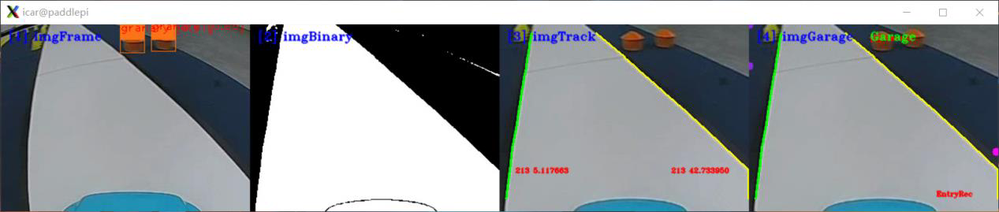

---

## Page 158

基于 AI 的赛道元素检测与识别 2-粮仓与维护区检测
图 12-12 运行代码文件
图 12-13 车辆维护区的标志识别效果
步骤 7：补全代码，修改优化
打开本实验项目的实践代码，对缺失代码的文件进行代码填充操作，进一步
掌握本工程代码实现方法。
图 12-13 粮仓区域检测代码补全文件
图 12-14 维修厂区域检测代码补全文件
将填充完毕的代码文件尝试替换智能汽车源文件中的对应文件，运行程序，
观察可视化运行结果，验证代码填充是否正确。为防止代码错误或丢失，务必将
源文件提前备份。
156

---

## Page 159

基于 AI 的赛道元素检测与识别 3-坡道与减速区检测
十三、基于 AI 的赛道元素检测与识别实验 3
——坡道与减速区检测
1.实验描述
通过之前的理论与实践的讲解，我们已经了解并掌握了基本赛道识别方法、
环岛类型赛道的识别方法、十字路口的识别方法、车库出入库情况下的识别方法
等等。但是在有些场景中，必须要结合使用 AI 方法才能完成识别任务，比如赛
道上各种标志元素的识别。在智能汽车竞赛中，合计有 8 种赛道标志可以通过
AI 方法进行检测和识别，分别是锥桶标志、斑马线、拱桥、车辆维护标志、农
田标志、减速标志、动物出没和粮仓标志。
本次课程我们尝试通过源码编程完成对坡道和减速区这两种代表性标志的
AI 识别任务。其中，图像来源既可以通过智能汽车的摄像头对赛道场景的三维
实物进行实时采集，也可以读取本地的“MP4”视频对赛道标志进行图像处理、
识别等操作。本次我们选取读取视频的方式完成任务。
2.实验目标
（1）理解赛道标志的深度学习检测与识别方法、程序及相关技术；
（2）通过源码调试、编程，完成智能汽车对坡道的识别与通行任务；
（3）通过源码调试、编程，完成智能汽车对减速区的识别与通行任务；
（4）参考教材内容及源码文件，完成本实验的部分代码补全任务。
157

---

## Page 160

基于 AI 的赛道元素检测与识别 3-坡道与减速区检测
3.实验步骤
步骤 1：了解坡道与减速区标志及行驶要求
（1）坡道
智能汽车竞赛场地中设置有坡道，需要谨慎行驶，如图所示，坡道前路旁摆
放实体坡道标志，车辆识别标志便于提前预知坡道，从而自主判断形势并开展路
径规划，比如需要控速先加速后降速再通过。
图 13-1 坡道区域
图 13-2 坡道标志
（2）减速区
车辆通过动物出没路段，区域内设置减速带，需要减速慢行以减小颠簸对于
车身姿态和传感器的影响。如图所示，车辆需识别减速带前路旁的动物出没实体
标志——桃红色猪，自主判断形势进行降速等控制。
158

---

## Page 161

基于 AI 的赛道元素检测与识别 3-坡道与减速区检测
图 13-3 减速区
图 13-4 减速标志
步骤 2：将智能汽车与 PC 电脑相连接
第一步，插入网线，将智能汽车通过网线与 PC 相连。PC 电脑需要参照实
训一步骤设置好静态 IP 地址，并完成网络映射相关设置。
第二步，打开 MobaXterm，建立 SSH 远程连接，将本地 PC 与智能汽车
Edgeboard 板卡建立远程连接，进而可通过命令行的方式对智能汽车的源码进行
启动等操作。
通过 MobaXterm，我们可以在电脑上看到智能汽车 Edgeboard 板卡上所展示
的界面内容。
步骤 3：打开 Visual Studio Code 学习部分源码逻辑
在前面的环境准备阶段，我们已经安装了 Visual Studio Code，本次坡道与减
速区的 AI 检测任务需要结合 EdgeBoard 嵌入式 AI 计算卡与本地计算机完成。
159

---

## Page 162

基于 AI 的赛道元素检测与识别 3-坡道与减速区检测
在上述步骤 3 基础上进行如下操作：
第 一 步 ， 把 部 署 在 EdgeBoard 嵌 入 式 AI 计 算 卡 中 的
intelligentcar_T710_python_v2 工程通过 Visual Studio Code 可视化界面打开。
第二步，准备视频。在该工程下，进入 res\samples 文件夹内，存放 AI 检测
使用的 MP4 视频。如果我们采用读取本地视频的方式进行本次实验，通过修改
代码中的读取视频源的方式从而读取本地的 MP4 视频。
第三步，准备源码文件。
在本实验中，通过路径 src\python 找到所提供的“bridge_detection.py”坡道
检测和“slowzone_detection.py”减速区检测实验的部分源码。
完成以上步骤后，该工程文件的文件结构如下图所示。
图 13-5 工程文件结构
160

---

## Page 163

基于 AI 的赛道元素检测与识别 3-坡道与减速区检测
步骤 4：AI 识别代码逻辑
AI 识别的源码编程主要分为如下几步：引入函数库、类的转换、确认视频
的输入源是来自本地 MP4 视频还是摄像头、功能类的初始化、图片处理包括图
像校正、灰度图转换、二值化转换、赛道识别，启动 AI 推理以及对坡道区和减
速区标志检测的 AI 识别，其中 AI 识别部分包含赛道标志检测与对应的路径规
划。
坡道区与减速区 AI 检测时，由于代码多处重叠此处不重复赘述，只有在赛
道标志检测与路径规划部分不同时再进行分别讲解。
(1) 引入函数库
引入 Python OpenCV 的函数库、智能汽车 intelligentCar_v2 函数库以及一些
其他的在程序中使用到的函数库。
import base64
import cv2
import numpy as np
import sys
sys.path.append("../lib") # 引用 C++库
import intelligentCar_v2
(2) 类的转换
将 C++的 Mat 类转换到到 Python,numpy 类中进行解码。
def base64ToMat(base64_data):
img = base64.b64decode(base64_data)
nparr = np.fromstring(img, np.uint8)
img_np = cv2.imdecode(nparr, 1)
img_np = cv2.cvtColor(img_np, cv2.COLOR_BGR2RGB)
return img_np
将 Python,numpy 类转换到 C++，Mat 类中进行编码。
def matToBase64(rgb, img):
if rgb:
img = cv2.cvtColor(img, cv2.COLOR_RGB2BGR) # RGB 转 BGR
x = cv2.imencode(".jpg", img)[1].tobytes()
base64_data = base64.b64encode(x)
return base64_data
161

---

## Page 164

基于 AI 的赛道元素检测与识别 3-坡道与减速区检测
(3) 确认输入源
根据自身情况调整输入源的输入方法，并检测视频是否接受，为防止死循环
加入 exit()方法。可切换选择本地视频或者选择摄像头的方式，同时设置分辨率
为 320×240，这里我们选择本地视频输入的方式。
capture = cv2.VideoCapture("../../res/samples/bridge.mp4") # 选择本地视
频
capture.set(cv2.CAP_PROP_FRAME_WIDTH, 320) # 设置视频分辨率
capture.set(cv2.CAP_PROP_FRAME_HEIGHT, 240)
# 检测视频是否接收到,加入 exit()防止死循环
if not capture.isOpened():
print("Cannot open camera")
exit()
rate = int(capture.get(cv2.CAP_PROP_FPS))
width = int(capture.get(cv2.CAP_PROP_FRAME_WIDTH))
height = int(capture.get(cv2.CAP_PROP_FRAME_HEIGHT))
print("Camera Param: frame rate = ", rate,
" width = ", width, " height = ", height)
(4) 初始化功能类
第一步，初始化智能汽车类，便于后续调用赛道处理、赛道识别的一些函数
功能；
第二步，相机校正参数初始化，保证后续在进行图像识别时照片的准确性；
第三步，AI 模型初始化，智能汽车在赛道行驶时，遇到赛道标志时，只能
通过 AI 识别的方式去完成赛道任务，通过初始化该模型，我们就可以调用其中
的函数功能去解决不同区域的赛道标志识别。
# 初始化智能汽车类
icar = intelligentCar_v2.IntelligentCar()
# 相机矫正参数初始化
icar.imageCorrecteInit()
# AI 模型初始化
icar.paddleModelInit()
(5) 对每一帧图像进行处理
第一步，读取视频帧。无论是通过读取本地 MP4 视频的方式，还是实时赛
道采集的方式，在进行图像识别时都需要对每一帧的图像进行操作，进而从连续
162

---

## Page 165

基于 AI 的赛道元素检测与识别 3-坡道与减速区检测
帧的图像中分析得出结果。
while True:
# 读取视频帧
isTrue, imageFrame = capture.read()
if isTrue:
cv2.waitKey(1)
else:
print("视频播放完毕")
break
第二步，图像校正。对智能汽车实车采集的图像进行校正。
base64Frame = matToBase64(False, imageFrame)
base64Corret = icar.imageCorrection(base64Frame)
imageCorret = base64ToMat(base64Corret)
第三步，灰度图转换。对赛道 RGB 彩色图像进行灰度转换，方便后续图像
处理。
# RGB 图像转换成灰度图像
imageGray = cv2.cvtColor(imageCorret, cv2.COLOR_BGR2GRAY)
第四步，图像二值化，将图像转换为二值化黑白图像。
# 图像二值化
rel, imageBinary = cv2.threshold(imageGray, 0, 255, cv2.THRESH_OTSU)
第五步，赛道识别，识别一般赛道区域的行驶范围，供智能汽车行驶。
# 赛道识别
base64Binary = matToBase64(False, imageBinary)
icar.trackRecognition(base64Binary)
icar.trackDrawImage(base64Corret) # 可视化显示识别结果
(6) 赛道标志的 AI 识别
启动 AI 推理，调用 AI 模型去完成坡道和减速区这两个区域的赛道标志检
测与路径规划。
①启动 AI 推理
# 启动 AI 推理
icar.AiDetection(base64Frame)
②坡道（桥）检测与路径规划（bridge_detection.py）
通过已经实例化的 icar 智能汽车类，调用 bridgeDetection()函数，完成坡道
区赛道的检测与路径规划。
# 坡道（桥）检测与路径规划
icar.bridgeDetection()
163

---

## Page 166

基于 AI 的赛道元素检测与识别 3-坡道与减速区检测
base64Bridge = matToBase64(True, imageCorret)
icar.bridgeDrawImage(base64Bridge) # 可视化显示识别结果
识别坡道标志的底层代码逻辑阐述如下；
在该路段，智能汽车首先会遇到“坡道标志”，当检测识别出此标志时，智
能汽车会切换行驶模式，从正常的赛道行驶模式切换为“坡道使能”模式。
为防止智能汽车上坡道的过程中摄像头抬起，错误识别远方赛道引发转向，
我们将识别到的赛道图像切掉上面一半，使智能汽车保持直行。并且控制智能汽
车加速行驶，防止坡道角度过大不能驶过的情况。
然后通过计时的方法，当智能汽车大概驶过坡道最高点后，使“坡道使能”
失效，将速度降低到正常行驶速度，防止速度太快会冲出赛道。
图 13-6 坡道检测与路径规划流程图
164

---

## Page 167

基于 AI 的赛道元素检测与识别 3-坡道与减速区检测
③减速区检测与路径规划（slowzone_detection.py）
通过已经实例化的 icar 智能汽车类，调用 slowzoneDetection()函数，完成减
速区赛道的检测与路径规划。
# 减速区检测与路径规划
icar.slowzoneDetection()
icar.slowzoneDrawImage(base64Corret)
base64Slowzone = matToBase64(True, imageCorret)
icar.slowzoneDrawImage(base64Slowzone) # 可视化显示识别结果
识别减速区域标志的底层代码逻辑阐述如下；
在该路段，智能汽车首先会遇到“减速标志”，这里需要同时检测减速带标
志和路边的“猪”标志，当检测出二者任何一个标志时，智能汽车会切换行驶模
式，从正常的赛道行驶模式切换为“减速使能”模式，控制智能汽车减速慢行。
通过计时的方式，当智能汽车通过减速带时，“减速使能”失效，使速度提升到
正常行驶速度。
图 13-7 减速区检测与路径规划流程图
165

---

## Page 168

基于 AI 的赛道元素检测与识别 3-坡道与减速区检测
步骤 5：运行代码文件，查看可视化结果
坡 道 检 测 实 训 所 用 脚 本 文 件 为 bridge_detection.py ， 可 使 用 “ cd
workspace/intelligentcar_T710_python_v2/src/python/”命令按回车键进入切换目录。
图 13-8 切换目录
输入 python3 bridge_detection.py 运行坡道识别程序(注意空格)，运行后即可
在弹出的窗口查看可视化结果（如需退出只需在终端界面按 Ctrl+c 即可）。
图 13-9 运行代码文件
图 13-10 坡道标志识别效果
输入 python3 slowzone_detection.py 运行减速区识别程序(注意空格)，运行后
即可在弹出的窗口查看减速区检测结果。
166

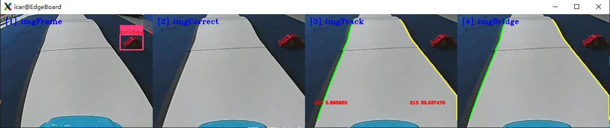

---

## Page 169

基于 AI 的赛道元素检测与识别 3-坡道与减速区检测
图 13-11 运行代码文件
图 13-12 减速区的标志识别效果
步骤 6：补全代码，修改优化
打开本实验项目的实践代码，对缺失代码的文件进行代码填充操作，进一步
掌握本工程代码实现方法。
图 13-13 坡道检测代码补全文件
图 13-14 减速区域检测代码补全文件
将填充完毕的代码文件尝试替换智能汽车源文件中的对应文件，运行程序，
观察可视化运行结果，验证代码填充是否正确。为防止代码错误或丢失，务必将
167

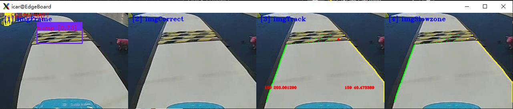

---

## Page 170

基于 AI 的赛道元素检测与识别 3-坡道与减速区检测
源文件提前备份。
168

---

## Page 171

智能汽车控制与决策
十四、智能汽车控制与决策实验指导
1.实验描述
通过前面 5 个模块的理论学习与实践操作，我们已经了解了智能汽车的硬件
控制架构，掌握了赛道图像的预处理技术，会进行环岛、十字路口等各种类型赛
道的识别，并能运用人工智能方法通过模型训练识别赛道上的农田区、减速区等
各种标志。在识别出车道线、车道标志、可行驶区域等内容后，智能汽车需要采
取相应的控制策略才能实现智能行驶。
本实验结合赛道识别及赛道标志识别结果为智能汽车规划行驶路线，并且通
过运动控制器对智能汽车进行 PD 姿态控制与速度控制。实践采用读取本地“MP4”
视频的方式，完成智能汽车行驶路径规划、控制与决策。
2.实验目标
（1）通过智能汽车运动控制的显示结果，理解智能汽车控制中心计算原理
与方法；
（2）进一步理解运动控制器的原理与使用方法；
（3）掌握智能汽车 PD 姿态控制与速度控制技术；
（4）参考教材内容及源码文件，完成本实验的部分代码补全任务。
3.实验步骤
步骤 1：将智能汽车与 PC 电脑相连接
第一步，插入网线，将智能汽车通过网线与 PC 相连。PC 电脑需要参照实
训一步骤设置好静态 IP 地址，并完成网络映射相关设置。
第二步，打开 MobaXterm，建立 SSH 远程连接，将本地 PC 与智能汽车
Edgeboard 板卡建立远程连接，进而可通过命令行的方式对智能汽车的源码进行
启动等操作。
169

---

## Page 172

智能汽车控制与决策
通过 MobaXterm，我们可以在电脑上看到智能汽车 Edgeboard 板卡上所展示
的界面内容。
步骤 2：打开 Visual Studio Code 学习部分源码逻辑
在前面的环境准备阶段，我们已经安装了 Visual Studio Code，本次车辆控制
任务需要结合 EdgeBoard 嵌入式 AI 计算卡与本地计算机完成。
在上述步骤 1 基础上进行如下操作：
第 一 步 ， 把 部 署 在 EdgeBoard 嵌 入 式 AI 计 算 卡 中 的
intelligentcar_T710_python_v2 工程通过 Visual Studio Code 可视化界面打开。
第二步，准备视频。在该工程下，进入 res/samples/文件夹，存放本实验使
用的 MP4 视频，如果我们采用读取本地视频的方式进行智能汽车控制，通过修
改代码中的读取视频源的方式读取 MP4 视频。本实验使用的 MP4 视频如下图：
图 14-1 视频存放位置
170

---

## Page 173

智能汽车控制与决策
第三步，准备控制与决策的源码文件。
在本实验中，通过路径 “src/python/motion_controller.py”找到本实验提供
的部分源码。
图 14-2 工程文件结构
步骤 3：智能汽车控制与决策
（1）引入函数库（src/python/motion_controller.py）
引入 Python OpenCV 的函数库、智能汽车 intelligentCar_v2 函数库以及一些
其他的在程序中使用到的函数库。
import base64
import cv2
import numpy as np
import sys
171

---

## Page 174

智能汽车控制与决策
sys.path.append("../lib") # 引用 C++库
import intelligentCar_v2
（2）确认输入源（src/python/motion_controller.py）
根据自身情况调整输入源的输入方法，可切换选择本地视频或者选择摄像头
的方式，同时设置分辨率为 320×240，这里我们选择本地输入视频的方式。
capture = cv2.VideoCapture("../../res/samples/demo.mp4") # 选择本地视频
capture.set(cv2.CAP_PROP_FRAME_WIDTH, 320) # 设置视频分辨率
capture.set(cv2.CAP_PROP_FRAME_HEIGHT, 240)
（3）实例对象初始化（src/python/motion_controller.py）
第一步，初始化智能汽车类，便于后续调用一些赛道处理的函数；
第二步，相机校正参数初始化，保证后续在进行图像识别时照片的准确性；
第三步，运动控制器初始化，保证智能汽车会根据识别效果对智能汽车进行
运动控制。
# 初始化智能汽车类
icar = intelligentCar_sou.IntelligentCar()
# 相机矫正参数初始化
icar.imageCorrecteInit()
# 运动控制器初始化
icar.motionInit()
（4）图片存储和读取（src/python/motion_controller.py）
定义函数，用于图片存储和读取，设置图片格式，保存路径以及 cv 读取图
片方式（读取名称和路径，设置分辨率）
def savPicture(img):
name = ".png"
global counter
counter += 1
img_path = "../res/samples/train/"
name = img_path + counter + ".png"
cv2.imwrite(name, img)
capture = cv2.VideoCapture("../../res/samples/demo.mp4") # 选择本地视频
capture.set(cv2.CAP_PROP_FRAME_WIDTH, 320) # 设置视频分辨率
capture.set(cv2.CAP_PROP_FRAME_HEIGHT, 240)
172

---

## Page 175

智能汽车控制与决策
（5）智能汽车运动控制（src/python/motion_controller.py）
第一步，读取视频的每一帧；
第二步，对这一帧的 RGB 彩色图像进行图像校正；
第三步，把 RGB 彩色图像转换成为灰度图；
第四步，把灰度图像转换成二值化图像；
第五步，根据传入的二值化图像完成赛道识别功能，并且可视化显示识别结
果；
第六步，基于前几个步骤处理的结果，完成智能汽车运动控制
while True:
# 读取视频帧
isTrue, imageFrame = capture.read()
cv2.imshow("imageFrame", imageFrame)
# 图像矫正
base64Frame = matToBase64(False, imageFrame)
base64Corret = icar.imageCorrection(base64Frame)
imageCorret = base64ToMat(base64Corret)
# RGB 图像转换成灰度图像
imageGray = cv2.cvtColor(imageCorret, cv2.COLOR_BGR2GRAY)
# 图像二值化
rel, imageBinary = cv2.threshold(imageGray, 0, 255, cv2.THRESH_OTSU)
cv2.imshow("imageBinary", imageBinary)
# 赛道识别
base64Binary = matToBase64(False, imageBinary)
icar.trackRecognition(base64Binary)
icar.trackDrawImage(base64Corret) # 可视化显示识别结果
# 智能汽车运动控制
icar.motionControl()
base64Motion = matToBase64(True, imageCorret)
icar.motionDrawImage(base64Motion) # 可视化显示识别结果
步骤 4：运行代码文件，查看结果
本 实 验 所 需 运 行 代 码 为 motion_controller.py 。 可 使 用 “ cd
173

---

## Page 176

智能汽车控制与决策
workspace/intelligentcar_T710_python_v2/src/python/”命令按回车键进入切换目录。
在输入 python3 motion_controller 命令运行代码文件，运行成功命令行如下图：
图 14-3 运行代码
路径规划的结果中有一个白色的矩形方块，这个方块沿着中心线偏左，表明
此时智能汽车正在向左转弯；如果这个方块沿着中心线偏右，表明此时智能汽车
正在向右转弯；如果两者重合，表明智能汽车正在直行。
左移或者右移的幅度表明左转弯或者右转弯的大小。
（a）赛道识别结果 （b）赛道路径规划的结果
图 14-4 即将进入左转弯路口
174

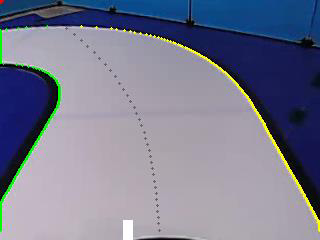

---

## Page 177

智能汽车控制与决策
（a）赛道识别结果 （b）赛道路径规划的结果
图 14-5 驶入左转弯道
（a）赛道识别结果 （b）赛道路径规划的结果
图 14-6 直行
图 14-7 Demo 代码运行实现效果 01
图 14-8 Demo 代码运行实现效果 02
175

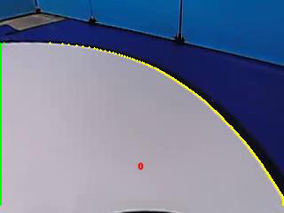

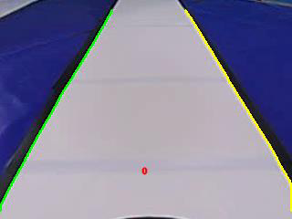

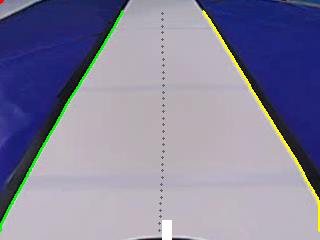

---

## Page 178

智能汽车控制与决策
步骤 5：补全代码，修改优化
打开本实验项目的实践代码，对缺失代码的文件进行代码填充操作，进一步
掌握本工程代码实现方法。
图 14-9 代码文件
将填充完毕的代码文件尝试替换智能汽车源文件中的对应文件，运行程序，
观察可视化运行结果，验证代码填充是否正确。为防止代码错误或丢失，务必将
源文件提前备份。
此实训代码功能可供实车运行，将相关代码调试好后即可操控智能汽车在不
同环境下的标准场地中实际运行。需要注意的是，此前各个实训的非 AI 部分相
关功能，比如赛道识别、环岛识别、十字路口识别等，均可通过 motion_controller
进行实车运行测试。
176

---
